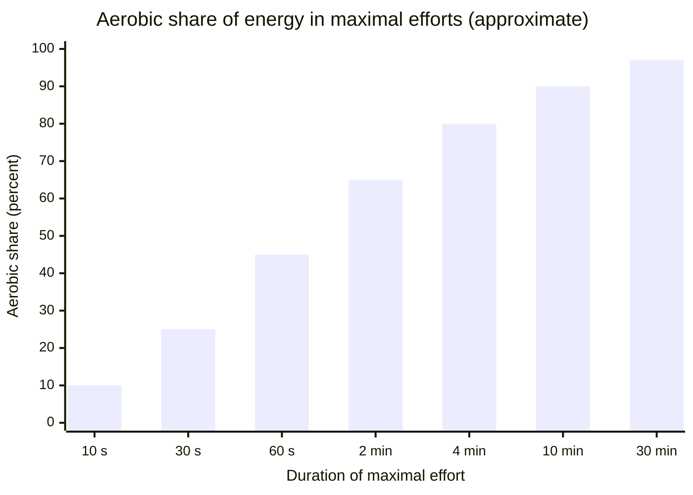
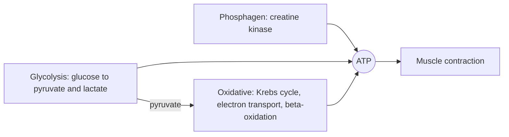

# Energy systems

## Summary

During exercise, muscles regenerate ATP with three energy systems that always work together but dominate at different intensities and durations. The phosphagen system (phosphocreatine) covers the first seconds of maximal effort, glycolysis dominates efforts of roughly 10 seconds to 2 minutes, and the oxidative system supplies most of the energy for anything longer. Training changes the capacity of each system, which is why sprint and endurance training produce different adaptations.

## Prerequisites

- [ATP](../../../natural-sciences/chemistry/biochemistry/atp.md)
- [Glycolysis](../../../natural-sciences/chemistry/biochemistry/glycolysis.md)

## Core concepts

### Definition

An *energy system* is a set of metabolic pathways that regenerate ATP in muscle. The three systems are the *phosphagen* (ATP-PCr) system, the *glycolytic* system (often called anaerobic) and the *oxidative* (aerobic) system, which includes the Krebs cycle, oxidative phosphorylation and beta-oxidation.

### Analogy

The energy systems are like three ways of paying in a shop. Cash in your pocket (phosphocreatine) is instant but runs out fast. A card with a daily limit (glycolysis) is quick and covers more, but you hit the limit within a couple of minutes. A bank transfer (oxidative system) is slower to arrange but has almost unlimited funds. All three are used together, depending on how fast you need to pay. The analogy breaks because the "card" produces a by-product (hydrogen ions and lactate) that limits its own use.

### Mechanism

| System | Fuel | Maximum rate of ATP supply | Capacity | Dominant in |
| --- | --- | --- | --- | --- |
| Phosphagen | Stored ATP and phosphocreatine | Highest | Smallest (about 10 s at maximum) | Jumps, throws, 100 m sprint start |
| Glycolytic | Muscle glycogen and blood glucose | High | Limited by glycogen and acidity | 200 to 800 m runs, hard sets of 30 to 90 s |
| Oxidative | Carbohydrate, fat, some protein | Lowest | Very large | Efforts longer than about 2 min, recovery between efforts |

The systems overlap: even in a 10 second sprint, glycolysis contributes substantially, and even at rest the oxidative system supplies nearly all ATP. The crossover point at which aerobic and anaerobic supply are equal during a maximal effort is reached after about 60 to 75 seconds.

The chart shows the approximate share of aerobic energy supply in maximal efforts of different durations (values from reviews of running and cycling, rounded).

The diagram links each system to its pathway notes.

### Training adaptations

- **Phosphagen**: creatine supplementation raises phosphocreatine stores by about 20 percent; sprint training improves resynthesis rate.
- **Glycolytic**: high-intensity intervals increase glycolytic enzymes and buffering capacity (including carnosine).
- **Oxidative**: endurance training increases mitochondria, capillaries, fat oxidation and heart stroke volume (see [VO2 max](respiration/vo2-max.md)).

### Recovery between efforts

Phosphocreatine is resynthesized by the oxidative system: about half within 30 seconds and nearly all within 3 to 5 minutes. This is why rest intervals of 3 to 5 minutes are used for maximal strength and power sets, and why aerobic fitness improves recovery in repeated sprints.

## Worked example

A 400 m sprinter (about 50 seconds) relies roughly equally on aerobic and anaerobic sources by the end, with phosphocreatine depleted in the first 10 seconds and glycolysis peaking between 10 and 40 seconds. A marathon runner (over 2 hours) obtains more than 95 percent of energy aerobically and is limited by glycogen stores and the ability to burn fat. A soccer player alternates all three: sprints use phosphocreatine and glycolysis, and the oxidative system restores phosphocreatine between sprints.

## Trade offs and when to use it

- Thinking in "zones" helps design training, but the systems never work in isolation.
- Training one system heavily (for example very long endurance work) can reduce adaptations in others (the interference effect), mostly at high volumes.

## Common mistakes

- **Calling glycolysis "anaerobic" as if it ran only without oxygen.** It runs all the time; the name refers to not needing oxygen.
- **Thinking you switch from one system to another at fixed times.** They overlap continuously.

## Practice

1. Which energy system dominates a 20 second all-out effort?
2. How long does phosphocreatine take to recover almost fully?
3. Why does aerobic fitness help repeated-sprint sports?

### Answers

1. Glycolysis, with a large contribution from the phosphagen system at the start.
2. About 3 to 5 minutes.
3. The oxidative system resynthesizes phosphocreatine between sprints.

## Further reading

- Kenney, W. L., Wilmore, J. H., Costill, D. L. (2020). *Physiology of Sport and Exercise (7th ed.)*. Human Kinetics. Energy systems during exercise.
- Haff, G. G., Triplett, N. T. (Eds.) (2016). *Essentials of Strength Training and Conditioning (4th ed.)*. Human Kinetics. Bioenergetics chapter for strength and conditioning.
- Kreider, R. B., Kalman, D. S., Antonio, J. et al. (2017). International Society of Sports Nutrition position stand: safety and efficacy of creatine supplementation in exercise, sport, and medicine. Journal of the International Society of Sports Nutrition, 14, 18. [DOI](https://doi.org/10.1186/s12970-017-0173-z). Creatine and phosphocreatine stores.
