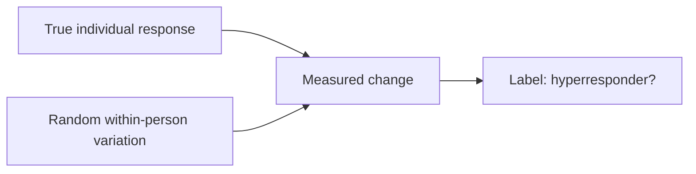
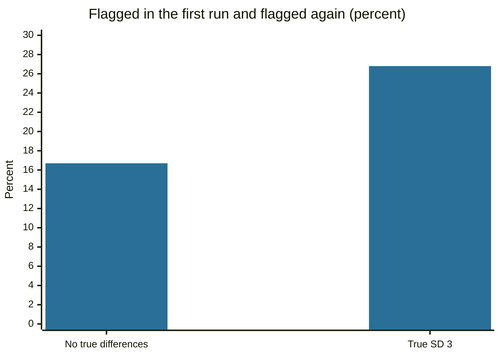

# Hyperresponders and response variability

## Summary

People given the same diet, drug or training program do not respond the same way. A hyperresponder is a person whose response is much larger than the average, and a hyporesponder one whose response is much smaller. Real differences exist, for example in how blood cholesterol reacts to dietary cholesterol, and they come from genes, hormones and other biology. But part of the apparent difference in any single measurement is random noise, so labeling someone a hyperresponder from one trial is often wrong.

*This note is educational. It is not medical advice. Do not change a drug dose or a treatment because of a label like this.*

## Prerequisites

No prior notes are needed. The distinction between measured change and true change is explained below.

## Core concepts

### Definition

A *hyperresponder* is a person whose measured response to a defined stimulus is far above that of most people. The stimulus can be a nutrient, a drug, a training program, a vaccine or a stressor. The opposite is a *hyporesponder*, and a person with almost no response is sometimes called a *non-responder*. The terms describe the upper and lower tails of the distribution of responses. They do not imply disease, since variation between people is normal.

### Analogy

Responses are like the heights of students in a class: there is an average and a spread. Calling the tallest student "a hypergrower" says little unless you know whether the height is stable. The limit of the analogy is that height is measured with small error, whereas the response to an intervention is the difference between two noisy measurements, and such a difference is much less reliable.

### Sources of true variation

| Source | How it changes the response |
| --- | --- |
| Genetic variants | Alter receptors, enzymes and signaling pathways, for example enzymes that clear a drug |
| Receptor sensitivity | More or more sensitive receptors give a larger signal for the same dose |
| Enzyme activity | Faster or slower metabolism of a compound changes its level and effect |
| Hormonal state | Different baselines change the response to training, food and stress |
| Microbiome, history, lifestyle | Prior exposure and gut bacteria change how a nutrient or a drug is handled |

### Where the term is used

| Field | Example |
| --- | --- |
| Nutrition | Katan and colleagues (1986) described consistent hypo- and hyperresponders to dietary cholesterol: some people's blood cholesterol rose clearly on a high-cholesterol diet, and others' hardly changed |
| Exercise | Some people gain much more fitness or muscle than others on the same program (Mann, Lamberts and Lambert, 2014) |
| Pharmacology | Some patients have strong effects or side effects at usual doses, often because of differences in drug metabolism |
| Immunology | Some people react more strongly to a vaccine or an allergen |
| Stress research | Some people show larger physiological reactions to stress |

The word has a different meaning in each field, so a claim about hyperresponders always needs the field, the measure and the stimulus.

### Real and apparent differences



A measured change is the sum of a true response and random variation from day to day and from measurement to measurement. Atkinson and Batterham (2015) show that this variation can be so large that it explains all apparent individual differences. Two ways to find true differences are to repeat the intervention in the same people and see whether the same people respond again, and to compare the spread of changes in an intervention group with the spread in a control group. If the spreads are similar, true individual differences are small.

## Worked example

A simulation shows the problem. 10,000 people follow the same program with an average true gain of 10 units. In case 1 every person has exactly the same true gain. In case 2 true gains vary (standard deviation 3). Each measured change has random noise (standard deviation 5). A person is labeled a hyperresponder when the measured gain is more than 1 standard deviation above the group mean. The same people then repeat the program.

```python
# Python 3.12. Do "hyperresponders" exist if everyone has the same true response?
import random
from statistics import correlation, mean, stdev

random.seed(7)
N, TRUE_MEAN, NOISE = 10_000, 10.0, 5.0   # people; mean true gain; within-person noise per measured change

def run(true_sd):
    true = [random.gauss(TRUE_MEAN, true_sd) for _ in range(N)]
    # the same people go through the same program twice
    first = [t + random.gauss(0, NOISE) for t in true]
    second = [t + random.gauss(0, NOISE) for t in true]
    cut = mean(first) + stdev(first)           # "hyperresponder" = more than 1 SD above the mean
    flagged = [i for i in range(N) if first[i] > cut]
    again = sum(second[i] > cut for i in flagged) / len(flagged)
    return correlation(first, second), len(flagged) / N, again

for true_sd in (0.0, 3.0):
    r, share, again = run(true_sd)
    print(f"true SD {true_sd}: r(first, second) = {r:.2f}, flagged {share:.1%}, flagged again {again:.1%}")
```

Output:

```text
true SD 0.0: r(first, second) = 0.02, flagged 15.6%, flagged again 16.7%
true SD 3.0: r(first, second) = 0.26, flagged 15.9%, flagged again 26.8%
```

In case 1, nobody is truly different, yet 15.6% of people are labeled hyperresponders in the first run. In the second run only 16.7% of them are labeled again, which is the rate expected by chance. In case 2 the correlation between the two runs is 0.26, and 26.8% are flagged again. The share flagged is almost the same in both cases (15.6% and 15.9%), so the first-run label alone cannot tell the cases apart. The repeat shows the difference. The numbers are invented for illustration, and the exact figures depend on the random seed.



The chart shows the share of first-run hyperresponders who are flagged again. With no true differences it is about the chance level, and with true differences it is higher.

## Trade offs and when to use it

The concept supports personalized approaches: drug dosing guided by genotype or blood levels, nutrition advice that follows each person's lipid response, training that is adjusted to results. The costs are measurement error and over-interpretation. Before concluding that a person is a hyperresponder, check whether the response repeats, whether the measure is reliable and whether the stimulus was the same. Then consider whether the difference changes any decision.

## Common mistakes

- **Labeling from a single trial.** Random variation creates apparent hyperresponders.
- **Treating hyperresponse as pathology.** It is usually normal variation.
- **Assuming it is beneficial.** Large effects of a drug can mean more side effects.
- **Carrying the label across fields.** A training hyperresponder is not necessarily a drug hyperresponder.
- **Equating the average response with the individual one.** Trial averages do not say how a given person will respond.

## Practice

1. What is the difference between a hyperresponder and a non-responder?
2. Why can a hyperresponder label from one trial be wrong?
3. How can one test whether individual differences are real?

### Answers

1. A hyperresponder has a response far above average and a non-responder has almost none.
2. The measured change includes random within-person variation, which can produce extreme values in people with an ordinary true response.
3. Repeat the intervention in the same people and check whether they respond similarly again, or compare the spread of changes in the intervention group with the spread in a control group.

## Further reading

Evidence grades used in this field are defined in [Evidence grades](../nutrition/evidence-grades.md).

- Atkinson, G. and Batterham, A. M. (2015). True and false interindividual differences in the physiological response to an intervention. *Experimental Physiology*, 100(6), 577-588. [DOI](https://doi.org/10.1113/EP085070). Shows that random within-person variation can mimic individual response differences, and how to test for real ones.
- Katan, M. B., Beynen, A. C., de Vries, J. H. M. et al. (1986). Existence of consistent hypo- and hyperresponders to dietary cholesterol in man. *American Journal of Epidemiology*, 123(2), 221-234. [DOI](https://doi.org/10.1093/oxfordjournals.aje.a114231). The study that described consistent differences in the cholesterol response to diet.
- Mann, T. N., Lamberts, R. P. and Lambert, M. I. (2014). High responders and low responders: factors associated with individual variation in response to standardized training. *Sports Medicine*, 44(8), 1113-1124. [DOI](https://doi.org/10.1007/s40279-014-0197-3). Reviews the size and the causes of individual differences in training response.
