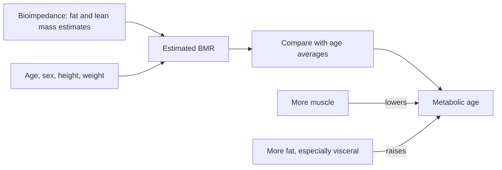

# Metabolic age

## Summary

Metabolic age is a number shown by many bioimpedance scales and fitness apps. It compares a person's estimated basal metabolic rate (BMR) with the average BMR of people of different ages and reports the age whose average matches. A metabolic age below one's actual age suggests a favorable body composition (more muscle, less fat); a higher one suggests the opposite. It is not a medical measure, the formulas are proprietary and differ between devices, and it adds little beyond knowing body composition. The factors that improve it, more muscle and less visceral fat through exercise, diet, sleep and stress management, are well supported for health.

## Prerequisites

- [Metabolism](../../../natural-sciences/chemistry/biochemistry/metabolism.md)

## Core concepts

### Definition

*Metabolic age* is a commercial estimate of how a person's metabolism compares with average values for age groups, based on basal metabolic rate and body composition. If it is lower than chronological age, the body is said to function better than average; if higher, it may indicate health problems or an unhealthy lifestyle. *Basal metabolic rate* is the energy used at complete rest to maintain vital functions.

### Analogy

Metabolic age is like a car's "equivalent age" estimated from its fuel consumption at idle. A well-maintained car with a strong engine may idle like a younger one. The analogy breaks because different garages (scale manufacturers) use different, secret formulas, and fuel consumption at idle says little about how safely the car drives (cardiovascular health, blood sugar, blood pressure).

### Mechanism

A bioimpedance scale passes a small current through the body, estimates fat and lean mass from resistance, calculates BMR with a formula (often similar to Harris-Benedict or Mifflin-St Jeor plus lean mass), and compares it with age norms. Muscle is more active at rest than fat, so more lean mass raises BMR and lowers metabolic age.

The diagram shows what feeds into the number.

### Factors that influence it

- **Body composition.** High fat, especially visceral fat, raises metabolic age; more muscle lowers it, because muscle uses more energy than fat.
- **Basal metabolic rate.** People with a higher BMR burn more calories at rest.
- **Lifestyle.** Regular activity (strength and cardio) builds muscle; a diet rich in protein, fiber and healthy fats with few added sugars supports metabolic health.
- **Hormonal health.** Insulin, cortisol, thyroid hormones and sex hormones affect metabolism; disorders can lower metabolic rate.
- **Stress and sleep.** Chronic stress and short sleep disturb hormones and appetite.
- **Genetics.** Some people are predisposed to a faster or slower metabolism.

A large study of doubly labeled water measurements (Pontzer and colleagues, 2021) found that energy expenditure adjusted for body size stays stable from about 20 to 60 years of age and declines after 60, contradicting the belief that metabolism slows steadily from the 30s.

### What lowers metabolic age: evidence by area

**Physical activity**

| Activity | Proposed reason | Recommended frequency | Evidence |
| --- | --- | --- | --- |
| Strength training (weights, bodyweight, bands) | More muscle raises BMR | 2 to 4 times a week, all major muscle groups (WHO: at least 2) | Strong for muscle and metabolic health |
| Cardio (running, swimming, cycling, dancing, brisk walking) | Improves cardiovascular health and blood sugar control | 150 min moderate or 75 min vigorous per week (WHO) | Strong |
| HIIT | Efficient for fitness; "afterburn" effect (EPOC) | 2 to 3 times a week with other activity | Strong for fitness; afterburn adds only about 6 to 15 percent of the session's calories |
| Functional training and HIRT | Strength, coordination, balance, calorie use | 2 to 3 times a week | Moderate |
| Yoga, Pilates | Flexibility, balance, stress reduction | 2 to 4 times a week | Moderate for stress and mobility, small for metabolism |

**Diet**

| Food | Proposed effect | Evidence |
| --- | --- | --- |
| Protein (lean meat, fish, eggs, tofu, beans, lentils, dairy) | Builds muscle; high thermic effect (20 to 30 percent of its calories used for digestion) | Strong |
| Whole grains (oats, brown rice, quinoa, wholemeal bread) | Fiber regulates blood sugar and digestion | Strong for health |
| Vegetables and fruit (leafy greens, broccoli, peppers, berries, grapefruit, apples, tomatoes) | Vitamins, minerals, antioxidants | Strong for health; claims that grapefruit speeds metabolism and fat burning are not supported |
| Unsaturated fats and omega-3 (olive oil, avocado, nuts, chia, flax, oily fish) | Heart health, less inflammation, insulin sensitivity | Moderate |
| Cinnamon | Blood sugar stabilization | Limited, small effects in trials |
| Ginger | Thermogenesis | Very limited |
| Turmeric (curcumin) | Anti-inflammatory, antioxidant | Limited |
| Cayenne pepper (capsaicin) | Thermogenesis, small rise in calorie use (about 50 kcal a day) | Limited |
| Fermented foods (kefir, yogurt, kimchi, sauerkraut, miso) | Gut health linked to weight and blood sugar | Limited |

**Supplements**

| Supplement | Proposed effect | Evidence |
| --- | --- | --- |
| Whey protein | More muscle mass with strength training | Strong for meeting protein needs |
| Green tea extract (EGCG) | Fat burning and thermogenesis; studies suggest about 3 to 4 percent more calories burned | Limited; meta-analysis (Hursel and colleagues, 2011) found small effects mostly with caffeine; high doses can harm the liver |
| Omega-3 fish oil | Less inflammation, insulin sensitivity | Limited for metabolism |
| Probiotics | Gut health, weight and glucose regulation | Limited and strain-specific |
| Vitamin D | Low levels linked to obesity and metabolic disorders | Helps if deficient; no metabolic benefit otherwise |
| L-carnitine | Transports fatty acids into mitochondria | Not supported for fat loss in healthy people |
| Caffeine | Increases fat burning and metabolic rate; excess causes health problems | Moderate for a small, temporary effect |

**Herbs and adaptogens**

| Herb | Proposed effect | Evidence |
| --- | --- | --- |
| Ashwagandha | Stress management, lower cortisol, hormonal health | Limited (small trials) |
| Ginseng | Energy, metabolism | Limited |
| Moringa | Antioxidants, less inflammation | Very limited |
| Gotu kola | Brain health, circulation (Ayurvedic) | Very limited |
| Berberine | Lowers blood sugar, improves insulin sensitivity | Moderate for blood glucose; interacts with many drugs |

**Lifestyle practices**

| Practice | Proposed reason | Typical frequency | Evidence |
| --- | --- | --- | --- |
| Sauna (dry or infrared) | Cardiovascular health, heat shock proteins, sweating | 2 to 3 times a week, 15 to 30 min | Moderate for cardiovascular associations (observational); detox by sweat not supported |
| Cold exposure (cold water, cryotherapy) | Activates brown fat and non-shivering thermogenesis (sometimes mislabeled as NEAT, which means non-exercise activity thermogenesis) | 2 to 4 times a week, start with 1 to 2 min, up to 5 to 10 | Limited; calorie effect small |
| Breathing techniques (Wim Hof, pranayama) | Stress reduction, autonomic balance | Daily or several times a week | Limited |
| Sleep 7 to 9 hours, regular schedule | Hormones, insulin sensitivity, appetite | Daily | Strong |
| Stress management (meditation, mindfulness, tai chi) | Lower cortisol, mental health | Daily, even 5 to 10 min | Moderate |
| Hydration | Needed for all metabolic processes; cold water raises energy use briefly | Daily | Strong for health; cold water effect very small |

### What raises metabolic age

Low physical activity (less muscle, slower metabolism), an unsuitable diet (excess calories, especially from added sugars and trans fats, leading to visceral fat), chronic stress (high cortisol, more fat tissue), too little sleep (hormonal disturbance, more appetite) and hormonal disorders (hypothyroidism, insulin resistance).

## Worked example

Two 40-year-old men weigh 85 kg. Man A has 15 percent fat (72 kg lean mass); man B has 30 percent fat (60 kg lean mass). A lean-mass-based equation (Katch-McArdle: BMR = 370 + 21.6 × lean mass in kg) gives about 1,925 kcal for A and 1,666 kcal for B. A scale compares these with age averages and may report A as "metabolic age 30" and B as "50". Both numbers simply restate the difference in body composition; their waist circumference, blood pressure and blood tests say more about health.

## Trade offs and when to use it

- Metabolic age can motivate, but it varies between devices and with hydration (bioimpedance changes with water status). Waist circumference, fitness tests and blood markers are more informative.

## Common mistakes

- **Treating metabolic age as a medical test.** It is a device estimate.
- **Comparing values from different scales.** Formulas differ.
- **Expecting supplements to change it meaningfully.** Body composition changes through training and diet dominate.

## Practice

1. What does a metabolic age lower than chronological age suggest?
2. Why does more muscle lower metabolic age on a scale?
3. What did a 2021 study find about energy expenditure between ages 20 and 60?

### Answers

1. A favorable body composition and higher BMR than average for one's age.
2. Muscle raises estimated BMR, which the scale compares with age norms.
3. Size-adjusted energy expenditure is stable from about 20 to 60 and declines after 60.

## Further reading

- Pontzer, H., Yamada, Y., Sagayama, H. et al. (2021). Daily energy expenditure through the human life course. Science, 373(6556), 808-812. [DOI](https://doi.org/10.1126/science.abe5017). Energy expenditure across the life course.
- World Health Organization (2020). *WHO guidelines on physical activity and sedentary behaviour*. WHO. WHO physical activity recommendations.
- Hursel, R., Viechtbauer, W., Dulloo, A. G. et al. (2011). The effects of catechin rich teas and caffeine on energy expenditure and fat oxidation: a meta-analysis. Obesity Reviews, 12(7), e573-e581. [DOI](https://doi.org/10.1111/j.1467-789X.2011.00866.x). Meta-analysis of green tea catechins on energy expenditure.
