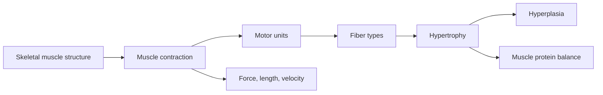

# Muscle physiology

These notes explain how skeletal muscle produces force: the structure of a muscle fiber, the sliding of actin and myosin, the recruitment of motor units, the differences between fiber types and the relationships between force, length and velocity. They end with how muscles grow (hypertrophy and hyperplasia) and the balance between building and breaking down muscle protein.

## Map

## Reading order

1. [Skeletal muscle structure](skeletal-muscle-structure.md)
2. [Muscle contraction](muscle-contraction.md)
3. [Motor units and neural control of force](motor-units.md)
4. [Muscle fiber types](muscle-fiber-types.md)
5. [Force, length and velocity of muscle](force-length-velocity.md)
6. [Muscle hypertrophy](hypertrophy.md)
7. [Muscle hyperplasia](hyperplasia.md)
8. [Muscle protein balance](muscle-protein-balance.md)
