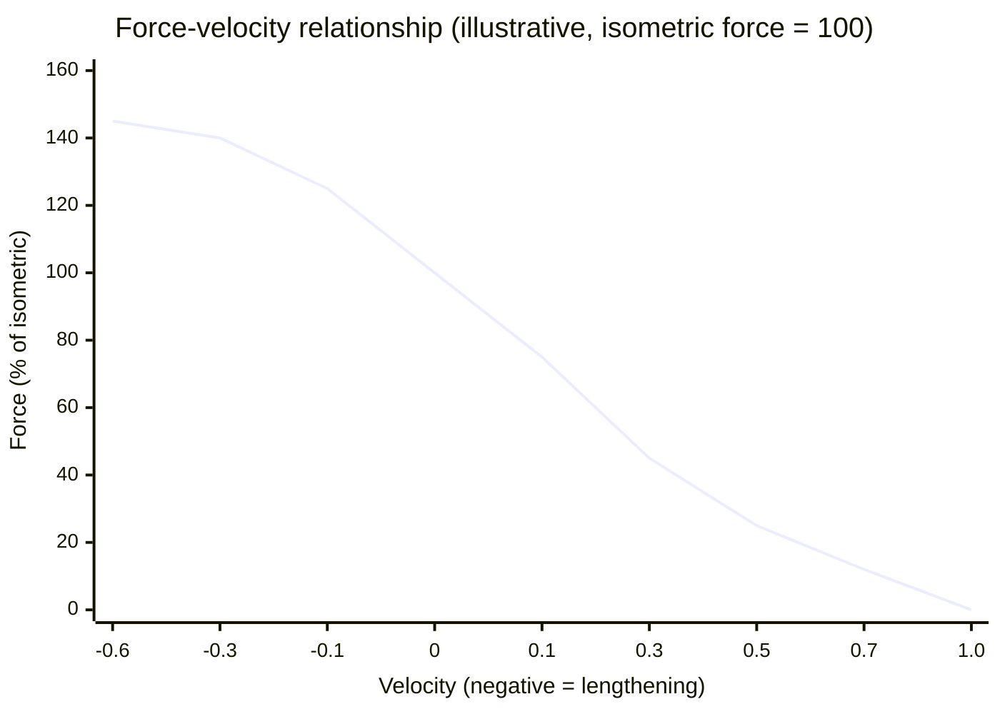
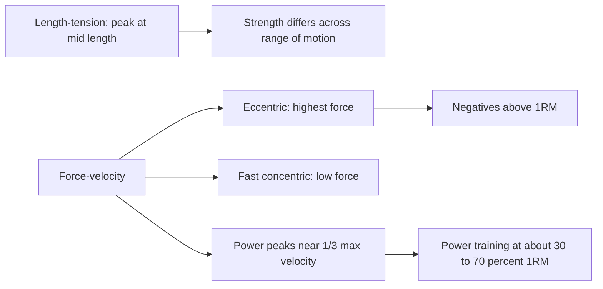

# Force, length and velocity of muscle

## Summary

The force a muscle can produce depends on its length and on how fast it shortens or lengthens. Force is highest at a middle length, where actin and myosin overlap best (length-tension relationship). Force falls as shortening speed rises and is highest when the muscle is forcibly lengthened (force-velocity relationship), described by Archibald Hill in 1938. In eccentric actions, muscles can resist loads well above their maximal isometric force, which is why lowering a weight is easier than lifting it.

## Prerequisites

- [Muscle contraction](muscle-contraction.md)

## Core concepts

### Definition

The *length-tension relationship* describes how active force varies with sarcomere length. The *force-velocity relationship* describes how force varies with the velocity of shortening (concentric) or lengthening (eccentric). *Power* is force multiplied by velocity and peaks at about one third of maximal shortening velocity.

### Analogy

The length-tension curve is like a group of people pulling on two ropes that overlap. If the ropes barely overlap (muscle stretched), few hands can grip; if they overlap too much (muscle very short), people get in each other's way. The best pull is in the middle. The force-velocity curve is like a rower: rowing very fast, each stroke can only grab a little water. Holding the oar still against the current or being dragged backward produces the highest force. The analogy breaks because muscle also has passive elastic tension when stretched, mainly from titin.

### Mechanism

**Length-tension.** At optimal sarcomere length (about 2.0 to 2.25 µm in human muscle), the maximum number of myosin heads can bind actin. Stretched further, overlap decreases; shorter, filaments collide and interfere. Passive tension from titin and connective tissue adds force at long lengths.

**Force-velocity.** During shortening, cross-bridges have less time to attach, so force falls as speed rises. During lengthening, attached cross-bridges are pulled backward and resist strongly, so eccentric force exceeds isometric force, typically by about 20 to 50 percent in humans, and up to about 80 percent in isolated muscle preparations.

The chart shows a normalized force-velocity curve with illustrative values (isometric force = 100).

The diagram links the relationships to training applications.

### Levers

Muscles act on bones as levers. A muscle attached close to a joint has a short lever arm: it must produce large force but moves the bone end quickly and far. The resistance acts on a longer arm. Changing body position changes lever arms: in a deadlift, a small forward shift of the hips lengthens the lever arm of the load around the hips and lower back and can make the same weight much harder. See [Biomechanics overview](../../exercise-and-fitness/biomechanics/biomechanics-overview.md).

## Worked example

A lifter can bench press 100 kg once. Lowering a weight under control is possible with roughly 120 to 140 kg, because eccentric force exceeds concentric force. This is the basis of "negatives" with weights above 1RM, using spotters to lift the bar. Because eccentric overload causes more muscle damage and soreness, it is used sparingly (see [Negative repetitions](../../exercise-and-fitness/intensification-methods/negative-reps.md)).

## Trade offs and when to use it

- Eccentric training is efficient (high force at low metabolic cost) and useful in rehabilitation of tendons, but causes more soreness in unaccustomed people.
- Power training uses moderate loads moved fast, because power peaks well below maximal load.

## Common mistakes

- **Assuming strength is the same throughout a movement.** It varies with joint angle (strength curve).
- **Thinking eccentric work is "easier" in every sense.** It feels easier but stresses tissues more.

## Practice

1. At what muscle length is active force highest, and why?
2. Why can a person lower more weight than they can lift?
3. At about what fraction of maximal velocity does power peak?

### Answers

1. At a middle length, where actin and myosin overlap optimally.
2. In lengthening, attached cross-bridges resist being pulled apart, giving higher force than in shortening.
3. About one third.

## Further reading

- Hill, A. V. (1938). The heat of shortening and the dynamic constants of muscle. Proceedings of the Royal Society B, 126(843), 136-195. [DOI](https://doi.org/10.1098/rspb.1938.0050). The original description of the force-velocity relationship.
- Kenney, W. L., Wilmore, J. H., Costill, D. L. (2020). *Physiology of Sport and Exercise (7th ed.)*. Human Kinetics. Muscle mechanics in exercise physiology.
