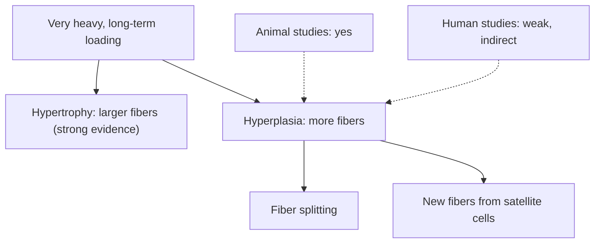

# Muscle hyperplasia

## Summary

Muscle hyperplasia is an increase in the number of muscle fibers. It was long assumed that fiber number is fixed at birth and set by genetics. Animal studies show that new fibers can form under extreme loading, and some studies suggest it may happen in humans, but the evidence in humans is weak and indirect, and any contribution to muscle growth is likely small compared with hypertrophy. Practical training advice therefore focuses on hypertrophy.

## Prerequisites

- [Muscle hypertrophy](hypertrophy.md)

## Core concepts

### Definition

*Hyperplasia* is growth of a tissue by an increase in the number of its cells. *Muscle hyperplasia* would mean the formation of new muscle fibers, either by splitting of existing fibers or by satellite cells forming new fibers. Hyperplasia determines the number of fibers; hypertrophy determines their size.

### Analogy

If hypertrophy is enlarging the existing factories in a town, hyperplasia is building new factories. In animals subjected to extreme demands, new factories appear; in humans, the town seems mostly to enlarge what it has. The analogy breaks because in humans it is technically hard even to count the factories, so we cannot be sure.

### Mechanism

**Proposed routes.**

1. *Fiber splitting*: a very large fiber splits longitudinally into two. Split fibers are seen in some biopsies of bodybuilders and in animal studies.
2. *De novo formation*: satellite cells proliferate and fuse into new fibers instead of joining existing ones.

**Evidence.**

- In birds with weights attached to a wing for weeks, and in cats trained to lift heavy weights with a paw, fiber numbers increased substantially.
- In humans, fiber number cannot be counted in a living muscle; it is estimated from biopsies and total muscle area. Some cross-sectional studies of bodybuilders found more fibers than in controls; others found similar numbers and larger fibers. Whether differences are trained or inherited is unclear.

**Factors listed as supporting hyperplasia.** Sources describing hyperplasia list protein synthesis as the main factor (adequate amino acids for building new fibers), anabolic hormones, creatine supplementation (which supports ATP regeneration and is linked to satellite cell activity) and hydrogen ions (said to aid hormone transport). These are general requirements for muscle growth; none has been shown to cause hyperplasia in humans, and the role claimed for hydrogen ions is not supported. The idea that the body "decides" at an advanced stage that it is more economical to build new fibers is a hypothesis.

The diagram contrasts the two routes of growth and the strength of evidence.

## Worked example

Suppose a bodybuilder has a biceps cross-sectional area 50 percent larger than an untrained man of the same height. If his fibers are 50 percent larger on average, hypertrophy explains everything. If his fibers are only 25 percent larger, he must have about 20 percent more fibers (1.5 ÷ 1.25 = 1.2), which could be hyperplasia or inheritance. Studies using this logic have produced both results, which is why the question remains open.

## Trade offs and when to use it

- Training designed to "trigger hyperplasia" does not differ from good hypertrophy training, so there is no practical reason to pursue it separately.

## Common mistakes

- **Claiming hyperplasia as an established human training effect.** Human evidence is inconclusive.
- **Using "hyperplasia" and "hypertrophy" interchangeably.**

## Practice

1. What does hyperplasia mean for muscle?
2. Why is hyperplasia hard to measure in humans?
3. Name the two proposed routes of hyperplasia.

### Answers

1. An increase in the number of muscle fibers.
2. Fiber number cannot be counted in a living human muscle; it must be estimated indirectly.
3. Splitting of existing fibers and formation of new fibers from satellite cells.

## Further reading

- Schoenfeld, B. J. (2010). The mechanisms of muscle hypertrophy and their application to resistance training. Journal of Strength and Conditioning Research, 24(10), 2857-2872. [DOI](https://doi.org/10.1519/JSC.0b013e3181e840f3). Discusses hyperplasia among mechanisms of growth.
- Kreider, R. B., Kalman, D. S., Antonio, J. et al. (2017). International Society of Sports Nutrition position stand: safety and efficacy of creatine supplementation in exercise, sport, and medicine. Journal of the International Society of Sports Nutrition, 14, 18. [DOI](https://doi.org/10.1186/s12970-017-0173-z). Creatine and muscle growth.
