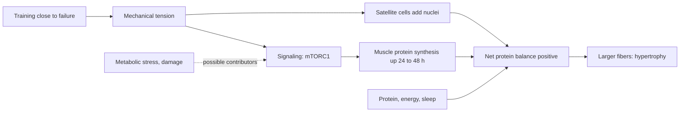

# Muscle hypertrophy

## Summary

Muscle hypertrophy is the increase in the size of existing muscle fibers, mainly by adding contractile proteins, so that the muscle's cross-section and force capacity grow. It is driven mostly by mechanical tension from training close to failure, supported by enough protein, energy and recovery. Hypertrophy should not be confused with hyperplasia, an increase in the number of fibers. Older distinctions between "myofibrillar" and "sarcoplasmic" hypertrophy and between "functional" and "non-functional" hypertrophy describe real differences in emphasis but are not separate processes in humans.

## Prerequisites

- [Muscle fiber types](muscle-fiber-types.md)
- [Motor units and neural control of force](motor-units.md)

## Core concepts

### Definition

*Hypertrophy* (Greek for "excess nourishment") means growth of a tissue by enlargement of its cells. *Muscle hypertrophy* is the increase in volume of muscle fibers. Two types are often described:

- **Myofibrillar hypertrophy**: growth of the myofibrils, adding actin and myosin, which increases force capacity.
- **Sarcoplasmic hypertrophy**: an increase in the volume of sarcoplasm, including glycogen and fluid, which contributes partly to the "pump". Evidence for it as a distinct, lasting adaptation in humans is limited (Jorgenson and colleagues, 2020).

A further division is into *structural (non-functional)* hypertrophy, where training mainly increases endurance but not strength, and *functional* hypertrophy, where both muscle volume and strength increase. In practice, most hypertrophy is accompanied by strength gains, and the size of the gain depends on the type of training.

### Analogy

A growing muscle fiber is like a factory that adds production lines (myofibrils) when demand rises. Each heavy order (training session) triggers a planning meeting (signaling), new machines arrive (protein synthesis), and the building expands to hold them. If orders stop, unused lines are dismantled (atrophy). The analogy breaks because muscle fibers also need to add new managers (nuclei from satellite cells) when they grow large.

### Mechanism

1. **Mechanical tension.** Tension on the fiber, especially in high-threshold motor units recruited near failure, is sensed by mechanosensors in the membrane and cytoskeleton.
2. **Signaling.** Pathways including mTORC1 are activated, raising muscle protein synthesis for about 24 to 48 hours after a session (see [Leucine](../../../../natural-sciences/chemistry/biochemistry/amino-acids/leucine.md)).
3. **Satellite cells.** Muscle damage and tension activate satellite cells, which proliferate and fuse with fibers, adding nuclei. More nuclei support more protein synthesis. Extra nuclei appear to be kept after detraining, a proposed basis of "muscle memory": regaining size is faster than gaining it the first time.
4. **Net protein balance.** Growth happens when synthesis exceeds breakdown over weeks, which needs adequate protein and energy (see [Muscle protein balance](muscle-protein-balance.md)).
5. **Other contributors.** Metabolic stress (accumulation of metabolites in sets with short rests or blood flow restriction) and muscle damage may contribute, but their independent role is debated. Damage is not required for growth.

The diagram shows the chain from training to growth.

### Training variables that matter

- **Volume**: more weekly sets per muscle increase growth up to a point, roughly 10 or more hard sets per week in meta-analyses (Schoenfeld and colleagues, 2017).
- **Proximity to failure**: sets ending about 0 to 3 repetitions short of failure.
- **Load**: a wide range, roughly 30 to 85 percent of 1RM, works when sets are hard (see [Repetition ranges and load](../../exercise-and-fitness/training-variables/rep-ranges-and-load.md)).
- **Range of motion**: training at long muscle lengths appears to favor growth.
- **Frequency**: training each muscle at least twice a week helps distribute volume.

## Worked example

In a 12-week program, a beginner does 12 hard sets per week for the quadriceps and eats about 1.6 g of protein per kg. Ultrasound of the vastus lateralis shows an increase in thickness of roughly 5 to 10 percent, typical for such studies. Strength in the squat rises by 20 to 40 percent over the same period, more than size, because neural adaptations add to hypertrophy.

## Trade offs and when to use it

- Hypertrophy improves strength potential, metabolic health and function in aging, but takes months and depends on consistent training and nutrition.
- Very high volumes give diminishing returns and slow recovery.

## Common mistakes

- **Chasing soreness or a pump as proof of growth.** Neither is a reliable marker.
- **Thinking only a narrow rep range builds muscle.** Effort and volume matter more than the exact range.
- **Confusing hypertrophy with hyperplasia.** Hypertrophy is larger fibers, hyperplasia more fibers.

## Practice

1. What is the difference between hypertrophy and hyperplasia?
2. What is the main stimulus for hypertrophy?
3. What is the proposed cellular basis of muscle memory?

### Answers

1. Hypertrophy is enlargement of existing fibers; hyperplasia is an increase in the number of fibers.
2. Mechanical tension, especially from sets taken close to failure.
3. Nuclei added to fibers by satellite cells during growth are kept after detraining.

## Further reading

- Schoenfeld, B. J. (2010). The mechanisms of muscle hypertrophy and their application to resistance training. Journal of Strength and Conditioning Research, 24(10), 2857-2872. [DOI](https://doi.org/10.1519/JSC.0b013e3181e840f3). Review of the mechanisms of hypertrophy.
- Schoenfeld, B. J., Ogborn, D., Krieger, J. W. (2017). Dose-response relationship between weekly resistance training volume and increases in muscle mass: a systematic review and meta-analysis. Journal of Sports Sciences, 35(11), 1073-1082. [DOI](https://doi.org/10.1080/02640414.2016.1210197). Meta-analysis of weekly volume and growth.
- Jorgenson, K. W., Phillips, S. M., Hornberger, T. A. (2020). Identifying the structural adaptations that drive the mechanical load-induced growth of skeletal muscle: a scoping review. Cells, 9(7), 1658. [DOI](https://doi.org/10.3390/cells9071658). Review questioning sarcoplasmic hypertrophy as a distinct process.
- Schoenfeld, B. J., Grgic, J., Ogborn, D. et al. (2017). Strength and hypertrophy adaptations between low- vs. high-load resistance training: a systematic review and meta-analysis. Journal of Strength and Conditioning Research, 31(12), 3508-3523. [DOI](https://doi.org/10.1519/JSC.0000000000002200). Low versus high loads for hypertrophy.
