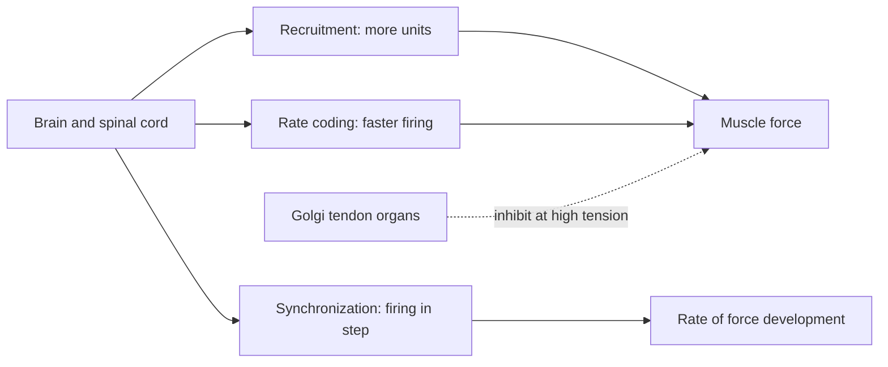

# Motor units and neural control of force

## Summary

A motor unit is one motor neuron and all the muscle fibers it supplies. The nervous system controls muscle force in three ways: by recruiting more motor units (recruitment), by firing them faster (rate coding) and by firing them more in step (synchronization). Units are recruited from small to large (the size principle). Strength gains in the first weeks of training come largely from these neural changes, and reflexes such as those from Golgi tendon organs can limit force.

## Prerequisites

- [Muscle contraction](muscle-contraction.md)

## Core concepts

### Definition

A *motor unit* consists of an alpha motor neuron in the spinal cord or brainstem and the muscle fibers it innervates. All fibers of a unit are of the same type and contract together. Units range from a few fibers (eye muscles, fine control) to over a thousand (large leg muscles, coarse force). The *size principle* (Henneman, 1957) states that motor units are recruited in order of increasing size: small, low-force, fatigue-resistant units first, large, high-force units last.

### Analogy

Motor units are like the light switches of a large hall with dimmers. To make the hall brighter, you can switch on more lamps (recruitment) or turn the dimmers up (rate coding). Small, efficient lamps come on first; the big floodlights only come on when you need full brightness. Flicking switches at the same instant gives a sudden flash (synchronization). The analogy breaks because muscle fibers cannot be partly on: each twitch is all or none, and the "dimmer" works by stacking twitches.

### Mechanism

**Recruitment.** As the required force rises, more and larger motor units are activated. Most muscles recruit nearly all units by about 80 to 90 percent of maximal force; small hand muscles finish recruiting at about 50 percent and rely more on rate coding above that.

**Rate coding.** A single impulse causes a twitch. If a second impulse arrives before relaxation, the twitches add up (summation). At high frequencies, twitches fuse into a smooth, maximal contraction (tetanus). Firing rates range from about 8 to over 50 impulses per second.

**Synchronization.** Firing more units at nearly the same time increases the rate of force development, which matters for explosive movements.

**Inhibition.** Golgi tendon organs in tendons sense tension and reflexively inhibit the muscle when tension is very high, which may protect it. Training with heavy loads is thought to reduce this inhibition, although the evidence in humans is indirect.

**Fiber activation.** Large units contain mostly fast-twitch (type II) fibers. Training that requires high force or speed, or sets taken close to failure, recruits them (see [Muscle fiber types](muscle-fiber-types.md)).

The diagram shows the ways the nervous system grades force.

### Neural adaptations to training

In the first 4 to 8 weeks of strength training, strength rises faster than muscle size. Better recruitment, higher firing rates, better coordination between agonists and antagonists (less co-activation) and possibly reduced inhibition explain much of the early gain. Later, hypertrophy contributes more.

## Worked example

Why does a set of light weights taken to failure still recruit large motor units? At the start, small units do the work. As they fatigue, the nervous system recruits larger units to maintain the force. Near failure, most units are active. This explains why low loads (about 30 percent of 1RM) lifted to failure produced similar muscle growth to heavy loads in a 2017 meta-analysis (Schoenfeld and colleagues), while heavy loads still produced more strength, which also depends on neural factors and practice with heavy weights.

## Trade offs and when to use it

- Heavy loads train maximal recruitment and rate coding directly; light loads reach the same units only with fatigue and are more uncomfortable.
- Explosive training improves synchronization and rate of force development, useful in jumping and sprinting.

## Common mistakes

- **Thinking a muscle contracts "partly" by partly contracting each fiber.** Each fiber's twitch is all or none; force is graded by recruitment and rate.
- **Attributing all early strength gains to muscle growth.** Neural adaptation dominates early.

## Practice

1. What is a motor unit?
2. State the size principle.
3. Why do untrained people gain strength quickly in the first weeks?

### Answers

1. A motor neuron and all the muscle fibers it supplies.
2. Motor units are recruited from smallest to largest as force demand rises.
3. Mostly neural adaptations: better recruitment, firing rate and coordination.

## Further reading

- Henneman, E. (1957). Relation between size of neurons and their susceptibility to discharge. Science, 126(3287), 1345-1347. [DOI](https://doi.org/10.1126/science.126.3287.1345). Original description of the size principle.
- Schoenfeld, B. J., Grgic, J., Ogborn, D. et al. (2017). Strength and hypertrophy adaptations between low- vs. high-load resistance training: a systematic review and meta-analysis. Journal of Strength and Conditioning Research, 31(12), 3508-3523. [DOI](https://doi.org/10.1519/JSC.0000000000002200). Meta-analysis of low versus high loads.
- Kenney, W. L., Wilmore, J. H., Costill, D. L. (2020). *Physiology of Sport and Exercise (7th ed.)*. Human Kinetics. Neural control of muscle and adaptations to training.
