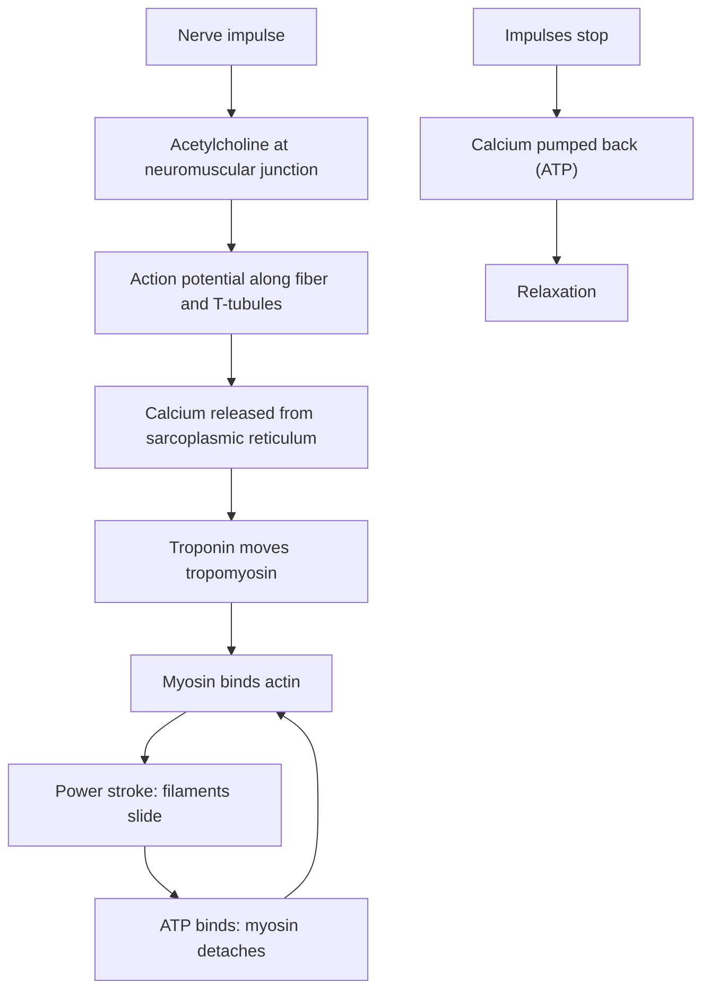

# Muscle contraction

## Summary

Muscle contraction starts with a nerve impulse that releases acetylcholine at the neuromuscular junction. The resulting action potential travels along the fiber and down the T-tubules, which makes the sarcoplasmic reticulum release calcium. Calcium uncovers binding sites on actin, and myosin heads attach, pull and release in repeated cycles powered by ATP. The filaments slide past each other and the sarcomere shortens: the sliding filament theory.

## Prerequisites

- [Skeletal muscle structure](skeletal-muscle-structure.md)
- [ATP](../../../../natural-sciences/chemistry/biochemistry/atp.md)

## Core concepts

### Definition

The *sliding filament theory*, proposed in 1954 by two pairs of researchers (Andrew Huxley with Rolf Niedergerke, and Hugh Huxley with Jean Hanson), states that muscles shorten because actin and myosin filaments slide past each other, not because the filaments themselves shorten. *Excitation-contraction coupling* is the chain of events that links the electrical signal to this mechanical sliding.

### Analogy

The myosin heads are like a team of rowers in a long boat (the thick filament) pulling on a rope (actin). Each rower grabs the rope, pulls, lets go, reaches forward and grabs again. Many rowers working out of step keep a constant pull. Calcium is the coxswain's command "row", and ATP is the energy each rower needs for every stroke. The analogy breaks because the "rope" is attached to both ends of the boat house (Z discs) and pulls the ends inward.

### Mechanism

**Excitation-contraction coupling.**

1. A motor neuron releases acetylcholine at the neuromuscular junction.
2. Acetylcholine opens ion channels; sodium enters and an action potential spreads along the sarcolemma and into the T-tubules.
3. Voltage sensors in the T-tubules (dihydropyridine receptors) open calcium release channels (ryanodine receptors) in the sarcoplasmic reticulum.
4. Calcium binds troponin, which moves tropomyosin off the myosin-binding sites on actin.

**Cross-bridge cycle.**

1. A myosin head, holding ADP and phosphate, binds actin (cross-bridge).
2. Release of phosphate triggers the power stroke: the head pivots and pulls actin toward the M line.
3. ADP is released; the head stays attached (rigor state).
4. A new ATP binds and the head detaches.
5. ATP is split, re-cocking the head for the next cycle.

**Relaxation.** When nerve impulses stop, acetylcholinesterase breaks down acetylcholine, calcium pumps (SERCA) return calcium to the sarcoplasmic reticulum using ATP, tropomyosin covers the binding sites again and the muscle relaxes.

The diagram shows the chain from nerve to force.

### Why ATP is needed twice

ATP is needed to detach myosin from actin and to pump calcium back. Without ATP, myosin stays bound: after death, ATP runs out and muscles stiffen (rigor mortis), which begins within a few hours and fades as proteins break down.

## Worked example

Botulinum toxin blocks the release of acetylcholine at the neuromuscular junction. Injected in tiny amounts into a facial muscle, it prevents contraction for about three to four months, until new nerve endings sprout. This is the basis of its cosmetic use against wrinkles and its medical use in spasticity, chronic migraine and excessive sweating. It shows that contraction depends on the first step of the chain.

## Trade offs and when to use it

- The calcium switch allows fast, fine control, but it costs ATP even to relax, which is one reason muscles use a large share of energy during exercise.
- Cramps involve sustained, involuntary activation of motor units; their exact cause during exercise is still debated (dehydration and electrolyte theories versus altered nerve control).

## Common mistakes

- **Thinking filaments shorten.** They slide; their length stays the same.
- **Thinking ATP is needed only for the power stroke.** It is also needed for detachment and for pumping calcium back.

## Practice

1. Which ion triggers contraction inside the muscle fiber, and where is it stored?
2. What causes rigor mortis?
3. What does troponin do when calcium binds to it?

### Answers

1. Calcium, stored in the sarcoplasmic reticulum.
2. Lack of ATP, so myosin heads cannot detach from actin.
3. It changes shape and moves tropomyosin off the myosin-binding sites on actin.

## Further reading

- Huxley, A. F., Niedergerke, R. (1954). Structural changes in muscle during contraction: interference microscopy of living muscle fibres. Nature, 173, 971-973. [DOI](https://doi.org/10.1038/173971a0). One of the two 1954 papers proposing sliding filaments.
- Huxley, H., Hanson, J. (1954). Changes in the cross-striations of muscle during contraction and stretch and their structural interpretation. Nature, 173, 973-976. [DOI](https://doi.org/10.1038/173973a0). The other 1954 paper.
- Betts, J. G., Young, K. A., Wise, J. A. et al. (2022). *Anatomy and Physiology 2e*. OpenStax, Rice University. [Link](https://openstax.org/details/books/anatomy-and-physiology-2e). Section 10.3 on muscle fiber contraction and relaxation.
