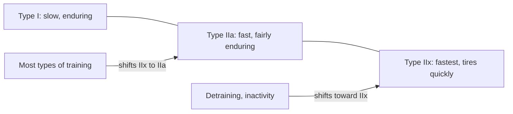

# Muscle fiber types

## Summary

Skeletal muscle fibers differ in how fast they contract and how quickly they tire. Type I (slow-twitch, "red") fibers contract slowly with low force but resist fatigue, because they are rich in mitochondria, capillaries and myoglobin. Type II (fast-twitch, "white") fibers contract quickly and forcefully but tire fast; type IIa is intermediate and type IIx the fastest. Most muscles are a mix, the proportion is largely inherited, and training shifts fibers mainly within the type II group.

## Prerequisites

- [Motor units and neural control of force](motor-units.md)

## Core concepts

### Definition

A *fiber type* is a class of muscle fibers defined mainly by the type of myosin heavy chain they express, which sets contraction speed, together with their metabolic profile. The main human types are type I, type IIa and type IIx (the IIx type was formerly called IIb in human studies).

### Analogy

Fiber types are like the vehicles of a delivery company. Type I fibers are fuel-efficient vans that can drive all day at moderate speed. Type IIx fibers are sports cars: very fast and forceful but with a small tank. Type IIa fibers are performance sedans in between. A muscle is a fleet; its mix decides whether the company is good at long routes or quick deliveries. The analogy breaks because training can retune some of the "sedans" and "sports cars" toward each other.

### Mechanism

| Property | Type I | Type IIa | Type IIx |
| --- | --- | --- | --- |
| Contraction speed | Slow | Fast | Fastest |
| Force per fiber | Low | High | Highest |
| Fatigue resistance | High | Moderate | Low |
| Mitochondria, capillaries, myoglobin | Many | Moderate | Few |
| Main energy pathway | Oxidative | Oxidative and glycolytic | Glycolytic |
| Color | Red | Pinkish | White |
| Motor unit size | Small | Larger | Largest |
| Recruited | First | Next | Last |

Type I fibers are adapted to long, low-intensity work because they tire slowly; they contract slowly and with relatively low force, which they make up for in endurance. Type II fibers can produce large efforts but tire fast, are less densely supplied with capillaries and rely more on anaerobic glycolysis.

The diagram shows the fiber types along a continuum and the direction of training shifts.

### Distribution and genetics

Average untrained people have roughly 50 percent type I fibers in the vastus lateralis. Elite marathon runners can have 70 to 80 percent or more, elite sprinters often 20 to 30 percent. Twin studies suggest that a large share of the variation is inherited. The soleus is mostly type I in nearly everyone, while muscles like the triceps and gastrocnemius have more type II fibers.

### Adaptation

Both endurance and strength training shift type IIx fibers toward IIa. Conversion between type I and type II is limited in humans. Inactivity and detraining increase IIx. Type II fibers grow more with strength training than type I fibers, which explains part of the difference between athletes.

## Worked example

Fiber type is measured from a needle biopsy of the vastus lateralis, typically a sample of a few hundred fibers. If 200 of 400 counted fibers stain as type I, the sample is 50 percent type I. Because fiber types are not evenly spread within a muscle, two biopsies from the same muscle can differ by about 10 percentage points. Fiber type results are therefore estimates, and they describe one muscle, not the whole body.

## Trade offs and when to use it

- Fiber type is one factor in performance, along with training, technique, motor unit control and heart and lung capacity. It is not a useful basis for choosing a sport for most people.
- Commercial genetic tests (for example ACTN3) predict fiber type and athletic success poorly.

## Common mistakes

- **Training "for fiber types" with different rep ranges.** Both heavy and light loads taken close to failure grow both fiber types.
- **Believing training converts type I to type II freely.** Shifts are mainly between IIx and IIa.

## Practice

1. Which fiber type has the most mitochondria?
2. In which direction does most training shift type II fibers?
3. Why are type I fibers red?

### Answers

1. Type I.
2. From IIx toward IIa.
3. They contain more myoglobin and capillaries.

## Further reading

- Kenney, W. L., Wilmore, J. H., Costill, D. L. (2020). *Physiology of Sport and Exercise (7th ed.)*. Human Kinetics. Chapter on skeletal muscle and fiber types.
- Betts, J. G., Young, K. A., Wise, J. A. et al. (2022). *Anatomy and Physiology 2e*. OpenStax, Rice University. [Link](https://openstax.org/details/books/anatomy-and-physiology-2e). Section 10.5 on types of muscle fibers.
