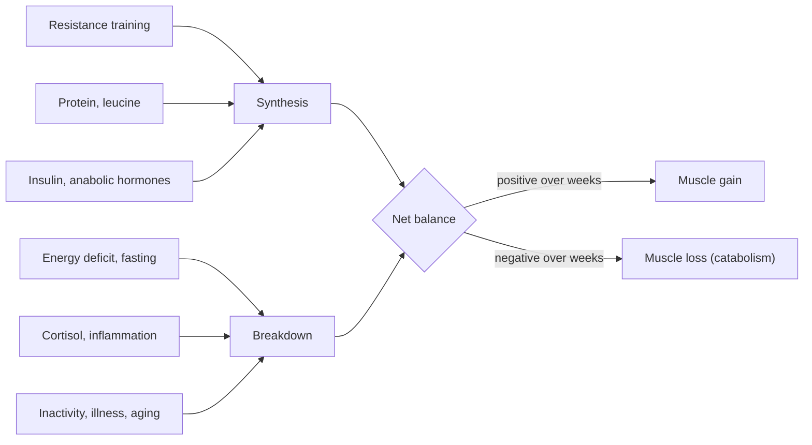

# Muscle protein balance

## Summary

Muscle proteins are built and broken down all the time. Muscle grows when synthesis exceeds breakdown over weeks and shrinks when breakdown wins. Training raises both, and eating protein raises synthesis, so the combination makes the balance positive. Muscle catabolism, the net breakdown of muscle protein, increases with too little food, too little sleep, excessive training without recovery, aging, injury and illness. The "anabolic window" after training is real but much wider than once believed: total daily protein matters more than exact timing.

## Prerequisites

- [Anabolism](../../../../natural-sciences/chemistry/biochemistry/anabolism.md)
- [Catabolism](../../../../natural-sciences/chemistry/biochemistry/catabolism.md)
- [Muscle hypertrophy](hypertrophy.md)

## Core concepts

### Definition

*Muscle protein synthesis* (MPS) is the building of new muscle proteins from amino acids. *Muscle protein breakdown* (MPB) is their degradation into amino acids. *Net protein balance* is MPS minus MPB. *Muscle catabolism* refers to a negative net balance, in which muscle proteins are broken down into amino acids that the body uses for energy or glucose when it cannot get enough from food.

### Analogy

Muscle protein is like the balance of a bank account with constant deposits (synthesis) and withdrawals (breakdown). Training is like a salary increase that also raises spending; eating protein adds deposits. The account grows only if deposits stay ahead of withdrawals over months. Illness, starvation or chronic sleep loss are like unexpected bills. The analogy breaks because withdrawals are not waste: breaking down damaged proteins is part of renewing the muscle.

### Mechanism

**What raises synthesis.** Resistance training (MPS stays elevated for about 24 to 48 hours in beginners, shorter in trained people), dietary protein and its leucine content, insulin and other anabolic hormones (see [Anabolic and catabolic hormones](../endocrine/anabolic-and-catabolic-hormones.md)).

**What raises breakdown.** Fasting and energy deficit, cortisol and inflammation, immobilization, aging and disease. At night, during the fast of sleep, the body is in a mild catabolic state, which is physiological; protein eaten before sleep can raise overnight synthesis.

The diagram shows the main inputs to the balance.

### Causes of muscle catabolism

- **Training too hard without nutrients.** Training creates microdamage, which is natural and useful as a stimulus. Without enough nutrients, strength declines and muscle cannot grow.
- **Inadequate diet.** Too little energy increases breakdown. Long gaps between meals are often said to start breakdown of muscle for energy; in practice, total protein and energy over the day matter more than meal spacing for most people.
- **Lack of recovery.** Nighttime catabolism is normal and amino acids are released from muscle overnight. Too little sleep impairs muscle building, and protein before sleep supports overnight synthesis.
- **Other causes:** aging (sarcopenia), injuries, and diseases such as cancer, infections and heart failure (cachexia).

### Effects of increased muscle catabolism

- Loss of muscle mass and strength, which lowers physical capacity.
- Difficulty maintaining a healthy body weight and composition.
- Weaker immune function and more susceptibility to infection (muscle is an amino acid reservoir for immune cells, especially in illness).
- Greater risk of chronic diseases such as type 2 diabetes, osteoporosis and cardiovascular disease, and of falls and disability in older age.

### Preventing catabolism and supporting anabolism

**Recovery.** Allow time between hard sessions for each muscle, sleep 7 to 9 hours (see [Sleep](../sleep/README.md)), and avoid long periods without any training load.

**Diet.**

- Energy balance: avoid a large deficit when building muscle; a small surplus helps.
- Protein: older advice of 1 to 1.5 g per kg per day is close to the evidence for active people. Current recommendations (ISSN) are about 1.4 to 2.0 g/kg for people who train, with a meta-analysis finding the benefit for muscle levels off at about 1.6 g/kg (Morton and colleagues, 2018).
- Macronutrients for a muscle-gaining diet are often given as roughly 20 percent protein, 50 percent carbohydrate and 30 percent fat; protein targets in g/kg are more precise.
- Spread protein over 3 to 5 meals with about 0.3 to 0.4 g/kg each.
- Quality sources: lean meat, poultry, fish, legumes and dairy. For lactose intolerance, goat or sheep milk products are sometimes suggested, but they contain similar amounts of lactose; lactose-free dairy, hard cheeses and fermented products are better choices.
- Carbohydrates fuel training and spare protein; grains, pasta, vegetables and fruit belong in the diet.

**Supplements.** Protein powders (for example whey isolate) help meet targets. Branched-chain amino acids are sometimes recommended, but complete protein is better, and creatine, often mentioned in the same breath, is not an amino acid supplement of that kind: it is a separate compound with strong evidence for strength and muscle gains (see [Creatine](../../nutrition/supplements/creatine.md)).

**Training.** Heavy multi-joint exercises are the main stimulus. Sessions of about an hour are often recommended to limit cortisol; there is little evidence that cortisol from a single session limits growth, and well-designed longer sessions are not harmful.

### The anabolic window

The "anabolic window" is the period after training when protein is said to be especially effective. Older advice claimed it lasts 30 minutes to 2 to 3 hours and that liquid supplements are best because they digest quickly. A meta-analysis (Schoenfeld and colleagues, 2013) found that once total daily protein was equal, protein timing had little effect on muscle growth. Eating a protein-rich meal within a few hours before or after training is a sensible, easy rule, and it matters more for people who train fasted.

## Worked example

A 75 kg person training four times a week targets 1.6 g/kg, which is 120 g of protein per day, split into four meals of about 30 g (0.4 g/kg). A post-workout shake of 25 g whey plus three meals with chicken, Greek yogurt and lentils reaches the target. Whether the shake is taken 20 minutes or 2 hours after training makes little difference if the daily total is met.

## Trade offs and when to use it

- High protein intakes are safe for healthy kidneys up to at least about 2 g/kg, but they displace other foods and cost more.
- In an energy deficit (fat loss), higher protein (up to about 2.2 g/kg of lean mass) and continued resistance training protect muscle.

## Common mistakes

- **Fearing that a missed shake erases a workout.** Daily intake matters most.
- **Calling creatine a branched-chain amino acid.** Creatine is a separate compound.
- **Assuming goat milk is lactose-free.** It contains lactose.

## Practice

1. What determines whether muscle grows over time?
2. What protein intake is recommended for people who train regularly?
3. What did meta-analyses find about protein timing?

### Answers

1. Whether muscle protein synthesis exceeds breakdown over weeks.
2. About 1.4 to 2.0 g per kg body weight per day, with benefits leveling off near 1.6 g/kg.
3. When daily protein is equal, timing has little effect on muscle growth.

## Further reading

- Morton, R. W., Murphy, K. T., McKellar, S. R. et al. (2018). A systematic review, meta-analysis and meta-regression of the effect of protein supplementation on resistance training-induced gains in muscle mass and strength in healthy adults. British Journal of Sports Medicine, 52(6), 376-384. [DOI](https://doi.org/10.1136/bjsports-2017-097608). Meta-analysis on protein and muscle gains.
- Jäger, R., Kerksick, C. M., Campbell, B. I. et al. (2017). International Society of Sports Nutrition position stand: protein and exercise. Journal of the International Society of Sports Nutrition, 14, 20. [DOI](https://doi.org/10.1186/s12970-017-0177-8). ISSN position stand on protein and exercise.
- Schoenfeld, B. J., Aragon, A. A., Krieger, J. W. (2013). The effect of protein timing on muscle strength and hypertrophy: a meta-analysis. Journal of the International Society of Sports Nutrition, 10, 53. [DOI](https://doi.org/10.1186/1550-2783-10-53). Meta-analysis of protein timing.
- Kreider, R. B., Kalman, D. S., Antonio, J. et al. (2017). International Society of Sports Nutrition position stand: safety and efficacy of creatine supplementation in exercise, sport, and medicine. Journal of the International Society of Sports Nutrition, 14, 18. [DOI](https://doi.org/10.1186/s12970-017-0173-z). Creatine position stand.
