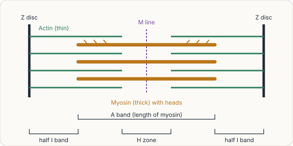
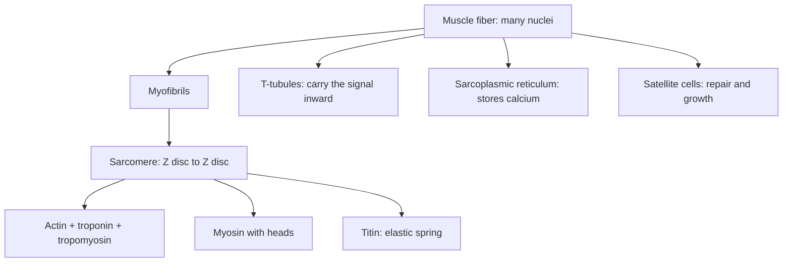

# Skeletal muscle structure

## Summary

A skeletal muscle fiber is a single, very long cell with hundreds of nuclei, packed with myofibrils. Each myofibril is a chain of sarcomeres, the repeating units in which thin actin and thick myosin filaments overlap, giving the fiber its striped look. A network of membranes (T-tubules and sarcoplasmic reticulum) carries the nerve signal deep into the fiber and stores the calcium that triggers contraction.

## Prerequisites

- [Muscular system overview](../../anatomy/muscular-system/muscular-system-overview.md)
- [Tissues](../../../../natural-sciences/biology/cell-biology/tissues.md)

## Core concepts

### Definition

A *muscle fiber* (myocyte) is a multinucleated cell formed during development by the fusion of many precursor cells. Its membrane is the *sarcolemma*, its cytoplasm the *sarcoplasm*. A *myofibril* is a rod of contractile proteins running the length of the fiber. A *sarcomere* is the segment of a myofibril between two Z discs, about 2 to 3 µm long at rest, the smallest unit that contracts.

### Analogy

A muscle fiber is like a long freight train made of thousands of identical cars (sarcomeres) coupled end to end. When every car shortens a little at the same moment, the whole train shortens a lot. Electrical cables (T-tubules) run into every car so that the "shorten" signal reaches all at once. The analogy breaks because the cars shorten by sliding internal parts past each other, not by compressing.

### Mechanism

**Organization.** Muscle → fascicles → fibers → myofibrils → sarcomeres → filaments. Each fiber is wrapped in endomysium, and satellite cells sit between the sarcolemma and the basal lamina, ready to repair or add nuclei.

**The sarcomere.** Thin filaments of actin, with the regulatory proteins troponin and tropomyosin, are anchored to the Z discs. Thick filaments of myosin, with heads that bind actin, sit in the middle and are anchored at the M line. Titin, a giant elastic protein, links the myosin filaments to the Z discs and provides passive tension. The bands seen under the microscope are:

- **A band**: the length of the myosin filaments (dark).
- **I band**: actin only (light).
- **H zone**: myosin only, in the middle of the A band.
- **M line**: center of the sarcomere.

The figure shows a sarcomere.

**Membrane systems.** T-tubules are inward folds of the sarcolemma that carry the action potential into the fiber. The sarcoplasmic reticulum, a specialized smooth endoplasmic reticulum, wraps each myofibril and stores calcium. Where a T-tubule meets two sarcoplasmic reticulum sacs is a *triad*, the site where the electrical signal triggers calcium release.

The diagram shows the levels of organization and the structures for signaling.

## Worked example

A biceps fiber 10 cm long contains roughly 10 cm ÷ 2.5 µm ≈ 40,000 sarcomeres in series along each myofibril. If each sarcomere shortens by 0.5 µm (20 percent), the fiber shortens by 40,000 × 0.5 µm = 2 cm. This is why long fibers can shorten over a large distance, and why muscles with long fibers are suited to range and speed.

## Trade offs and when to use it

- Many nuclei let a large cell make enough protein, and satellite cells allow repair, but adult fibers cannot divide.
- The striped arrangement is efficient for fast, forceful contraction but costs a lot of energy compared with smooth muscle.

## Common mistakes

- **Thinking a muscle fiber is a bundle of cells.** It is one cell with many nuclei.
- **Confusing myofibrils with muscle fibers.** Myofibrils are inside fibers.

## Practice

1. What is a sarcomere?
2. Which band keeps its length during contraction?
3. Where is calcium stored in a muscle fiber?

### Answers

1. The segment of a myofibril between two Z discs, the basic contractile unit.
2. The A band.
3. In the sarcoplasmic reticulum.

## Further reading

- Betts, J. G., Young, K. A., Wise, J. A. et al. (2022). *Anatomy and Physiology 2e*. OpenStax, Rice University. [Link](https://openstax.org/details/books/anatomy-and-physiology-2e). Chapter 10 on muscle tissue.
- Huxley, H., Hanson, J. (1954). Changes in the cross-striations of muscle during contraction and stretch and their structural interpretation. Nature, 173, 973-976. [DOI](https://doi.org/10.1038/173973a0). Original observation of band changes during contraction.
