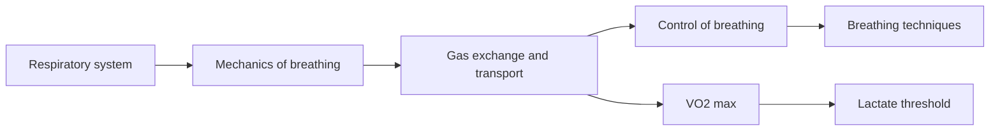

# Respiration

Respiration covers everything from moving air into the lungs to delivering oxygen to the mitochondria. These notes describe the respiratory system, the mechanics of breathing, gas exchange and oxygen transport, the control of breathing, breathing techniques in training, and the two main measures of aerobic fitness: VO2 max and the lactate threshold.

## Map

## Reading order

1. [Respiratory system](respiratory-system.md)
2. [Mechanics of breathing](mechanics-of-breathing.md)
3. [Gas exchange and oxygen transport](gas-exchange.md)
4. [Control of breathing](control-of-breathing.md)
5. [Breathing techniques in training](breathing-techniques.md)
6. [VO2 max](vo2-max.md)
7. [Lactate threshold](lactate-threshold.md)
