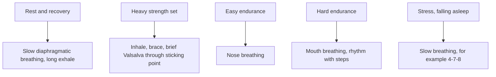

# Breathing techniques in training

## Summary

Breathing is essential for life, but in sport it also plays a strategic role. A good breathing technique supports performance, energy use, fatigue resistance, recovery and trunk stability. The basic pattern is diaphragmatic breathing. In strength training, a brief breath hold (Valsalva maneuver) stabilizes the spine during the hardest part of a lift; in endurance training, nose breathing at low intensity and rhythmic breathing at higher intensity are common. Many claimed benefits of breathing training are plausible but supported by limited evidence.

## Prerequisites

- [Control of breathing](control-of-breathing.md)

## Core concepts

### Definition

A *breathing technique* is a deliberate pattern of breathing (depth, rate, route, timing and pauses) used for a specific purpose, such as stabilizing the trunk, pacing effort or reducing stress. *Diaphragmatic breathing* moves the abdomen and lower ribs rather than the upper chest. The *Valsalva maneuver* is a forced exhalation against a closed glottis.

### Analogy

Breathing in sport is like the clutch and gearbox of a car. The engine (muscles) produces power, but how smoothly it reaches the wheels depends on shifting at the right moment. Holding the breath at the hardest point of a squat is like locking the clutch for maximum transfer; rhythmic breathing in running is like a steady gear. The analogy breaks because breathing also affects the nervous system directly, which no gearbox does.

### Mechanism

**Physiology in brief.** Breathing combines ventilation (air between atmosphere and lungs) and gas exchange (between alveoli and blood). Inhalation is active (diaphragm and external intercostals). Exhalation is passive at rest and assisted by the abdominals and internal intercostals in exercise. In the lungs oxygen diffuses into the blood and CO2 out; in tissues oxygen goes to the mitochondria for ATP production and CO2 returns. The breathing center in the medulla responds mainly to CO2, and chemoreceptors in the carotid arteries and aorta monitor pH, CO2 and oxygen. See [Mechanics of breathing](mechanics-of-breathing.md) and [Control of breathing](control-of-breathing.md).

**Rest versus exercise.**

- At rest, breaths are often shallow and use the upper chest, especially in stressed people or those sitting at a computer. The optimal pattern is slow diaphragmatic breathing using the lower lungs.
- During exercise, ventilation rises in proportion to metabolic demand; breathing becomes deeper and faster. At very high intensity, hyperventilation removes excess CO2 and stabilizes pH.

**Diaphragmatic breathing.** Inhale through the nose with active diaphragm work, expanding the lower ribs and abdomen; exhale through the mouth or nose, longer and calm, with the abdominal muscles. Proposed effects: better oxygenation, posture stability, less muscle tension and stress reduction.

**Strength training.** The Valsalva maneuver, a controlled breath hold during the hardest part of a lift, raises intra-abdominal pressure and stabilizes the spine. A common rule is to inhale while lowering the weight and exhale while lifting, with modifications for the exercise: for heavy sets, inhale and brace before the descent, hold through the sticking point and exhale near the top. See [Breathing pattern in lifting](../../exercise-and-fitness/training-variables/breathing-pattern-in-lifting.md).

**Endurance training.** At moderate intensity, nose breathing filters, warms and humidifies air and may favor a calm breathing pattern. At higher intensity, people naturally switch to mouth breathing for greater flow. Runners often coordinate breathing with steps, for example 3 steps inhaling and 2 steps exhaling.

The diagram matches techniques to situations.

### Common mistakes in breathing

- Chest breathing instead of diaphragmatic breathing.
- Breathing too shallowly (hypoventilation).
- A chaotic rhythm during exercise.
- Holding the breath at the wrong moment, which risks a drop in blood pressure and dizziness.
- Mouth breathing even at low intensity, which favors hyperventilation and filters air poorly.

### Adaptations to breathing training

Regular breathing training and conscious breathing are reported to lead to:

| Proposed adaptation | Evidence |
| --- | --- |
| Larger vital capacity | Little change in healthy adults; lung size is largely fixed |
| Better rib cage mobility | Plausible, limited data |
| Better breathing economy | Inspiratory muscle training shows small performance benefits in some trials |
| Higher CO2 tolerance | Plausible for divers and with practice; relevance to endurance unclear |
| Later onset of breathlessness | Inspiratory muscle training reduces perceived breathlessness in some studies |
| Better oxygen use in tissues | Not shown for breathing training alone |

Slow breathing at about 6 breaths per minute increases heart rate variability and lowers stress markers in short-term studies (Zaccaro and colleagues, 2018).

## Worked example

A lifter squats 140 kg for 3 repetitions. Before each descent, they inhale into the belly and lower ribs, brace the abdominal wall as if expecting a punch, descend and rise through the sticking point while holding the breath, and exhale near the top. Each breath hold lasts about 3 to 5 seconds. Blood pressure rises steeply during the hold (values over 300 mmHg have been measured in heavy leg presses), which is why people with uncontrolled hypertension, recent eye surgery or aneurysms should avoid maximal Valsalva efforts.

## Trade offs and when to use it

- The Valsalva maneuver improves stability and force in heavy lifts but raises blood pressure briefly; for lighter sets and for people with cardiovascular risk, continuous breathing is preferable.
- Nose breathing is comfortable at low intensity but limits flow at high intensity.

## Common mistakes

- **Using a long Valsalva for many repetitions in a row.** Breathe between repetitions.
- **Forcing nose breathing at high intensity.** Switch to mouth breathing when needed.

## Practice

1. When should the breath be held in a heavy squat?
2. Name two benefits of nose breathing at low intensity.
3. Who should avoid maximal Valsalva efforts?

### Answers

1. From the start of the descent through the sticking point, exhaling near the top.
2. It filters, warms and humidifies air and supports calm breathing.
3. People with uncontrolled high blood pressure, aneurysms or recent eye surgery, among others.

## Further reading

- Zaccaro, A., Piarulli, A., Laurino, M. et al. (2018). How breath-control can change your life: a systematic review on psycho-physiological correlates of slow breathing. Frontiers in Human Neuroscience, 12, 353. [DOI](https://doi.org/10.3389/fnhum.2018.00353). Systematic review of slow breathing effects.
- Haff, G. G., Triplett, N. T. (Eds.) (2016). *Essentials of Strength Training and Conditioning (4th ed.)*. Human Kinetics. Breathing guidance in resistance training.
- Kenney, W. L., Wilmore, J. H., Costill, D. L. (2020). *Physiology of Sport and Exercise (7th ed.)*. Human Kinetics. Respiratory adaptations to training.
