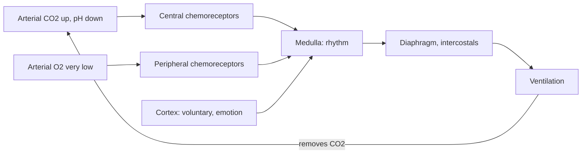

# Control of breathing

## Summary

Breathing is controlled by the respiratory centers in the brainstem, which set the basic rhythm, and adjusted by chemoreceptors that sense carbon dioxide, pH and oxygen. Carbon dioxide, through its effect on pH, is the main driver; low oxygen matters only when it falls considerably. Hyperventilation, breathing more than needed, lowers carbon dioxide and causes respiratory alkalosis with tingling and dizziness. Breathing can also be controlled voluntarily, which is the basis of breathing techniques.

## Prerequisites

- [Gas exchange and oxygen transport](gas-exchange.md)

## Core concepts

### Definition

The *respiratory centers* are groups of neurons in the medulla oblongata (which generate the rhythm) and the pons (which smooth it). *Central chemoreceptors* in the medulla respond to the pH of cerebrospinal fluid, which reflects arterial carbon dioxide. *Peripheral chemoreceptors* in the carotid and aortic bodies respond to arterial oxygen, carbon dioxide and pH. *Hyperventilation* is ventilation in excess of metabolic need, which lowers arterial carbon dioxide (hypocapnia) and raises pH (respiratory alkalosis). The term is also used for deliberate fast, deep breathing, which in medicine can provoke seizures in some people and is used as a test in the diagnosis of epilepsy.

### Analogy

Breathing control works like a thermostat for carbon dioxide rather than for oxygen. The thermostat (brainstem) keeps carbon dioxide close to 40 mmHg: if it rises, breathing speeds up; if it falls, breathing slows. A separate low-oxygen alarm (peripheral chemoreceptors) only goes off when oxygen drops a lot. The analogy breaks because the "thermostat" can be overridden voluntarily for a while, and anticipates exercise before carbon dioxide even rises.

### Mechanism

1. The medulla generates rhythmic signals to the phrenic and intercostal nerves.
2. Rising CO2 lowers pH in cerebrospinal fluid; central chemoreceptors increase ventilation. This is the main control at rest.
3. Peripheral chemoreceptors respond strongly when arterial PO2 falls below about 60 mmHg, for example at altitude.
4. During exercise, ventilation rises immediately at the start (signals from the motor cortex and from moving limbs), then follows CO2 production. At high intensity, hydrogen ions from metabolism drive extra ventilation (the ventilatory threshold), which also removes CO2 to buffer the acid.
5. Stretch receptors in the lungs and the cortex (emotion, voluntary control) also influence breathing.

The diagram shows the control loop.

### Hyperventilation

Breathing too fast or too deep for the body's needs washes out carbon dioxide. The rise in pH constricts brain blood vessels and changes calcium binding, causing light-headedness, tingling in the fingers and around the mouth, and sometimes muscle cramps. It often accompanies anxiety and panic. Slowing breathing, especially exhalation, corrects it. During very intense exercise, hyperventilation is a normal compensation for metabolic acid.

### Breath holding

Holding the breath raises CO2 until the urge to breathe forces a breath (the breaking point). Hyperventilating before diving lowers CO2 and delays this urge, but oxygen can then fall to the point of unconsciousness before the urge returns (shallow water blackout), which kills experienced swimmers every year.

## Worked example

A person having a panic attack breathes 30 times a minute and feels tingling and dizziness. Their arterial CO2 has fallen from 40 to perhaps 25 mmHg. Breathing slowly, for example inhaling for 4 seconds and exhaling for 6, brings CO2 back toward normal within minutes. Breathing into a paper bag was once advised but is no longer recommended, because it can lower oxygen dangerously if the cause is actually a heart or lung problem.

## Trade offs and when to use it

- Regulating by CO2 keeps pH very stable, but it also means a person can lose consciousness from low oxygen without feeling breathless, if CO2 is low.

## Common mistakes

- **Thinking the urge to breathe comes from low oxygen.** It comes mainly from rising CO2.
- **Hyperventilating before free diving.** It increases the risk of blackout.

## Practice

1. Which gas is the main driver of breathing at rest?
2. What symptoms does hyperventilation cause, and why?
3. Why is hyperventilating before underwater swimming dangerous?

### Answers

1. Carbon dioxide (through pH).
2. Dizziness, tingling and cramps, because low CO2 raises blood pH and constricts brain vessels.
3. It delays the CO2-driven urge to breathe, so oxygen can fall to unconsciousness without warning.

## Further reading

- Betts, J. G., Young, K. A., Wise, J. A. et al. (2022). *Anatomy and Physiology 2e*. OpenStax, Rice University. [Link](https://openstax.org/details/books/anatomy-and-physiology-2e). Section 22.3 on the regulation of breathing.
- Kenney, W. L., Wilmore, J. H., Costill, D. L. (2020). *Physiology of Sport and Exercise (7th ed.)*. Human Kinetics. Regulation of ventilation in exercise.
