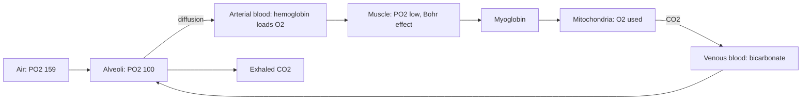

# Gas exchange and oxygen transport

## Summary

Oxygen and carbon dioxide move between air, blood and tissues by diffusion, always from higher to lower partial pressure. In the lungs, oxygen diffuses from the alveoli into the blood and carbon dioxide out; in the tissues, the reverse happens. Most oxygen is carried bound to hemoglobin in red blood cells, and most carbon dioxide travels as bicarbonate. Hemoglobin releases more oxygen where tissues are warm, acidic and rich in carbon dioxide, which matches supply to need during exercise.

## Prerequisites

- [Mechanics of breathing](mechanics-of-breathing.md)

## Core concepts

### Definition

*External respiration* is gas exchange between alveoli and blood. *Internal respiration* is gas exchange between blood and tissues. *Cellular respiration* is the use of oxygen in the mitochondria to make ATP ([Oxidative phosphorylation](../../../../natural-sciences/chemistry/biochemistry/oxidative-phosphorylation.md)). The *partial pressure* of a gas is the pressure it contributes in a mixture; diffusion follows partial pressure differences.

### Analogy

Hemoglobin is like a fleet of delivery trucks with four seats each (four oxygen-binding sites). In the lungs, where oxygen is plentiful, the trucks fill up. In busy parts of the city (working muscle), where it is hot, acidic and full of carbon dioxide, drivers are told to unload more freely. The analogy breaks because loading one seat makes it easier to load the next (cooperative binding), which gives hemoglobin its S-shaped dissociation curve.

### Mechanism

**Partial pressures (approximate, at sea level).**

| Location | PO2 (mmHg) | PCO2 (mmHg) |
| --- | --- | --- |
| Inspired air | 159 | 0.3 |
| Alveoli | 100 | 40 |
| Arterial blood | 95 to 100 | 40 |
| Venous blood at rest | 40 | 46 |
| Working muscle | 20 or less | 50 or more |

**Oxygen transport.** About 98.5 percent of oxygen is bound to hemoglobin; the rest is dissolved. Each gram of hemoglobin binds about 1.34 ml of oxygen. With 150 g of hemoglobin per liter, arterial blood carries about 200 ml of oxygen per liter.

**The Bohr effect.** Higher carbon dioxide, lower pH and higher temperature shift the oxygen dissociation curve to the right, so hemoglobin releases more oxygen in working muscle.

**Carbon dioxide transport.** About 70 percent travels as bicarbonate (carbonic anhydrase in red cells converts CO2 and water to carbonic acid, which splits into bicarbonate and hydrogen ions), about 20 percent bound to hemoglobin and about 10 percent dissolved.

**Myoglobin** in muscle stores oxygen and passes it to the mitochondria.

The diagram follows oxygen from air to mitochondria and carbon dioxide back.

## Worked example

At an altitude of 3,000 m, atmospheric pressure is about 70 percent of sea level, so inspired PO2 falls to about 110 mmHg and alveolar PO2 to about 60 mmHg. Thanks to the S-shaped curve, hemoglobin is still about 90 percent saturated, but aerobic performance drops. Over days to weeks, the kidneys release more erythropoietin, red cell mass rises, and performance partly recovers. This is the basis of altitude training ([VO2 max](vo2-max.md)).

## Trade offs and when to use it

- Cooperative binding allows hemoglobin to load fully in the lungs and unload well in tissues, but it also makes carbon monoxide dangerous: it binds hemoglobin about 200 to 250 times more strongly than oxygen.

## Common mistakes

- **Thinking oxygen is actively pumped into the blood.** It moves by diffusion.
- **Assuming 100 percent oxygen saturation is always better.** Normal saturation is 95 to 100 percent; breathing extra oxygen does not help healthy people at rest.

## Practice

1. What drives gas exchange in the lungs?
2. What is the Bohr effect?
3. How is most carbon dioxide transported in the blood?

### Answers

1. Differences in partial pressure, by diffusion.
2. A rightward shift of the oxygen dissociation curve with more CO2, lower pH or higher temperature, releasing more oxygen in tissues.
3. As bicarbonate.

## Further reading

- Betts, J. G., Young, K. A., Wise, J. A. et al. (2022). *Anatomy and Physiology 2e*. OpenStax, Rice University. [Link](https://openstax.org/details/books/anatomy-and-physiology-2e). Sections 22.4 and 22.5 on gas exchange and transport.
- Kenney, W. L., Wilmore, J. H., Costill, D. L. (2020). *Physiology of Sport and Exercise (7th ed.)*. Human Kinetics. Oxygen transport during exercise.
