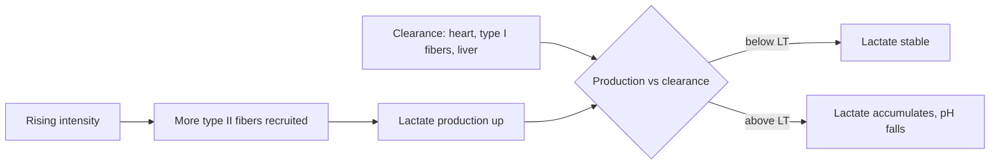

# Lactate threshold

## Summary

The lactate threshold (LT) is the exercise intensity at which blood lactate starts to rise faster than the body can clear it. It marks the shift from mainly aerobic work to a growing contribution from glycolysis, and it is the highest intensity that can be sustained for a long time without rapidly accumulating fatigue. It is often a better predictor of endurance performance than VO2 max. Training near and above the threshold moves it to higher speeds or power outputs.

## Prerequisites

- [VO2 max](vo2-max.md)
- [Lactate and fermentation](../../../../natural-sciences/chemistry/biochemistry/lactate-and-fermentation.md)

## Core concepts

### Definition

The *lactate threshold* is the intensity at which blood lactate concentration begins to increase above resting levels in a non-linear way. Many definitions exist. Two common points are the *first lactate threshold* (the first rise above baseline, about 2 mmol/L) and the *onset of blood lactate accumulation* (OBLA) at a fixed 4 mmol/L, although the individual value varies. A related concept is the *maximal lactate steady state*, the highest intensity at which lactate stays stable over about 30 minutes.

### Analogy

The lactate threshold is like the point at which a sink with an open drain starts to fill up. At low tap flow (easy pace), the drain (lactate clearance by heart, slow fibers and liver) keeps up. Turn the tap higher and, at some point, the water level starts rising: that point is the threshold. Training widens the drain and improves the plumbing. The analogy breaks because lactate itself is not the waste that causes fatigue; it marks a metabolic state in which acid and other metabolites accumulate.

### Mechanism

**Lactate physiology.** Lactate is a product of glycolysis, once considered toxic waste. It is now known to be an important fuel for the heart, brain and type I fibers, to redistribute energy between muscle fibers and to act as a signal for mitochondrial adaptation (see [Lactate and fermentation](../../../../natural-sciences/chemistry/biochemistry/lactate-and-fermentation.md)). The body produces lactate constantly, even at rest; it accumulates only when production exceeds clearance.

**How the threshold arises.**

- At low intensity, lactate production is balanced by clearance.
- As intensity rises, more type II fibers are recruited and glycolysis speeds up, producing more lactate.
- Above the threshold, lactate accumulates quickly, pH falls, muscles "burn" and fatigue builds.

The diagram shows the balance.

### Typical values

| Group | LT as percent of VO2 max |
| --- | --- |
| Untrained and amateurs | 50 to 60 |
| Trained athletes | 70 to 80 |
| Elite endurance athletes | 85 to 90 |

This explains why two athletes with similar VO2 max can perform very differently.

### Measurement

- **Laboratory**: an incremental test on a treadmill or cycle ergometer with small blood samples from the fingertip or earlobe every few minutes; lactate is plotted against speed or power and the threshold is found where the curve bends (see the chart in [Lactate and fermentation](../../../../natural-sciences/chemistry/biochemistry/lactate-and-fermentation.md#worked-example)).
- **Field**: the Conconi test looks for a break in the linear relationship between heart rate and speed, but its validity is poor. A 30 to 60 minute all-out time trial gives an average speed or heart rate near the threshold.
- **Wearables**: smartwatches estimate the threshold from heart rate and pace; useful for trends, less accurate in absolute terms.

### Raising the threshold

- **Training near LT (threshold or tempo training)**: sessions that feel hard but controlled, for example 3 × 15 minutes at 85 to 90 percent of maximal heart rate with short breaks.
- **High-intensity intervals above LT**: for example 8 × 3 minutes at about 95 percent of maximal heart rate with 2 minutes of easy jogging, driving enzymatic and mitochondrial adaptations.
- **Long aerobic sessions**: build the aerobic base and fat oxidation, reducing dependence on glycolysis.
- **Strength and plyometric training**: improve economy, so a given pace costs less energy.
- **Altitude training**: more red blood cells and better muscle oxygenation.
- **Breathing training**: better CO2 tolerance and breathing control are proposed, with limited evidence.

### Use in coaching

Zones are often anchored to the threshold: zones 1 and 2 below LT (recovery and endurance), zone 3 around LT (key for development), zones 4 and 5 above LT (anaerobic adaptations). The threshold defines the pace an athlete can sustain in races of roughly 30 to 60 minutes, and a shift of the threshold to a higher speed or power shows real progress.

### VO2 max versus lactate threshold

VO2 max is the aerobic ceiling (potential), and the lactate threshold is how much of it can be used in practice. In endurance sports, the threshold usually predicts performance better than VO2 max.

## Worked example

Two runners both have a VO2 max of 60 ml/kg/min. Runner A's threshold is at 65 percent of VO2 max and runner B's at 85 percent. In a 10 km race, runner B can sustain an oxygen uptake of about 51 ml/kg/min without accumulating lactate, runner A only about 39. With similar running economy, runner B will be several minutes faster, although their VO2 max is identical.

## Trade offs and when to use it

- Laboratory testing is precise but requires blood samples; time trials are simpler and practical.
- Threshold training is effective but tiring; most endurance programs keep about 80 percent of training at low intensity and use threshold and interval work sparingly.

## Common mistakes

- **Treating 4 mmol/L as everyone's threshold.** Individual thresholds vary widely.
- **Blaming lactate for fatigue and soreness.** Lactate is a fuel and a marker, not the cause of soreness.
- **Doing every run at threshold pace.** This leads to fatigue without better adaptation.

## Practice

1. Define the lactate threshold.
2. Why is the lactate threshold often a better predictor of endurance performance than VO2 max?
3. Name two ways to raise the lactate threshold.

### Answers

1. The intensity at which blood lactate begins to rise faster than it is cleared.
2. It shows what fraction of the aerobic ceiling can be sustained.
3. Threshold (tempo) training and intervals above the threshold (also long aerobic training and strength work for economy).

## Further reading

- Faude, O., Kindermann, W., Meyer, T. (2009). Lactate threshold concepts: how valid are they?. Sports Medicine, 39(6), 469-490. [DOI](https://doi.org/10.2165/00007256-200939060-00003). Review of lactate threshold concepts and their validity.
- Brooks, G. A. (2018). The science and translation of lactate shuttle theory. Cell Metabolism, 27(4), 757-785. [DOI](https://doi.org/10.1016/j.cmet.2018.03.008). Lactate as a fuel and signal.
- Kenney, W. L., Wilmore, J. H., Costill, D. L. (2020). *Physiology of Sport and Exercise (7th ed.)*. Human Kinetics. Lactate threshold in exercise physiology.
