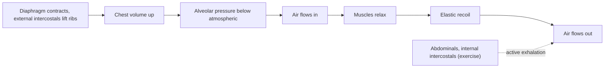

# Mechanics of breathing

## Summary

Breathing works by changing the volume of the chest. Inhalation is active: the diaphragm contracts and flattens, and the external intercostal muscles lift the ribs, so the chest enlarges, pressure in the lungs falls below atmospheric pressure and air flows in. Exhalation at rest is passive: the elastic lungs and chest wall recoil. During exercise, exhalation becomes active with the abdominal and internal intercostal muscles. The diaphragm also contributes to trunk stability.

## Prerequisites

- [Respiratory system](respiratory-system.md)
- [Diaphragm](../../anatomy/muscular-system/trunk/diaphragm.md)

## Core concepts

### Definition

*Pulmonary ventilation* is the movement of air between the atmosphere and the alveoli. It follows *Boyle's law*: at constant temperature, the pressure of a gas is inversely proportional to its volume. Air flows from higher to lower pressure.

### Analogy

The chest works like a bellows. Pulling the handles apart (contracting the diaphragm and intercostals) enlarges the bellows, lowers the pressure inside and sucks air in. Letting go lets the springy leather (elastic lungs) push air out. The analogy breaks because the lungs are not attached to the chest wall directly but are held to it by a thin film of fluid between the pleural layers, which transmits the pull.

### Mechanism

**Inhalation (active).**

1. The diaphragm contracts and moves down, by about 1.5 cm at rest and up to 7 to 10 cm in deep breaths ([Diaphragm](../../anatomy/muscular-system/trunk/diaphragm.md)).
2. The external intercostals lift the ribs up and out ([Intercostal muscles](../../anatomy/muscular-system/trunk/intercostal-muscles.md)): the upper ribs move like a pump handle, the lower ribs like a bucket handle ([Ribs](../../anatomy/skeletal-system/thorax/ribs.md)).
3. Lung volume rises, alveolar pressure falls by about 1 to 3 mmHg below atmospheric, and air flows in.
4. In deep or labored breathing, accessory muscles join: scalenes, sternocleidomastoid, pectoralis minor.

**Exhalation.**

- At rest, passive: elastic recoil of the lungs and chest wall raises alveolar pressure slightly above atmospheric.
- During exercise, coughing or blowing: active, with the abdominal muscles pushing the diaphragm up and the internal intercostals pulling the ribs down.

**Breathing and stability.** The diaphragm forms the top of the abdominal cylinder. Contracting it with the abdominal wall and pelvic floor raises intra-abdominal pressure, which stiffens the trunk. In heavy lifting, people briefly hold their breath to maximize this (Valsalva maneuver), see [Breathing techniques in training](breathing-techniques.md).

The diagram shows the sequence of a breath.

### Ventilation in exercise

Minute ventilation rises from about 6 to 8 L per minute at rest to 100 L or more in trained adults and over 150 to 200 L in large elite endurance athletes. At moderate intensity, depth rises first; at high intensity, rate rises too, up to 40 to 60 breaths per minute.

## Worked example

A person with a broken rib breathes shallowly to avoid pain. Each breath drops from 500 to 300 ml, and with 150 ml of dead space, alveolar ventilation per breath halves. If the rate does not rise enough, carbon dioxide accumulates and parts of the lung collapse, which raises the risk of pneumonia. Pain control and breathing exercises after rib fractures aim to keep breaths deep.

## Trade offs and when to use it

- Passive exhalation at rest saves energy; active exhalation increases flow when needed.
- Using the diaphragm for both breathing and bracing means very heavy lifts require brief breath holds.

## Common mistakes

- **Breathing mostly with the upper chest and neck muscles at rest.** This uses accessory muscles unnecessarily and can increase tension; diaphragmatic breathing is the efficient default.
- **Thinking exhalation is always active.** At rest it is passive.

## Practice

1. Which law explains air flow into the lungs?
2. Which muscles assist forced exhalation?
3. Why does a person with weak abdominal muscles cough weakly?

### Answers

1. Boyle's law: pressure falls as volume rises.
2. The abdominal muscles and internal intercostals.
3. Forceful coughing needs active exhalation by the abdominal muscles.

## Further reading

- Betts, J. G., Young, K. A., Wise, J. A. et al. (2022). *Anatomy and Physiology 2e*. OpenStax, Rice University. [Link](https://openstax.org/details/books/anatomy-and-physiology-2e). Section 22.3 on the process of breathing.
- Kenney, W. L., Wilmore, J. H., Costill, D. L. (2020). *Physiology of Sport and Exercise (7th ed.)*. Human Kinetics. Ventilation during exercise.
