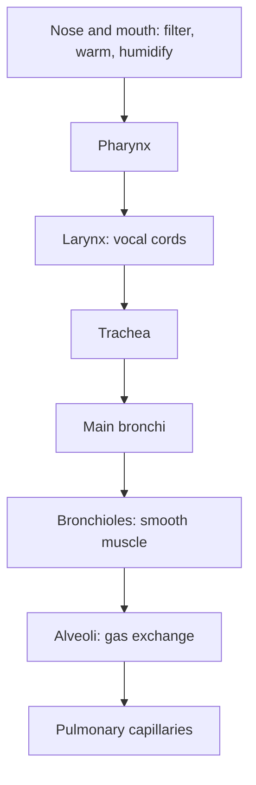

# Respiratory system

## Summary

The respiratory system brings air from the nose and mouth through branching airways to about 300 to 500 million alveoli, tiny air sacs where oxygen enters the blood and carbon dioxide leaves it. The upper airways warm, humidify and filter the air; the lower airways conduct it; the alveoli exchange gases across a membrane thinner than a cell. The lungs are moved by the diaphragm and chest wall, not by muscle of their own.

## Prerequisites

- [Directional terms](../../anatomy/anatomical-terminology/directional-terms.md)

## Core concepts

### Definition

The *respiratory system* comprises the airways (nose, pharynx, larynx, trachea, bronchi and bronchioles), the lungs with their alveoli, the pleura, and the muscles of breathing. Its *conducting zone* moves air without gas exchange; its *respiratory zone* (respiratory bronchioles, alveolar ducts and alveoli) exchanges gases.

### Analogy

The respiratory system is like an upside-down tree. The trunk is the trachea, the big branches are the bronchi, the twigs are the bronchioles, and the leaves are the alveoli, where the real work of exchange happens. Spread out, the "leaves" would cover roughly 50 to 100 square meters, about half a tennis court. The analogy breaks because air flows in and out along the same branches, so some air in the trunk and branches never reaches the leaves (dead space).

### Mechanism

**Upper airway.** The nose filters particles with hairs and mucus, warms and humidifies air over the conchae ([Inferior nasal concha](../../anatomy/skeletal-system/skull/inferior-nasal-concha.md)), and produces nitric oxide. The pharynx is shared with the digestive tract; the larynx contains the vocal cords and closes during swallowing.

**Lower airway.** The trachea divides into the two main bronchi at about the level of T4 to T5. The airways divide about 23 times. Cartilage rings keep the larger airways open; smaller bronchioles have smooth muscle that can narrow them, as in asthma. Cilia and mucus move trapped particles upward (the mucociliary escalator).

**Alveoli.** Alveolar walls consist of thin type I cells for gas exchange and type II cells that produce *surfactant*, which reduces surface tension so alveoli do not collapse. The blood-air barrier is about 0.5 µm thick.

**Volumes.** At rest an adult breathes about 0.5 L per breath (tidal volume), 12 to 16 times a minute, about 6 to 8 L per minute. Of each breath, about 150 ml stays in the conducting airways (anatomical dead space). Vital capacity, the largest breath that can be exhaled after the deepest inhalation, is typically 3 to 5 L.

The diagram shows the path of air.

## Worked example

Why does fast, shallow breathing waste air? At 30 breaths per minute with 250 ml each, minute ventilation is 7.5 L, but 150 ml of every breath is dead space, so only 100 ml × 30 = 3.0 L reaches the alveoli. At 10 breaths of 750 ml, ventilation is the same 7.5 L, but alveolar ventilation is 600 ml × 10 = 6.0 L, twice as much. This is one reason slow, deeper breathing is more efficient at rest.

## Trade offs and when to use it

- A huge surface and thin barrier allow fast exchange but also let pollutants, allergens and infections reach the blood easily.
- Nose breathing conditions air better; mouth breathing allows higher flow during hard exercise.

## Common mistakes

- **Thinking the lungs pull air in by themselves.** The diaphragm and chest wall do the work.
- **Thinking all inhaled air reaches the alveoli.** Dead space air does not.

## Practice

1. What does surfactant do?
2. Where does gas exchange take place?
3. Calculate alveolar ventilation for 12 breaths of 500 ml with 150 ml dead space.

### Answers

1. It lowers surface tension so alveoli do not collapse.
2. In the respiratory zone, mainly the alveoli.
3. (500 − 150) × 12 = 4.2 L per minute.

## Further reading

- Betts, J. G., Young, K. A., Wise, J. A. et al. (2022). *Anatomy and Physiology 2e*. OpenStax, Rice University. [Link](https://openstax.org/details/books/anatomy-and-physiology-2e). Chapter 22 on the respiratory system.
- Kenney, W. L., Wilmore, J. H., Costill, D. L. (2020). *Physiology of Sport and Exercise (7th ed.)*. Human Kinetics. Pulmonary ventilation during exercise.
