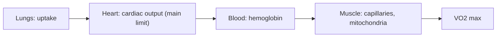
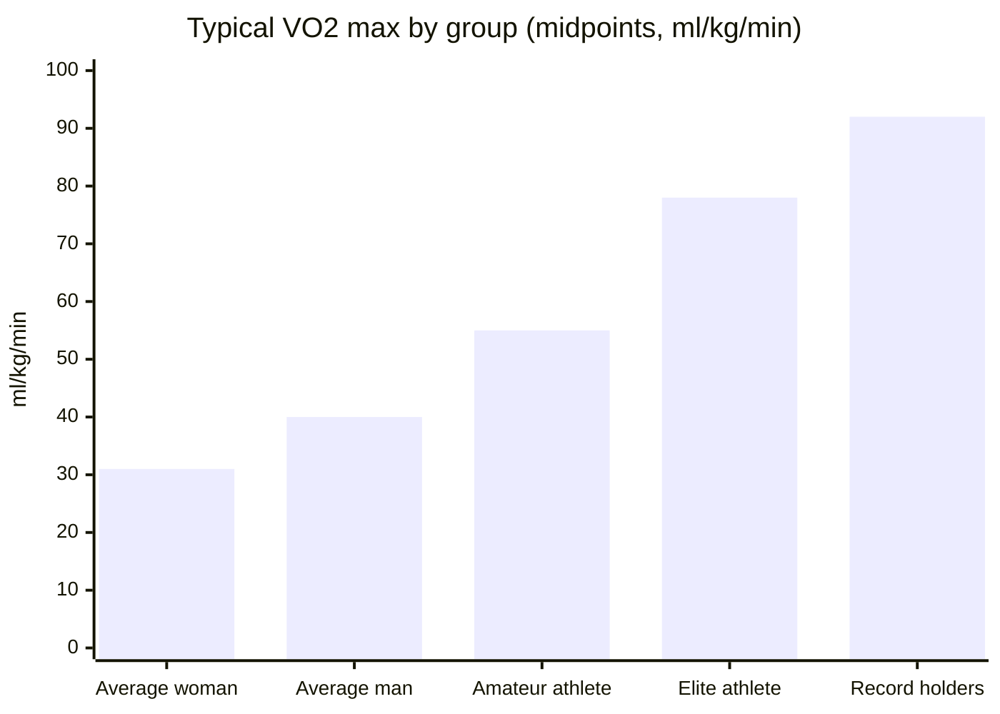

# VO2 max

## Summary

VO2 max (maximal oxygen uptake) is the largest amount of oxygen the body can take up, transport and use during intense exercise, expressed in milliliters of oxygen per kilogram of body mass per minute (ml/kg/min). It is the gold standard measure of aerobic fitness and a strong predictor of health: low VO2 max is associated with higher cardiovascular and all-cause mortality. It depends on the whole oxygen delivery chain, especially the heart's output. Genetics, age and sex set the range; training raises it by roughly 15 to 30 percent in previously untrained people.

## Prerequisites

- [Gas exchange and oxygen transport](gas-exchange.md)
- [Energy systems](../energy-systems.md)

## Core concepts

### Definition

*VO2 max* is the maximal rate of oxygen consumption reached during exhaustive exercise involving large muscle groups, when oxygen uptake no longer rises despite increasing workload. It is expressed in absolute terms (L/min) or relative to body mass (ml/kg/min). By the Fick equation:

VO2 = cardiac output × (arterial oxygen content − venous oxygen content)

so VO2 max = maximal oxygen delivery × maximal oxygen extraction.

### Analogy

VO2 max is like the maximum output of a power plant. It depends on how much fuel (oxygen) the supply lines can bring (lungs, heart, blood) and how much the furnaces can burn (mitochondria). In healthy people, the supply line, mainly the pump (heart), is the bottleneck. The analogy breaks because the plant's ceiling is not the same as how much power can be sustained for an hour, which depends on other factors (see [Lactate threshold](lactate-threshold.md)).

### Mechanism

**The oxygen delivery chain.**

1. Respiratory system: uptake of oxygen into the lungs.
2. Cardiovascular system: the heart's pumping capacity (cardiac output = heart rate × stroke volume).
3. Blood: oxygen transport by hemoglobin.
4. Muscle: mitochondria use oxygen to make ATP; capillary density supports extraction.

In healthy trained people, maximal cardiac output, especially stroke volume, is the main limit (Bassett and Howley, 2000).

The diagram shows the chain and its main limit.

### Typical values

| Group | VO2 max (ml/kg/min) |
| --- | --- |
| Average man | 35 to 45 |
| Average woman | 27 to 35 |
| Amateur endurance athlete | 50 to 60 |
| Elite runners and cyclists | 70 to 85 |
| Highest recorded values | 90 or more |

These are approximate values for young to middle-aged adults; norms differ by age.

### Factors that influence VO2 max

- **Genetics**: estimates of heritability are about 40 to 60 percent for baseline VO2 max; the response to training also varies widely (HERITAGE Family Study).
- **Age**: VO2 max declines by about 1 percent per year after about age 30 without training (roughly 10 percent per decade); training slows the decline.
- **Sex**: men have higher values on average because of more muscle mass, higher hemoglobin and larger hearts.
- **Body composition**: extra fat mass lowers the value per kilogram.
- **Training**: regular endurance training can raise VO2 max by about 15 to 30 percent.

### Measurement

- **Laboratory (gold standard)**: an incremental test on a treadmill or cycle ergometer with breath-by-breath gas analysis (spiroergometry).
- **Field tests**: the Cooper test (distance in 12 minutes of running), the 20 m shuttle run (beep test), the Rockport walking test (1.6 km).
- **Wearables**: smartwatches estimate VO2 max from heart rate and pace; errors of about 5 to 10 percent are common, but trends over time are useful.

### Improving VO2 max

- **High-intensity intervals**: at about 90 to 100 percent of maximal heart rate (or at velocity at VO2 max), for example 4 × 4 minutes hard with 3 minutes of easy jogging. In a 2007 trial (Helgerud and colleagues), this protocol raised VO2 max more than moderate continuous training.
- **Aerobic endurance training**: longer efforts at about 60 to 75 percent of maximal heart rate build the aerobic base (more mitochondria and capillaries).
- **Strength training**: improves movement economy and stability, which helps performance, but does little for VO2 max itself.
- **Altitude training**: hypoxia stimulates red blood cell and hemoglobin production. "Live high, train low" designs show benefits in some studies.
- **Respiratory muscle training**: may improve breathing economy; effects on VO2 max are small or absent.

### VO2 max in coaching

Training zones are sometimes set as percentages of VO2 max: recovery 50 to 60 percent, aerobic endurance 60 to 75 percent, threshold 80 to 90 percent, maximal above 90 percent. A rising VO2 max shows cardiorespiratory adaptation. In amateurs, improving running economy or breathing technique often brings more than chasing VO2 max, which has a genetic ceiling.

### Limits of VO2 max as a predictor

VO2 max is not the only determinant of performance. The lactate threshold, running economy or cycling efficiency, mental factors and tactics also decide results. Two athletes with the same VO2 max can perform very differently.

## Worked example

A 30-year-old man runs 2,600 m in the Cooper 12-minute test. The Cooper formula estimates VO2 max ≈ (distance in m − 504.9) ÷ 44.73 = (2,600 − 504.9) ÷ 44.73 ≈ 46.8 ml/kg/min, above average for his age. A meta-analysis (Kodama and colleagues, 2009) found that each 1 MET higher fitness (3.5 ml/kg/min) was associated with about 13 percent lower all-cause mortality.

## Trade offs and when to use it

- Laboratory tests are accurate but expensive and exhausting; field tests and watches are convenient but less precise.
- VO2 max is a strong health marker, but for race performance the lactate threshold and economy often matter more.

## Common mistakes

- **Comparing watch estimates between people as if they were lab values.** Use them for personal trends.
- **Expecting unlimited improvement.** Gains slow after the first months, and the ceiling is partly genetic.

## Practice

1. Write the Fick equation for oxygen uptake.
2. What usually limits VO2 max in healthy trained people?
3. Estimate VO2 max from 2,200 m in the Cooper test.

### Answers

1. VO2 = cardiac output × (arterial minus venous oxygen content).
2. Maximal cardiac output, especially stroke volume.
3. (2,200 − 504.9) ÷ 44.73 ≈ 37.9 ml/kg/min.

## Further reading

- Bassett, D. R., Howley, E. T. (2000). Limiting factors for maximum oxygen uptake and determinants of endurance performance. Medicine and Science in Sports and Exercise, 32(1), 70-84. [DOI](https://doi.org/10.1097/00005768-200001000-00012). Review of the limiting factors of VO2 max.
- Helgerud, J., Høydal, K., Wang, E. et al. (2007). Aerobic high-intensity intervals improve VO2max more than moderate training. Medicine and Science in Sports and Exercise, 39(4), 665-671. [DOI](https://doi.org/10.1249/mss.0b013e3180304570). Trial of 4 × 4 intervals versus moderate training.
- Kodama, S., Saito, K., Tanaka, S. et al. (2009). Cardiorespiratory fitness as a quantitative predictor of all-cause mortality and cardiovascular events in healthy men and women: a meta-analysis. JAMA, 301(19), 2024-2035. [DOI](https://doi.org/10.1001/jama.2009.681). Meta-analysis of fitness and mortality.
- Bouchard, C., An, P., Rice, T. et al. (1999). Familial aggregation of VO2max response to exercise training: results from the HERITAGE Family Study. Journal of Applied Physiology, 87(3), 1003-1008. [DOI](https://doi.org/10.1152/jappl.1999.87.3.1003). HERITAGE study on the heritability of training response.
