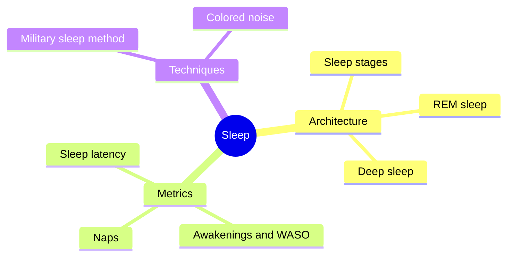

# Sleep

Sleep is an active, regulated state in which the brain cycles through distinct stages that support memory, tissue repair, hormone release and clearance of waste from the brain. This subfield explains sleep architecture, the metrics used by sleep trackers and clinicians, and techniques for falling asleep.

## Map

Related measures recorded during sleep, resting heart rate and heart rate variability, are in [Cardiovascular](../cardiovascular/README.md).

## Reading order

1. [Sleep architecture](sleep-architecture.md): stages, cycles and how much sleep adults need.
2. [REM sleep](rem-sleep.md)
3. [Deep sleep](deep-sleep.md)
4. [Sleep latency](sleep-latency.md)
5. [Night awakenings and wake after sleep onset](awakenings-and-waso.md)
6. [Naps](naps.md)
7. [Military sleep method](military-sleep-method.md)
8. [White, pink and brown noise](colored-noise.md)

## Scope and evidence

Sleep stage percentages from consumer wearables are estimates; laboratory polysomnography is the reference. The notes say where a technique has trial evidence and where it rests on experience or plausibility.
