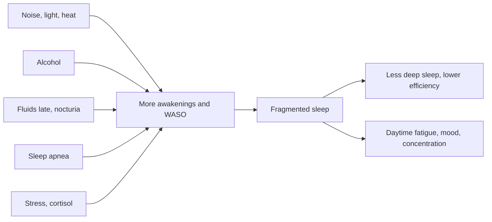

# Night awakenings and wake after sleep onset

## Summary

Brief awakenings during the night are normal, but frequent or long ones fragment sleep. The number of awakenings counts full awakenings longer than about one minute; zero to one is usually considered normal, and more than two or three may point to stress, sleep apnea, an irregular rhythm or hormonal factors. Wake after sleep onset (WASO), the total time spent awake after first falling asleep, is usually under 20 to 30 minutes in healthy adults.

## Prerequisites

- [Sleep architecture](sleep-architecture.md)

## Core concepts

### Definition

The *number of awakenings* counts episodes of wakefulness during the sleep period, usually those lasting more than one minute. *Wake after sleep onset* (WASO) is the sum of all wake time between falling asleep and final awakening. *Sleep efficiency* is total sleep time divided by time in bed, typically 85 percent or more in good sleepers.

### Analogy

Night awakenings are like interruptions during a long film. One or two short pauses do not spoil it, but frequent interruptions break the story, even if the total viewing time is the same. The analogy breaks because many brief awakenings are not remembered, so people can underestimate how fragmented their sleep is.

### Mechanism

Awakenings cluster at transitions between cycles. Common causes are noise, light, heat, a full bladder (nocturia), pain, alcohol wearing off, breathing pauses in obstructive sleep apnea, stress hormones such as cortisol, and in older age lighter, more fragmented sleep.

The diagram shows causes and effects.

### Norms

| Measure | Typical healthy value |
| --- | --- |
| Awakenings over 1 minute | 0 to 1 |
| WASO | Under 20 to 30 minutes |
| Sleep efficiency | 85 percent or more |

### Effects

Frequent awakenings and high WASO lower sleep quality, especially deep sleep, reduce sleep efficiency and recovery, and cause fatigue despite enough time in bed, as well as mood changes and poorer concentration.

### Reducing awakenings

- Improve sleep comfort: mattress, pillow, noise and temperature (a cool room of about 16 to 19 °C suits many people).
- Limit fluids in the evening to reduce nocturia.
- Reduce alcohol.
- Reduce light at night, for example with blackout curtains.
- Keep a consistent pre-sleep routine.
- Melatonin is sometimes suggested short term; it helps mainly with timing problems rather than awakenings.
- Loud snoring with pauses in breathing or daytime sleepiness should be checked for sleep apnea.

## Worked example

A person spends 8 hours in bed, falls asleep after 15 minutes and is awake for 50 minutes during the night in four episodes. Total sleep is 480 − 15 − 50 = 415 minutes; sleep efficiency is 415 ÷ 480 ≈ 86 percent, but WASO of 50 minutes and four awakenings indicate fragmented sleep. Cutting evening alcohol and late drinks reduces WASO to 20 minutes, raising efficiency to about 93 percent.

## Trade offs and when to use it

- Some awakenings are normal and increase with age. Worry about awakenings can itself worsen sleep.

## Common mistakes

- **Checking the clock at every awakening.** It increases arousal; turn the clock away.
- **Ignoring snoring with breathing pauses.** Sleep apnea is common and treatable.

## Practice

1. What is WASO?
2. How is sleep efficiency calculated?
3. Name three causes of frequent awakenings.

### Answers

1. Wake after sleep onset: total time awake after first falling asleep.
2. Total sleep time divided by time in bed.
3. Alcohol, nocturia and sleep apnea (also noise, light, heat, stress).

## Further reading

- Ohayon, M. M., Carskadon, M. A., Guilleminault, C. et al. (2004). Meta-analysis of quantitative sleep parameters from childhood to old age in healthy individuals. Sleep, 27(7), 1255-1273. [DOI](https://doi.org/10.1093/sleep/27.7.1255). Normal values for WASO and sleep efficiency.
- Qaseem, A., Kansagara, D., Forciea, M. A. et al. (2016). Management of chronic insomnia disorder in adults: a clinical practice guideline from the American College of Physicians. Annals of Internal Medicine, 165(2), 125-133. [DOI](https://doi.org/10.7326/M15-2175). Insomnia management guideline.
