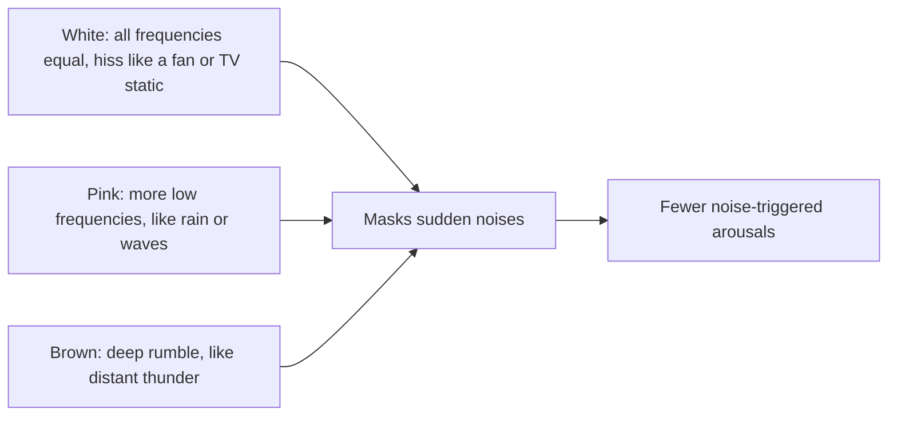

# White, pink and brown noise

## Summary

"White noise" is used loosely for steady background sounds that help some people sleep by masking disturbing noises. Strictly, white noise contains all audible frequencies at roughly equal power, like a detuned TV or a fan; pink noise has more power in lower frequencies and sounds more natural, like rain or waves; brown noise is deeper still, like distant thunder or heavy rain. A 2021 systematic review found the evidence that continuous noise improves sleep to be of very low quality.

## Prerequisites

- [Night awakenings and wake after sleep onset](awakenings-and-waso.md)

## Core concepts

### Definition

*White noise* has equal power per unit of frequency across the audible range. *Pink noise* has power that falls by half per octave (1/f), so each octave carries equal energy and it sounds balanced to the ear. *Brown (red) noise* falls faster (1/f²), emphasizing low frequencies. Many recordings sold as "white noise" are pink or brown noise or mixtures with nature sounds.

### Analogy

Background noise works like fog for sounds. A sudden noise in a quiet room stands out like a lighthouse on a clear night; in fog (steady noise), the same light is much less noticeable. The analogy breaks because the fog itself is a sound, which some people find disturbing.

### Mechanism

The brain responds most to *changes* in sound. Steady noise raises the background level, so the difference between background and a sudden noise (a car, a door) is smaller, and the sudden noise is less likely to cause an arousal. Some small studies played pink noise in time with slow waves and reported enhanced deep sleep and memory, an approach called closed-loop acoustic stimulation.

The diagram compares the noise colors.

### Evidence and cautions

- Riedy and colleagues (2021) reviewed 38 studies and judged the evidence that continuous noise improves sleep to be of very low quality; some studies found benefits, others none or harm.
- Loud noise all night may affect hearing and sleep; keeping the volume moderate (well below 50 to 60 dB at the ear, guidance for infants is lower) is advised.
- For infants, machines placed close to the crib can exceed safe levels.

## Worked example

A person living on a busy street is woken by passing trucks at 55 to 65 dB. A fan or noise machine providing a steady 45 dB background reduces the jump from background to peak from about 25 dB (in a 35 dB quiet room) to about 15 dB, which may reduce awakenings. Earplugs or moving the bedroom to the quiet side of the building address the source more directly.

## Trade offs and when to use it

- Cheap and harmless at moderate volume, useful in noisy environments, but not a treatment for insomnia.

## Common mistakes

- **Playing noise very loudly.** Keep it moderate.
- **Expecting noise to fix poor sleep habits.** It only masks disturbances.

## Practice

1. How does pink noise differ from white noise?
2. How does steady noise help with sleep?
3. How strong is the evidence that continuous noise improves sleep?

### Answers

1. Pink noise has more power in the lower frequencies; white noise has equal power across frequencies.
2. It raises the background level so sudden noises stand out less and cause fewer arousals.
3. Very low quality according to a 2021 systematic review.

## Further reading

- Riedy, S. M., Smith, M. G., Rocha, S. et al. (2021). Noise as a sleep aid: a systematic review. Sleep Medicine Reviews, 55, 101385. [DOI](https://doi.org/10.1016/j.smrv.2020.101385). Systematic review of noise as a sleep aid.
