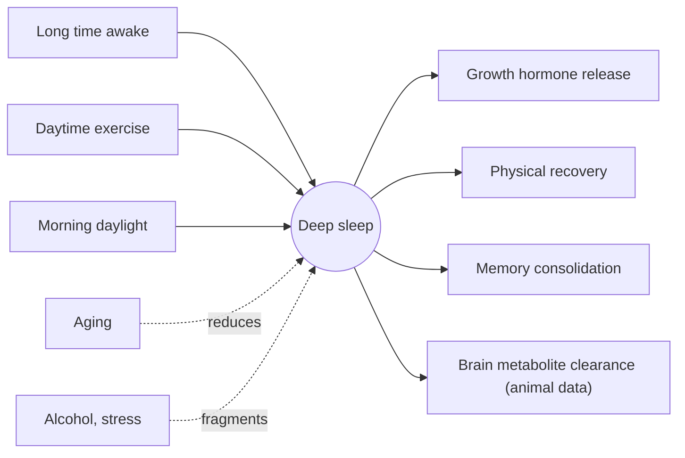

# Deep sleep

## Summary

Deep sleep, also called slow-wave sleep or NREM stage 3, is the stage with the slowest brain waves and the highest threshold for waking. It makes up about 13 to 23 percent of adult sleep (roughly 60 to 110 minutes), mostly in the first half of the night. It is important for physical recovery, growth hormone release, memory consolidation and, according to animal research, the clearance of waste products from the brain. It declines with age.

## Prerequisites

- [Sleep architecture](sleep-architecture.md)

## Core concepts

### Definition

*Deep sleep* (N3, slow-wave sleep) is the non-REM sleep stage in which at least 20 percent of a 30-second epoch consists of high-amplitude delta waves (0.5 to 2 Hz) on EEG.

### Analogy

Deep sleep is like the night shift of a city's maintenance crews. While traffic is lowest, crews repair roads (tissues), deliver supplies (growth hormone) and clear garbage (brain metabolites). Waking the city during this shift is hard and leaves people groggy. The analogy breaks because the brain's "garbage collection" has been shown convincingly in mice, and its extent in humans is still being studied.

### Mechanism

- Large populations of neurons fire in synchrony, producing slow waves.
- The first deep sleep period after falling asleep is accompanied by the largest pulse of growth hormone.
- In mice, the space between brain cells expands during sleep and cerebrospinal fluid flow clears metabolites such as beta-amyloid more effectively, through what is called the glymphatic system (Xie and colleagues, 2013).
- Sleep pressure (time awake, physical activity) increases subsequent deep sleep.

The diagram shows influences on deep sleep and its functions.

### Normal values and deficiency

About 13 to 23 percent of total sleep in adults (roughly 60 to 110 minutes), declining with age. Reduced deep sleep is associated in observational studies with higher dementia risk, weaker immunity and hormonal disturbances; cause and effect are not settled.

### Increasing deep sleep

- Morning daylight exposure to strengthen the circadian rhythm.
- Physical activity, preferably finished by late afternoon (about 16:00 to 17:00) for those whose sleep is disturbed by evening exercise.
- Stress reduction.
- Supplements suggested include magnesium, glycine and theanine. Evidence: glycine and theanine have small trials on subjective sleep quality, magnesium has weak evidence except in deficiency, and none has been shown to reliably increase deep sleep measured by EEG (see [Glycine](../../../../natural-sciences/chemistry/biochemistry/amino-acids/glycine.md), [Theanine](../../../../natural-sciences/chemistry/biochemistry/amino-acids/theanine.md), [Magnesium](../../nutrition/minerals/magnesium.md)).

## Worked example

Being woken by an alarm during deep sleep in the first half of the night causes strong grogginess (sleep inertia) that can last 15 to 30 minutes or more. This is why short naps under 20 to 30 minutes, which usually do not reach deep sleep, leave people more alert, while naps of about 45 to 60 minutes often end in deep sleep and leave people groggy (see [Naps](naps.md)).

## Trade offs and when to use it

- Deep sleep is regulated mostly by sleep pressure and age; attempts to "boost" it with supplements or gadgets show little effect in healthy people.

## Common mistakes

- **Exercising intensely right before bed if it delays sleep.** Many people tolerate evening exercise well; those who do not should move it earlier.
- **Assuming tracker deep sleep values are exact.** Wearables estimate them indirectly.

## Practice

1. What share of adult sleep is deep sleep?
2. Which hormone is released mainly during the first deep sleep period?
3. What is the glymphatic system?

### Answers

1. About 13 to 23 percent.
2. Growth hormone.
3. A proposed system by which cerebrospinal fluid flow clears waste from the brain, more active during sleep in mice.

## Further reading

- Xie, L., Kang, H., Xu, Q. et al. (2013). Sleep drives metabolite clearance from the adult brain. Science, 342(6156), 373-377. [DOI](https://doi.org/10.1126/science.1241224). Mouse study on sleep and brain metabolite clearance.
- Ohayon, M. M., Carskadon, M. A., Guilleminault, C. et al. (2004). Meta-analysis of quantitative sleep parameters from childhood to old age in healthy individuals. Sleep, 27(7), 1255-1273. [DOI](https://doi.org/10.1093/sleep/27.7.1255). Normal values of slow-wave sleep across age.
