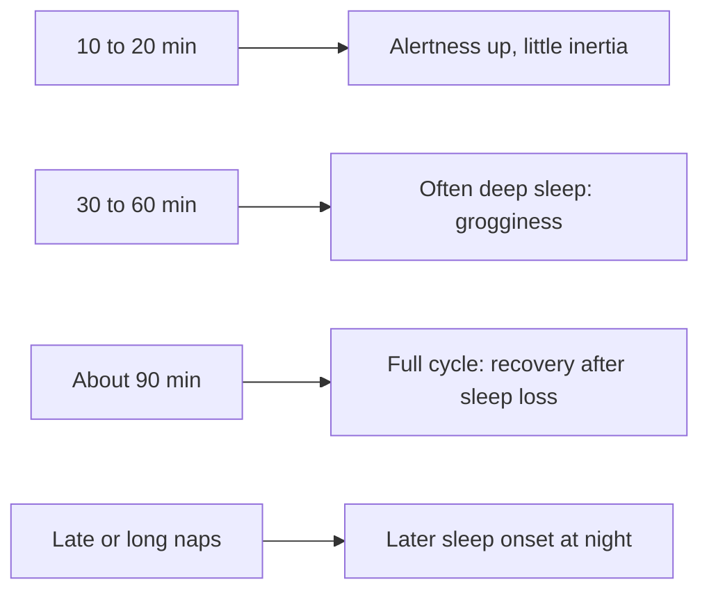

# Naps

## Summary

Healthy adults do not need naps, but a short nap of 10 to 20 minutes can improve alertness and memory without grogginess. A 90-minute nap covers a full sleep cycle and can help after sleep loss. Naps of 30 to 60 minutes often end in deep sleep, causing sleep inertia. Many or long naps, or naps late in the day, can disturb the circadian rhythm and night sleep. A practical rule is at most one nap a day, ending at least 6 to 7 hours before bedtime.

## Prerequisites

- [Sleep architecture](sleep-architecture.md)

## Core concepts

### Definition

A *nap* is a short sleep period during the day. *Sleep inertia* is the grogginess and impaired performance after waking, strongest when waking from deep sleep.

### Analogy

A nap is like a pit stop in a race. A quick stop for fuel (10 to 20 minutes) gets you back on track fast. A full service (90 minutes) restores more but costs time. Stopping long enough to start dismantling the engine (deep sleep) without finishing leaves you worse off when you rush back out. The analogy breaks because the "pit stop" also reduces the sleep pressure needed for good night sleep.

### Mechanism

During a short nap, a person usually stays in N1 and N2. After about 20 to 30 minutes, deep sleep becomes likely, and waking from it causes inertia. A full cycle of about 90 minutes ends near REM or light sleep, so waking is easier. Napping reduces adenosine sleep pressure, which can lengthen sleep latency at night if the nap is late or long.

The diagram matches nap length to effect.

### Recommendations

- At most one nap a day.
- No later than about 6 to 7 hours before night sleep.
- Ideal length 10 to 20 minutes for alertness; 90 minutes when a full recovery is needed.
- Avoid naps of 30 to 60 minutes if grogginess is a problem.
- A quiet, dark place; an eye mask and earplugs help.

## Worked example

In a laboratory study (Brooks and Lack, 2006) after a short night, a 10-minute nap improved alertness and performance immediately and for about 2.5 hours, while a 30-minute nap first caused grogginess before benefits appeared. A 5-minute nap had little effect. Combining a coffee just before a 15 to 20 minute nap ("caffeine nap") is a practical strategy, since caffeine takes about 20 to 30 minutes to act.

## Trade offs and when to use it

- Short naps help shift workers and people with short nights; people with insomnia are usually advised to avoid daytime naps.
- In observational studies, frequent long daytime napping in older adults is associated with worse health, probably reflecting underlying conditions.

## Common mistakes

- **Napping late in the evening.** It delays night sleep.
- **Setting no alarm for a short nap.** It can run into deep sleep.

## Practice

1. What nap length improves alertness without grogginess?
2. Why do 45-minute naps often cause grogginess?
3. Why might people with insomnia avoid naps?

### Answers

1. About 10 to 20 minutes.
2. They often end during deep sleep, causing sleep inertia.
3. Naps reduce the sleep pressure needed to fall asleep at night.

## Further reading

- Brooks, A., Lack, L. (2006). A brief afternoon nap following nocturnal sleep restriction: which nap duration is most recuperative?. Sleep, 29(6), 831-840. [DOI](https://doi.org/10.1093/sleep/29.6.831). Laboratory comparison of nap durations.
