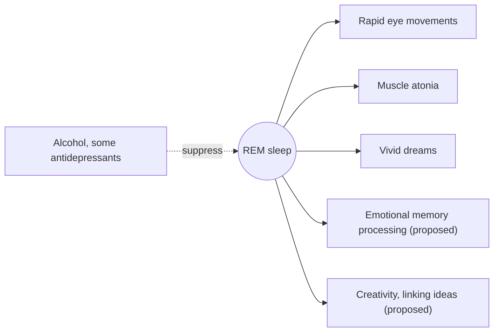

# REM sleep

## Summary

REM (rapid eye movement) sleep is the stage associated with vivid dreams. The brain is highly active, the eyes move rapidly and most skeletal muscles are paralyzed. REM makes up about 20 to 25 percent of sleep, roughly 90 to 120 minutes a night, mostly in the second half. It is thought to support emotional memory processing, creativity and the consolidation of information. Alcohol and some medicines suppress it.

## Prerequisites

- [Sleep architecture](sleep-architecture.md)

## Core concepts

### Definition

*REM sleep* is a sleep stage characterized by rapid eye movements, low-amplitude mixed-frequency brain waves similar to wakefulness, and loss of muscle tone (atonia), except in the eye muscles and diaphragm. It was described in 1953 by Aserinsky and Kleitman.

### Analogy

REM sleep is like a film editing room working at night. The brain replays and reorganizes the day's material, cuts emotional scenes into a calmer version and links new clips to the archive. The muscles are locked so the "actor" does not act out the scenes. The analogy breaks because researchers still debate exactly what REM accomplishes; much of the editing picture is a hypothesis.

### Mechanism

- REM periods lengthen over the night, from about 10 minutes in the first cycle to 30 to 60 minutes near morning.
- Brainstem circuits block motor neurons, producing atonia. When this fails, people act out dreams (REM sleep behavior disorder).
- Activity in the amygdala and hippocampus is high, while noradrenaline is low, which is proposed to allow emotional memories to be processed with less emotional charge.

The diagram summarizes REM features and functions.

### Share and deficiency

REM takes about 20 to 25 percent of total sleep, about 90 to 120 minutes in a night of 7 to 8 hours. Reduced REM is associated with memory problems, poorer emotional processing and greater emotional reactivity (an imbalance between hippocampus and amygdala is proposed).

### Increasing REM

Lengthening total sleep (because REM is concentrated in the second half of the night), limiting alcohol and medicines that suppress REM, and improving overall sleep quality.

## Worked example

A person who sleeps from midnight to 6:00 instead of midnight to 8:00 loses 25 percent of total sleep but a larger share of REM, because the last two hours are REM-rich. Over a week, this can amount to several hours of lost REM, which may contribute to irritability and poorer emotional regulation reported after short nights.

## Trade offs and when to use it

- Most people need not target REM directly; getting enough regular sleep and limiting alcohol protects it.

## Common mistakes

- **Drinking alcohol to sleep better.** It speeds falling asleep but suppresses REM and fragments the second half of the night.
- **Waking early daily with an alarm and catching up on weekends.** This repeatedly cuts REM.

## Practice

1. What fraction of sleep is REM in adults?
2. Why does cutting sleep short in the morning remove a lot of REM?
3. What prevents us from acting out dreams?

### Answers

1. About 20 to 25 percent.
2. REM periods are longest in the last cycles of the night.
3. Muscle atonia produced by brainstem circuits.

## Further reading

- Ohayon, M. M., Carskadon, M. A., Guilleminault, C. et al. (2004). Meta-analysis of quantitative sleep parameters from childhood to old age in healthy individuals. Sleep, 27(7), 1255-1273. [DOI](https://doi.org/10.1093/sleep/27.7.1255). Normal values of REM across age.
- Berry, R. B. et al. (2020). *The AASM Manual for the Scoring of Sleep and Associated Events (version 2.6)*. American Academy of Sleep Medicine. Definition and scoring of REM.
