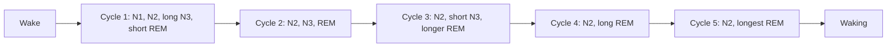

# Sleep architecture

## Summary

Sleep consists of cycles of about 90 minutes, repeated four to six times a night. Each cycle moves through non-REM stages N1 (light), N2 and N3 (deep, slow-wave sleep), followed by REM sleep, in which most vivid dreaming happens. Deep sleep dominates the first half of the night and REM the second half. Adults need about 7 to 9 hours; consistently sleeping less is linked to worse health, mood and performance.

## Prerequisites

- [Chronobiology](../chronobiology.md)

## Core concepts

### Definition

*Sleep architecture* is the structure of sleep: the sequence, duration and proportion of sleep stages across the night. Stages are defined by brain waves (EEG), eye movements and muscle tone in *polysomnography*, scored according to the American Academy of Sleep Medicine manual: wake, N1, N2, N3 and REM.

### Analogy

A night of sleep is like a series of dives in a swimming pool. In each cycle, you descend from the shallow end (N1) to the deep end (N3) and come back up to a special surface zone where you dream (REM). Early dives go deep; later dives stay shallower but spend longer near the surface. The analogy breaks because brief awakenings between cycles are normal and usually forgotten.

### Mechanism

| Stage | Share of sleep (adults) | Features |
| --- | --- | --- |
| N1 | About 5 percent | Transition, slow eye movements, easily woken |
| N2 | About 45 to 55 percent | Sleep spindles and K-complexes, memory consolidation |
| N3 (deep, slow-wave) | About 13 to 23 percent | Delta waves, hardest to wake, growth hormone release |
| REM | About 20 to 25 percent | Rapid eye movements, vivid dreams, muscle paralysis |

Two processes regulate sleep: *sleep pressure* (process S), which builds with time awake as adenosine accumulates (caffeine blocks adenosine receptors), and the *circadian rhythm* (process C), set by the suprachiasmatic nucleus and melatonin ([Chronobiology](../chronobiology.md)).

The diagram shows a typical night as a sequence of cycles.

### How much sleep

The American Academy of Sleep Medicine and the Sleep Research Society recommend at least 7 hours per night for adults (Watson and colleagues, 2015). The National Sleep Foundation recommends 7 to 9 hours for adults aged 18 to 64 and 7 to 8 hours for those over 65 (Hirshkowitz and colleagues, 2015). Total sleep, deep sleep and REM decline with age (Ohayon and colleagues, 2004).

## Worked example

A tracker reports 7 h 20 min of sleep: 25 min N1, 3 h 40 min N2, 1 h 20 min deep and 1 h 55 min REM. As shares: N1 about 6 percent, N2 50 percent, deep 18 percent and REM 26 percent, all within typical ranges. Because wrist devices estimate stages from movement and heart rate, their stage values can be off by 20 percent or more compared with polysomnography; total sleep time is estimated more reliably.

## Trade offs and when to use it

- Sleep staging helps diagnose sleep disorders in the laboratory. For healthy people, regular timing and sufficient total sleep matter more than optimizing stage percentages.

## Common mistakes

- **Treating tracker stage data as precise.** Use it for trends.
- **Thinking all sleep is equal.** Fragmented sleep with many awakenings is less restorative even if total time is the same.

## Practice

1. How long is a typical sleep cycle?
2. Which stage dominates the first half of the night?
3. What two processes regulate sleep?

### Answers

1. About 90 minutes.
2. Deep sleep (N3).
3. Sleep pressure (adenosine) and the circadian rhythm.

## Further reading

- Watson, N. F., Badr, M. S., Belenky, G. et al. (2015). Recommended amount of sleep for a healthy adult: a joint consensus statement of the American Academy of Sleep Medicine and Sleep Research Society. Sleep, 38(6), 843-844. [DOI](https://doi.org/10.5665/sleep.4716). AASM and SRS consensus on adult sleep duration.
- Hirshkowitz, M., Whiton, K., Albert, S. M. et al. (2015). National Sleep Foundation's sleep time duration recommendations: methodology and results summary. Sleep Health, 1(1), 40-43. [DOI](https://doi.org/10.1016/j.sleh.2014.12.010). National Sleep Foundation duration recommendations.
- Ohayon, M. M., Carskadon, M. A., Guilleminault, C. et al. (2004). Meta-analysis of quantitative sleep parameters from childhood to old age in healthy individuals. Sleep, 27(7), 1255-1273. [DOI](https://doi.org/10.1093/sleep/27.7.1255). Meta-analysis of sleep parameters across age.
- Berry, R. B. et al. (2020). *The AASM Manual for the Scoring of Sleep and Associated Events (version 2.6)*. American Academy of Sleep Medicine. Scoring rules for sleep stages.
