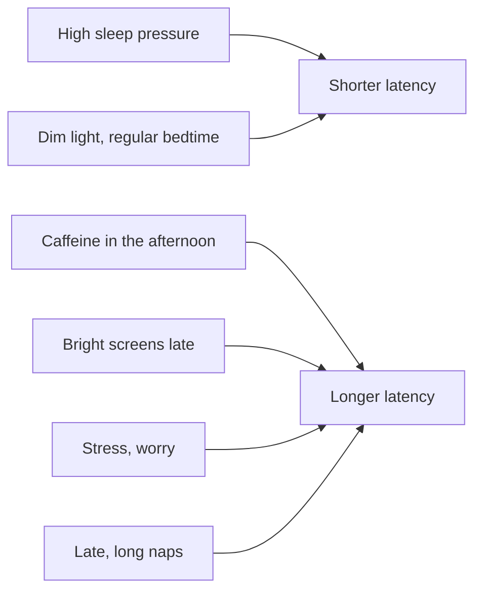

# Sleep latency

## Summary

Sleep latency is the time from going to bed with the intention to sleep to actually falling asleep. In healthy adults it is usually about 5 to 20 minutes. Falling asleep in under 5 minutes often signals sleep deprivation or excessive sleepiness, while regularly taking more than 20 to 30 minutes suggests insomnia, stress, anxiety or poor sleep habits.

## Prerequisites

- [Sleep architecture](sleep-architecture.md)

## Core concepts

### Definition

*Sleep onset latency* (SOL) is the time between lights out and the first epoch of sleep. In the clinic, the *Multiple Sleep Latency Test* measures how quickly a person falls asleep during daytime naps to assess sleepiness.

### Analogy

Sleep latency is like the time a car takes to slow to a stop after you release the accelerator. Too fast means you were nearly out of fuel (sleep debt); too slow means something keeps pressing the pedal (stress, caffeine, light). The analogy breaks because worrying about the time it takes to fall asleep itself lengthens latency.

### Mechanism

Latency depends on sleep pressure (adenosine), circadian timing (melatonin rising in the evening) and arousal (stress hormones, thoughts, light and noise). Caffeine blocks adenosine receptors; its half-life is about 5 hours, longer in some people and in pregnancy.

The diagram shows what shortens and lengthens latency.

### Interpretation

| Latency | Possible meaning |
| --- | --- |
| Under 5 minutes | Sleep deprivation or excessive sleepiness, possible sleep disorder |
| 5 to 20 minutes | Typical |
| Over 20 to 30 minutes regularly | Insomnia, stress, anxiety, poor sleep habits |

### Improving latency

- Fixed bedtime and wake time to stabilize the circadian rhythm.
- Avoiding bright screens (blue light) 1 to 2 hours before bed, or reducing brightness.
- Reducing caffeine and other stimulants in the afternoon.
- Relaxation techniques, for example 4-7-8 breathing (inhale 4 s, hold 7 s, exhale 8 s), meditation or writing down worries.
- If awake for about 20 minutes, getting up and doing something calm in dim light until sleepy (stimulus control, part of cognitive behavioral therapy for insomnia).

## Worked example

A person drinks a coffee with 100 mg of caffeine at 16:00 and goes to bed at 23:00. With a half-life of about 5 hours, roughly 38 mg is still active at bedtime, about the caffeine in a cup of black tea. Their latency is 40 minutes. Moving the last coffee to before 13:00 cuts the bedtime caffeine to about 15 mg and latency improves.

## Trade offs and when to use it

- Short latency is not automatically good; very short latency with daytime sleepiness should be discussed with a doctor.
- Cognitive behavioral therapy for insomnia (CBT-I) is the first-line treatment for chronic insomnia (American College of Physicians, 2016) and outperforms sleeping pills in the long term.

## Common mistakes

- **Staying in bed for hours trying to sleep.** This links the bed with wakefulness; get up after about 20 minutes.
- **Using alcohol to fall asleep.** It shortens latency but disrupts later sleep.

## Practice

1. What is a typical sleep latency in healthy adults?
2. What might a latency of 2 minutes indicate?
3. What does stimulus control advise if you cannot fall asleep?

### Answers

1. About 5 to 20 minutes.
2. Sleep deprivation or excessive sleepiness.
3. Get up after about 20 minutes, do something calm in dim light and return when sleepy.

## Further reading

- Qaseem, A., Kansagara, D., Forciea, M. A. et al. (2016). Management of chronic insomnia disorder in adults: a clinical practice guideline from the American College of Physicians. Annals of Internal Medicine, 165(2), 125-133. [DOI](https://doi.org/10.7326/M15-2175). Guideline recommending CBT-I for chronic insomnia.
- Watson, N. F., Badr, M. S., Belenky, G. et al. (2015). Recommended amount of sleep for a healthy adult: a joint consensus statement of the American Academy of Sleep Medicine and Sleep Research Society. Sleep, 38(6), 843-844. [DOI](https://doi.org/10.5665/sleep.4716). Adult sleep needs.
