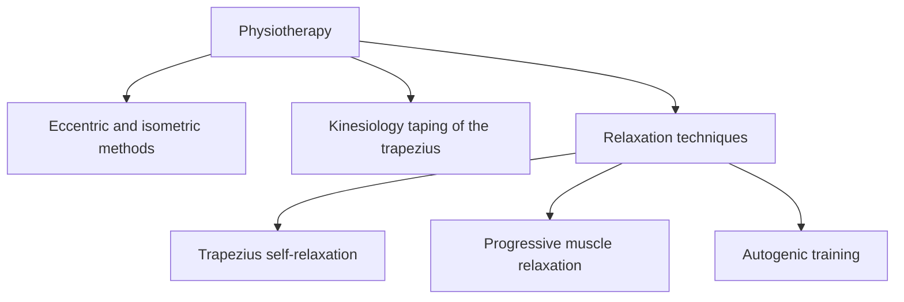

# Physiotherapy

Physiotherapy (physical therapy) uses movement, exercise, manual techniques and physical agents to restore and maintain function. These notes cover methods that use the phases of muscle action (eccentric and isometric training), kinesiology taping of the upper trapezius, and relaxation techniques: trapezius self-relaxation with post-isometric relaxation, Jacobson's progressive muscle relaxation and Schultz's autogenic training. The muscle actions themselves are explained in [Muscle actions: concentric, eccentric and isometric](../exercise-and-fitness/biomechanics/muscle-actions.md).

The notes are educational. Anyone with pain or an injury should be assessed by a physiotherapist or physician.

## Map

## Reading order

1. [Eccentric and isometric methods](eccentric-and-isometric-methods.md)
2. [Kinesiology taping of the upper trapezius](kinesiotaping-trapezius.md)
3. [Relaxation techniques](relaxation-techniques.md)
4. [Trapezius self-relaxation](trapezius-self-relaxation.md)
5. [Progressive muscle relaxation (Jacobson)](progressive-muscle-relaxation.md)
6. [Autogenic training (Schultz)](autogenic-training.md)
