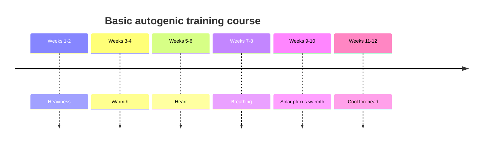

# Autogenic training (Schultz)

## Summary

Autogenic training is a self-relaxation method developed by the German psychiatrist and psychotherapist Johannes Schultz, published in 1932, drawing on methods used in yoga and Zen meditation. A person influences their own nervous system through passive concentration on six formulas: heaviness, warmth, a calm heartbeat, easy breathing, warmth in the solar plexus and a cool forehead. A meta-analysis found medium to large effects on several stress-related conditions.

*This note is educational. It is not medical advice and does not replace a doctor, dietitian or pharmacist, especially during pregnancy, illness or when taking medicines.*

## Prerequisites

No prior notes are needed.

## Core concepts

### Definition

*Autogenic training* is a relaxation method based on repeated self-suggestions ("formulas") that direct attention to bodily sensations, aiming to shift the balance of the autonomic nervous system toward the parasympathetic side. "Autogenic" means generated by oneself.

### Analogy

Autogenic training is like tuning a radio by ear: you do not force the dial, you listen and let the signal come in. Trying hard to relax works against it; passive attention lets relaxation happen. The analogy breaks because the "signal" is produced by your own body.

### Mechanism

**Aim and background.** The goal is to learn to enter a state of passivity and concentration and to influence the body at will. It can be practiced at home as a relaxation method and to prevent the effects of stress. It draws on Eastern techniques but has nothing to do with their philosophy and does not aim at self-knowledge or mystical states. It aims at maximal relaxation and at preventing illnesses linked to strong nervous and muscular tension.

**Autonomic balance.** The basic assumption is restoring balance between the parasympathetic and sympathetic nervous systems. The parasympathetic system controls digestion and gut movement, lowers blood pressure, slows the heart and helps regulate the immune system.

**The six phases.**

1. Heaviness.
2. Warmth.
3. Regulation of the heart.
4. Regulation of easy breathing.
5. Warmth in the solar plexus.
6. Coolness of the forehead.

**How to practice.**

- At first, each phase should take no longer than 5 minutes and the whole session no longer than 30 minutes.
- For the first 2 weeks, practice only heaviness; after 2 weeks, move to the next exercises, repeating them in order. Each group is trained for 2 weeks, 2 to 3 times a day, 3 to 5 minutes per group. Move to the next group when the expected effect appears. The basic course lasts about 12 weeks.
- Take one of four positions: lying, half-lying in an armchair, the "coachman" position (sitting slumped forward with forearms on the thighs) or standing. Do not cross the limbs. A pillow under the head is fine.
- Limit outside stimuli: silence or quiet background music, eyes closed, phone off, slightly darkened, ventilated room at about 20 °C.
- Do not get up suddenly afterward; lie still for a moment.
- Good times: early morning, after lunch, after dinner, just before sleep.
- Say the formulas passively, without force, with a positive attitude. Stay passive and concentrate on sensations and suggestions.
- End the session by cancelling the relaxation with an energetic command: "Arms firm, breathe deeply, open eyes."

**Formulas.**

1. *Heaviness.* Repeat: "My right arm is heavy" (6 times), "I am calm"; "My left arm is heavy" (6 times), "I am calm"; "My right leg is heavy" (6 times), "I am calm"; "My left leg is heavy" (6 times), "I am calm".
2. *Warmth flowing through the body.* "My right arm is completely warm" (6 times), "I am calm"; "My left arm is completely warm" (6 times), "I am calm"; "My right leg is completely warm" (6 times), "I am calm"; "My left leg is completely warm" (6 times), "I am calm".
3. *Warmth in the solar plexus.* "My solar plexus is radiating warmth, I am calm", several times.
4. *Calm heartbeat.* "My heart beats calmly", followed several times by "I am calm".
5. *Easy breathing.* "My breathing is light and calm", several times, then "I am calm".
6. *Cool forehead.* "My forehead is pleasantly cool", several times, then "I am calm".

In Schultz's standard order, the heart and breathing formulas come third and fourth, and the solar plexus fifth; some teaching versions, including the one above, change this order. Either way, the formulas are learned one at a time.

**Intention formulas.** After mastering the basic exercises, a person can add self-suggestions, for example "Smoking cigarettes is indifferent to me", "Alcohol is indifferent to me", "It is indifferent to me whether people pay attention to me", "I can stand my ground", "I am friendly toward people". People can create their own formulas.

The timeline shows the 12-week basic course.

### Claimed effects and evidence

Each entry states the claimed effect and how strong the evidence is, using the grades defined in the [Evidence grades](../nutrition/evidence-grades.md) note.

- **Reduced anxiety and stress symptoms.** A meta-analysis found medium to large effects. Evidence: moderate.
- **Benefits in tension headache, mild hypertension and sleep problems.** Positive results in several trials of variable quality. Evidence: limited.
- **Intention formulas change habits such as smoking.** Little research. Evidence: very limited.

## Worked example

A nurse with work stress practices heaviness formulas twice a day for 2 weeks, lying down after work and before sleep, for 5 minutes. When the heaviness appears quickly, they add warmth. After 12 weeks, they can induce relaxation in 2 to 3 minutes during breaks, and they report fewer stress symptoms.

## Trade offs and when to use it

Autogenic training is safe for most people, but people with severe psychiatric conditions, uncontrolled heart disease or a tendency to dissociation should learn it under supervision.

## Common mistakes

- **Trying to force sensations.** Stay passive; sensations come with practice.
- **Moving on too quickly.** Spend about 2 weeks on each phase.
- **Getting up abruptly.** End with the cancelling command and rise slowly.

## Practice

1. Name the six phases of autogenic training.
2. How long is each phase practiced before moving on?
3. How is a session ended?

### Answers

1. Heaviness, warmth, heart regulation, breathing regulation, solar plexus warmth and cool forehead.
2. About 2 weeks, 2 to 3 times a day.
3. With an energetic command: "Arms firm, breathe deeply, open eyes."

## Further reading

- Schultz, J. H. (1932). *Das autogene Training: konzentrative Selbstentspannung*. Thieme. Original description of autogenic training.
- Stetter, F., Kupper, S. (2002). Autogenic training: a meta-analysis of clinical outcome studies. Applied Psychophysiology and Biofeedback, 27(1), 45-98. [DOI](https://doi.org/10.1023/A:1014584822567). Meta-analysis of autogenic training outcomes.
