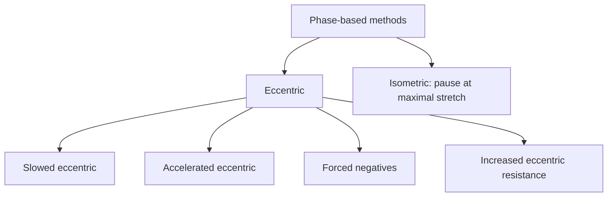

# Eccentric and isometric methods

## Summary

Eccentric and isometric methods use specific phases of muscle action as training tools. Eccentric methods slow down the lowering phase, speed it up, add forced negative repetitions after a set, or increase resistance in the lowering phase. The isometric method adds a pause in the most stretched position. Each phase affects muscle and strength differently: eccentric work produces the most mechanical tension, damage and soreness, and isometric work builds strength mainly at the trained joint angle.

*This note is educational. It is not medical advice and does not replace a doctor, dietitian or pharmacist, especially during pregnancy, illness or when taking medicines.*

## Prerequisites

- [Muscle actions: concentric, eccentric and isometric](../exercise-and-fitness/biomechanics/muscle-actions.md)

## Core concepts

### Definition

*Eccentric methods* are training methods that emphasize the lengthening phase of a muscle action. The *isometric method* uses holds at a constant muscle length. The three muscle actions (concentric, eccentric, isometric) are defined in [Muscle actions: concentric, eccentric and isometric](../exercise-and-fitness/biomechanics/muscle-actions.md).

### Analogy

The phases of a repetition are like the gears of a bicycle. The same ride can be done in different gears, and each gear trains the legs a little differently. The analogy breaks because the phases of a repetition cannot be chosen freely: every lift contains all three to some degree.

### Mechanism

**Effects of each phase.**

- *Concentric (positive)*: the muscle shortens and its attachments move closer. It increases blood flow and pump, but causes less of the damage linked to growth. It suits returning to exercise after an injury or long rest, when strength is too low for effective eccentric work, and it causes little soreness.
- *Eccentric (negative)*: the muscle lengthens under load. It produces the highest forces (often cited as about 120 percent of concentric strength; estimates range from about 120 to 150 percent), improves neuromuscular coordination because the movement must be controlled, improves technique, strengthens tendons and ligaments with slow movement in the stretched position, and causes the most damage and soreness.
- *Isometric*: the muscle holds a fixed length. It builds strength efficiently, but mainly in the trained position. Adding a pause at maximal stretch lengthens time under tension and can increase strength and size. It is useful at a sticking point where the lifter lacks strength.

**Note on the eccentric versus concentric study.** A frequently cited study of 12 weeks of eccentric-only or concentric-only training (4 to 6 sets of 8 to 12 repetitions, 3 times per week) is often summarized as showing a tenfold increase in the number of type II fibers. The study (Hortobágyi and colleagues, 1996) measured fiber cross-sectional area, not fiber number: type II fiber area grew about ten times more after eccentric training, and type I fibers did not change significantly in either group. Concentric training did increase muscle size in other studies, so the claim that it "does not affect growth" is too strong. Meta-analyses show eccentric training gives somewhat larger strength gains and similar or slightly larger hypertrophy ([Eccentric resistance](../exercise-and-fitness/intensification-methods/eccentric-resistance.md)).

**Eccentric methods.**

1. *Slowed eccentric phase*: both phases are done, but the lowering is slowed to fatigue the muscle more and promote hypertrophy.
2. *Accelerated eccentric phase*: negative repetitions performed as fast as possible while still controlled, despite fatigue. Proponents describe it as stimulating type II fibers and growth signaling; research on fast eccentrics shows similar or slightly greater hypertrophy than slow eccentrics in some studies. Which approach works better for a person may depend on individual factors.
3. *Forced eccentric repetitions*: after the set is finished, a few extra repetitions are done with only the lowering phase. On the bench press, a partner hands the bar to the lifter at the top, the lifter lowers it to the chest, and the partner lifts it back up. They are effective for hypertrophy but carry an injury risk, so use them carefully and sparingly.
4. *Increased eccentric resistance*: the lowering is slowed by adding resistance in that phase (for example two-up, one-down on machines, or weight releasers).

**Isometric method.** A hold at the end of the eccentric phase, at maximal stretch. In a squat, at the bottom of the range, hold for a few seconds before standing up. This strengthens the muscle in that position and contributes to hypertrophy. In most exercises, the phases cannot be fully separated, but some exercises emphasize one phase or create ideal conditions to activate it.

The flowchart summarizes the methods.

### Claimed effects and evidence

Each entry states the claimed effect and how strong the evidence is, using the grades defined in the [Evidence grades](../nutrition/evidence-grades.md) note.

- **Eccentric training increases strength more than concentric.** Meta-analytic evidence. Evidence: moderate.
- **Eccentric training treats tendinopathy.** Heavy eccentric loading is an established treatment for Achilles tendinopathy, though not superior to other heavy slow loading. Evidence: moderate.
- **Isometric strength gains are specific to joint angle.** Gains are largest near the trained angle, wider when training at long muscle lengths. Evidence: strong.
- **Concentric training causes no soreness.** It causes very little soreness compared with eccentric work. Evidence: strong.

## Worked example

A runner with Achilles tendinopathy follows the Alfredson protocol under physiotherapist supervision: 3 × 15 eccentric heel drops with the knee straight and 3 × 15 with the knee bent, twice a day for 12 weeks, rising on both feet and lowering on the painful side. Load is increased with a backpack when the exercise becomes easy. Many patients in the original study returned to running.

## Trade offs and when to use it

Eccentric methods produce strong adaptations but cause soreness and need gradual introduction. Isometrics are useful when movement is painful, but their effect is joint-angle specific.

## Common mistakes

- **Using forced negatives often.** They are highly fatiguing and risky; use them sparingly.
- **Expecting isometric strength everywhere in the range.** Train several angles or the long muscle length.

## Practice

1. Name four eccentric methods.
2. What did the frequently cited 12-week study actually measure?
3. Why is concentric training useful after an injury?

### Answers

1. Slowed eccentric, accelerated eccentric, forced negatives and increased eccentric resistance.
2. Fiber cross-sectional area, not fiber number.
3. It requires less strength for control and causes little soreness.

## Further reading

- Roig, M., O'Brien, K., Kirk, G. et al. (2009). The effects of eccentric versus concentric resistance training on muscle strength and mass in healthy adults: a systematic review with meta-analysis. British Journal of Sports Medicine, 43(8), 556-568. [DOI](https://doi.org/10.1136/bjsm.2008.051417). Meta-analysis of eccentric versus concentric training.
- Hortobágyi, T., Hill, J. P., Houmard, J. A. et al. (1996). Adaptive responses to muscle lengthening and shortening in humans. Journal of Applied Physiology, 80(3), 765-772. [DOI](https://doi.org/10.1152/jappl.1996.80.3.765). Study of eccentric versus concentric training and fiber size.
- Alfredson, H., Pietilä, T., Jonsson, P. et al. (1998). Heavy-load eccentric calf muscle training for the treatment of chronic Achilles tendinosis. American Journal of Sports Medicine, 26(3), 360-366. [DOI](https://doi.org/10.1177/03635465980260030301). Heavy-load eccentric training for Achilles tendinosis.
- Oranchuk, D. J., Storey, A. G., Nelson, A. R. et al. (2019). Isometric training and long-term adaptations: effects of muscle length, intensity, and intent: a systematic review. Scandinavian Journal of Medicine and Science in Sports, 29(4), 484-503. [DOI](https://doi.org/10.1111/sms.13375). Review of isometric training adaptations.
