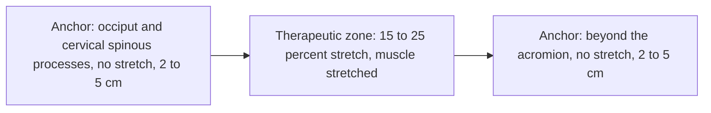

# Kinesiology taping of the upper trapezius

## Summary

The descending (upper) part of the trapezius is a classic example in physiotherapy: under prolonged psychological stress, it becomes tense. Over time, this unchecked reaction may lead to lasting changes in the nervous system, in the muscle (for example trigger points) and in the fascia, with pain as a result. Removing the cause would be the best therapy, but stress cannot be eliminated completely. Kinesiology taping is one method used to reduce tension. Systematic reviews find little evidence that kinesiology tape is better than sham taping.

*This note is educational. It is not medical advice and does not replace a doctor, dietitian or pharmacist, especially during pregnancy, illness or when taking medicines.*

## Prerequisites

- [Trapezius](../anatomy/muscular-system/upper-limb/trapezius.md)

## Core concepts

### Definition

*Kinesiology taping* is the application of elastic adhesive tape (Kinesio Tex is the original brand) to the skin with defined amounts of stretch. An *inhibitory application* is intended to reduce muscle activity; it is applied from the insertion to the origin in some teachings, or from the origin with low tension in others.

### Analogy

Kinesiology tape is meant to work like a gentle hand resting on a tense shoulder: it lifts the skin slightly and reminds the body to relax. The analogy breaks because research suggests the effect may come mostly from expectation and attention, not from mechanical lifting.

### Mechanism

**Proposed mechanisms.** Proponents claim the tape lifts the skin, improving circulation and lymph flow, and changes input from skin receptors, which modulates pain and muscle tone. These mechanisms are not well supported by research.

**Application (as described in the Kinesio method).**

1. Start at the origin of the descending trapezius on the occipital bone and the spinous processes of the cervical vertebrae, as far as the hairline allows.
2. Finish (preferably) beyond the acromion of the scapula.
3. The anchor at the start and the end (about 2 to 5 cm long each) is applied without stretch, on a relaxed muscle.
4. The therapeutic part is applied with about 15 to 25 percent stretch, on a stretched muscle (the tape on its backing paper is already at about 15 percent tension).

**Variants.**

- *I-strip*: the fastest and simplest, but not necessarily the most effective, because the "therapeutic zone" is only under the tape.
- *Y-strip*: the open space between the two tails increases the treated area. According to the Kinesio method, spaces between strips are also therapeutic zones, but only in selected cases. If the strips are too far apart, the opposite effect occurs and the treated area is only under the tape.
- *Fan technique*: several narrow tails reduce the risk of excluding the therapeutic space, but it requires more patience from both patient and therapist.

**Effect on jaw muscles.** An inhibitory application with Kinesio Tex Gold tape on the descending trapezius has been reported to reduce the electrical activity of the masseter and the anterior temporalis. These muscles, like the trapezius, are sensitive to negative emotional states and often become tense ([Masseter](../anatomy/muscular-system/head-and-neck/masseter.md), [Temporalis](../anatomy/muscular-system/head-and-neck/temporalis.md)). This finding comes from small studies and has not been confirmed in larger trials.

The diagram shows the I-strip application from origin to beyond the acromion.

### Claimed effects and evidence

Each entry states the claimed effect and how strong the evidence is, using the grades defined in the [Evidence grades](../nutrition/evidence-grades.md) note.

- **Reduced pain and tension in the trapezius.** Reviews find kinesiology tape no better than sham or other treatments for musculoskeletal pain. Evidence: limited.
- **Reduced masseter and temporalis activity.** Small studies only. Evidence: very limited.
- **Spaces between strips are therapeutic.** No evidence. Evidence: not supported.

## Worked example

An office worker with neck tension during deadlines has an I-strip applied by a physiotherapist, together with advice on breaks, posture variation and the [self-relaxation technique](trapezius-self-relaxation.md). They report less tension after a week. Because sham tape often produces similar reports, the improvement may come from the whole program rather than the tape itself.

## Trade offs and when to use it

Taping is low-risk and some people find it helpful, but it should not replace exercise, workplace changes and stress management. Skin irritation is the main side effect.

## Common mistakes

- **Treating tape as the main therapy.** Combine it with exercise and stress management.
- **Applying too much stretch.** Excess tension irritates the skin and may change the intended effect.

## Practice

1. Where does the trapezius application start and end?
2. How much stretch is used in the therapeutic zone?
3. What do systematic reviews conclude?

### Answers

1. It starts at the occiput and cervical spinous processes and ends beyond the acromion.
2. About 15 to 25 percent.
3. Kinesiology tape is not clearly better than sham taping.

## Further reading

- Kase, K., Wallis, J., Kase, T. (2003). *Clinical Therapeutic Applications of the Kinesio Taping Method (2nd ed.)*. Kinesio Taping Association. Description of the Kinesio taping method.
- Parreira, P. C. S., Costa, L. C. M., Hespanhol, L. C. et al. (2014). Current evidence does not support the use of Kinesio Taping in clinical practice: a systematic review. Journal of Physiotherapy, 60(1), 31-39. [DOI](https://doi.org/10.1016/j.jphys.2013.12.008). Systematic review of Kinesio taping evidence.
