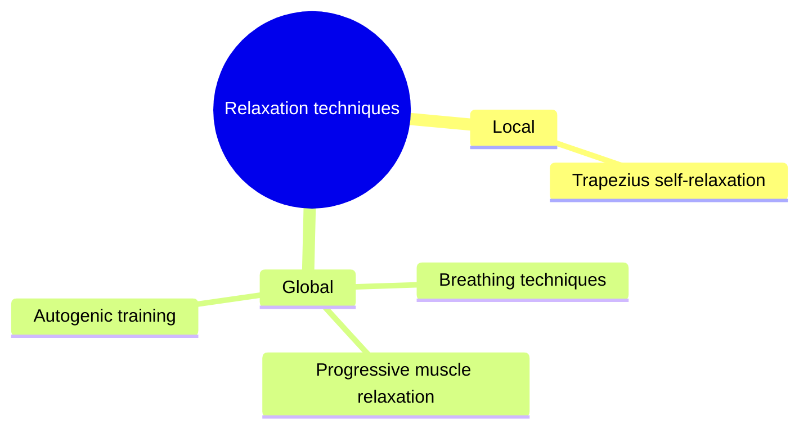

# Relaxation techniques

## Summary

Relaxation techniques are methods for reducing muscle tension and arousal of the nervous system. Some act locally on one muscle, such as post-isometric relaxation of the trapezius; others act on the whole body and mind, such as Jacobson's progressive muscle relaxation and Schultz's autogenic training. They shift the autonomic nervous system toward parasympathetic activity and have moderate evidence for reducing anxiety.

*This note is educational. It is not medical advice and does not replace a doctor, dietitian or pharmacist, especially during pregnancy, illness or when taking medicines.*

## Prerequisites

No prior notes are needed.

## Core concepts

### Definition

*Relaxation techniques* are structured methods that reduce muscle tension and physiological arousal. They fall into *local techniques* (one muscle or region) and *global techniques* (the whole body and mind).

### Analogy

Relaxation techniques are like dimmer switches for the body. Some dim one lamp (a tense shoulder), others lower the lighting of the whole house (overall arousal). The analogy breaks because, unlike a switch, relaxation is a skill that improves with practice.

### Mechanism

Stress activates the sympathetic nervous system ("fight or flight"): heart rate, blood pressure and muscle tone rise. Relaxation techniques work through three main routes:

- **Muscle**: contracting and then relaxing a muscle lowers its resting tone (post-isometric relaxation, progressive muscle relaxation).
- **Breathing**: slow breathing increases parasympathetic activity ([Breathing techniques in training](../physiology/respiration/breathing-techniques.md)).
- **Attention and suggestion**: focusing on sensations of heaviness and warmth (autogenic training).

### Trapezius self-relaxation

The upper trapezius often tenses with stress and desk work. A post-isometric relaxation technique reduces its tension by a gentle contraction followed by relaxation and a slightly increased stretch. The full procedure is in [Trapezius self-relaxation](trapezius-self-relaxation.md).

### Progressive muscle relaxation

Edmund Jacobson's method tenses and relaxes muscle groups in sequence to learn the difference between tension and relaxation ([Progressive muscle relaxation (Jacobson)](progressive-muscle-relaxation.md)).

### Autogenic training

Johannes Schultz's method uses self-suggestion of heaviness, warmth, calm heartbeat and breathing, warmth in the solar plexus and a cool forehead ([Autogenic training (Schultz)](autogenic-training.md)).

The mindmap groups the techniques.

### Claimed effects and evidence

Each entry states the claimed effect and how strong the evidence is, using the grades defined in the [Evidence grades](../nutrition/evidence-grades.md) note.

- **Reduced anxiety.** A meta-analysis found moderate to large effects of relaxation training on anxiety. Evidence: moderate.
- **Reduced muscle tension.** Plausible and reported in trials; measurement varies. Evidence: limited.

## Worked example

A student with exam anxiety learns progressive muscle relaxation for 2 weeks (15 minutes daily) and then a short version (5 minutes). Before exams, they use the short version with slow breathing. Their self-reported anxiety falls, consistent with trial findings.

## Trade offs and when to use it

Relaxation techniques are safe and cheap; they complement, but do not replace, treatment of anxiety disorders or the causes of chronic stress.

## Common mistakes

- **Expecting results after one session.** Relaxation is a skill; practice daily for weeks.
- **Using relaxation instead of treatment for a disorder.** Seek professional help for persistent anxiety or pain.

## Practice

1. Name three relaxation techniques.
2. Which part of the nervous system do relaxation techniques shift toward?
3. What is the difference between local and global techniques?

### Answers

1. Trapezius self-relaxation, progressive muscle relaxation and autogenic training.
2. The parasympathetic nervous system.
3. Local techniques act on one muscle or region; global techniques act on the whole body and mind.

## Further reading

- Manzoni, G. M., Pagnini, F., Castelnuovo, G. et al. (2008). Relaxation training for anxiety: a ten-years systematic review with meta-analysis. BMC Psychiatry, 8, 41. [DOI](https://doi.org/10.1186/1471-244X-8-41). Meta-analysis of relaxation training for anxiety.
- Jacobson, E. (1938). *Progressive Relaxation (2nd ed.)*. University of Chicago Press. Progressive relaxation.
- Schultz, J. H. (1932). *Das autogene Training: konzentrative Selbstentspannung*. Thieme. Autogenic training.
