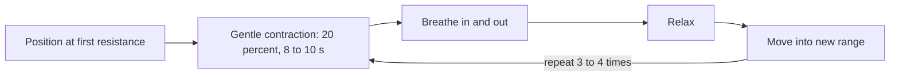

# Trapezius self-relaxation

## Summary

This technique relaxes the descending (upper) part of the trapezius using post-isometric relaxation (PIR): a gentle contraction of the muscle against resistance for 8 to 10 seconds, followed by relaxation and a slightly larger stretch, repeated 3 to 4 times. It is performed by a therapist or partner, or adapted for self-treatment. PIR is widely used for muscle tension and trigger points, although high-quality evidence is limited.

*This note is educational. It is not medical advice and does not replace a doctor, dietitian or pharmacist, especially during pregnancy, illness or when taking medicines.*

## Prerequisites

- [Trapezius](../anatomy/muscular-system/upper-limb/trapezius.md)

## Core concepts

### Definition

*Post-isometric relaxation* is a muscle energy technique in which a muscle is brought to its first resistance in stretch, contracts gently (about 10 to 20 percent of maximal force) for several seconds, and is then relaxed and moved into a new, slightly longer position.

The *trapezius* (Latin *musculus trapezius*) belongs to the superficial back muscles, more specifically to the spinohumeral group. It lies in the neck and upper back, the most superficial muscle of the region. It is flat, broad and triangular; the right and left muscles together form a rhombus. Its old name was the "hood muscle" (*musculus cucullaris*), because its shape resembles a monk's hood. Its origin includes tendinous fibers on:

- the medial part of the superior nuchal line and the external occipital protuberance of the occipital bone;
- the nuchal ligament;
- the spinous processes of the seventh cervical vertebra and all thoracic vertebrae, and the corresponding parts of the supraspinous ligament.

See [Trapezius](../anatomy/muscular-system/upper-limb/trapezius.md).

### Analogy

PIR is like opening a stuck drawer: first you push it in a little (gentle contraction), then you pull it out a bit further than before (new stretch). Forcing it straight out would make it jam harder. The analogy breaks because the "release" is neural and perceptual, not only mechanical.

### Mechanism

After a gentle isometric contraction, the muscle's resistance to stretch is temporarily reduced. Proposed explanations include increased stretch tolerance and changes in muscle spindle and Golgi tendon organ activity; the exact mechanism is debated.

**Procedure (with a therapist or partner).**

1. The person lies on their back with legs slightly bent.
2. The therapist laterally flexes the head away from the side being treated.
3. The therapist presses the person's shoulder down with one hand.
4. The person pushes the shoulder up into the therapist's hand with about 20 percent of their strength. Hold this for about 8 to 10 seconds while breathing in and out.
5. The person relaxes; the therapist increases the range of motion (more side bending or shoulder depression).
6. Repeat the whole sequence 3 to 4 times.

**Self-treatment adaptation.** Sitting, hold the edge of the chair with the hand on the treated side, side-bend the head away, gently lift the shoulder against the fixed hand for 8 to 10 seconds, relax and side-bend slightly further.

The flowchart shows one cycle of post-isometric relaxation.

### Claimed effects and evidence

Each entry states the claimed effect and how strong the evidence is, using the grades defined in the [Evidence grades](../nutrition/evidence-grades.md) note.

- **Increased range of motion.** Muscle energy techniques increase range of motion in the short term. Evidence: moderate.
- **Reduced neck pain and tension.** Some trials show benefit; quality is low to moderate. Evidence: limited.

## Worked example

A desk worker with a tense right upper trapezius side-bends the neck to the left only 30 degrees. After 4 cycles of PIR with a partner, side bending increases to 38 degrees and the neck feels looser. The effect lasts hours to days; regular practice and workplace changes help maintain it.

## Trade offs and when to use it

PIR is gentle and safe; it does not treat the causes of tension (stress, posture, workload). Stop if it causes numbness, dizziness or sharp pain.

## Common mistakes

- **Contracting too hard.** Use about 20 percent of maximal effort.
- **Forcing the stretch.** Move gently into the new range.

## Practice

1. How hard should the contraction be in PIR?
2. How long is the contraction held?
3. Where does the trapezius originate?

### Answers

1. About 20 percent of maximal strength.
2. About 8 to 10 seconds.
3. Superior nuchal line and external occipital protuberance, nuchal ligament, spinous processes of C7 and all thoracic vertebrae.

## Further reading

- Lewit, K., Simons, D. G. (1984). Postisometric relaxation in combination with other methods of muscular facilitation and inhibition. Archives of Physical Medicine and Rehabilitation, 65(8), 452-456. Description of post-isometric relaxation.
- Standring, S. (Ed.) (2020). *Gray's Anatomy: The Anatomical Basis of Clinical Practice (42nd ed.)*. Elsevier. Anatomy of the trapezius.
