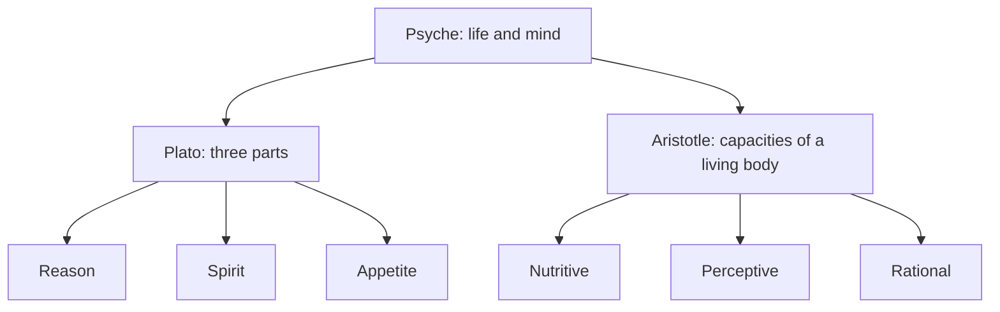

# Ancient Greek psychology

## Summary

Greek philosophers asked what the *psyche* is and how it explains thought, desire and emotion long before psychology became a science. In Homer, the psyche is the breath of life. Plato divided the soul into reason, spirit and appetite to explain inner conflict. Aristotle described the soul as the form of a living body, with nutritive, perceptive and rational capacities. Epicurus and the Stoics treated the emotions as things that can be understood and changed. Many modern ideas echo these theories, and the Greek accounts are philosophy and not empirical science.

*This note is educational.*

## Prerequisites

No prior notes are needed.

## Core concepts

### Definition

*Psyche* (ψυχή) originally meant breath or life, and became the term for the principle of life and mind. Greek thinkers wanted to explain what the soul is, how it moves the body, and why people act against their own judgment.

### Analogy

Plato's image of the soul is a chariot: a charioteer (reason) tries to guide two horses, one noble (spirit) and one unruly (appetite). The picture shows that inner conflict is a clash between parts that want different things. The limit of the analogy is that Plato presents the soul as an immortal being, and the image is a myth and not a lab result.

### The main theories

| Thinker | Main idea | Modern echo |
| --- | --- | --- |
| Plato | Tripartite soul: reason, spirit (anger, honor) and appetite; justice is harmony of the parts (*Republic*, Book IV) | Inner conflict, dual-process accounts, Freud's id, ego and superego |
| Aristotle | The soul is the form of a living body, with nutritive, perceptive and rational capacities (*De Anima*) | The idea that mind is what the body does, not a separate thing |
| Epicurus | Pleasure as absence of pain and disturbance (ataraxia), limited desires, no reason to fear death | Hedonic well-being, anxiety about death, acceptance |
| Stoics | Emotions are judgments, and the wise person trains judgment (see [Stoicism](stoicism.md)) | Cognitive therapy |

### Plato

Plato (Brown, Stanford Encyclopedia of Philosophy, on the *Republic*) argued from conflict: a person can be thirsty and yet refuse to drink, so the part that wants and the part that refuses must differ. The parts are reason (calculating the good), spirit (anger, shame, ambition) and appetite (hunger, thirst, sex). A just soul is one in which reason rules with the support of spirit.

### Aristotle

Aristotle (Shields, Stanford Encyclopedia of Philosophy) rejected a separate soul in the body. A living thing has a soul as its organizing principle, and different living things have different capacities: plants nourish and grow, animals also perceive and move, and humans also reason. Emotions involve both body and belief, for example anger is a desire for revenge together with a belief about being slighted.

### Epicurus

Epicurus (Konstan, Stanford Encyclopedia of Philosophy) taught that the goal of life is a tranquil mind and a body free of pain. He distinguished natural and necessary desires (food), natural and unnecessary ones (luxury food) and empty ones (fame). He argued that death is nothing to us, since when we exist, death is not present, and when death is present, we do not exist.

## Worked example

Someone knows they should stop scrolling at night and keeps doing it.

| Theory | Reading |
| --- | --- |
| Plato | Appetite overpowers reason, and spirit does not side with it |
| Aristotle | Weak will: the person knows in general and fails to apply it in the moment |
| Epicurus | The desire is unnecessary and creates more disturbance than pleasure |
| Stoics | A judgment that the scroll is good and needed, which can be examined |

The four readings suggest different remedies: strengthen the alliance of reason and spirit, train habits, drop the empty desire, and test the judgment. The comparison is an exercise in using the theories, and not a test.

## Trade offs and when to use it

Ancient theories give a rich vocabulary for inner conflict, character and well-being, and they predate the methods of modern psychology. They are not tested hypotheses, and parts of them, such as the immortal soul, are outside empirical science. Use them as lenses and compare with current evidence.

## Common mistakes

- **Reading the tripartite soul as a brain map.** It is a philosophical model.
- **Equating Epicurean pleasure with indulgence.** Epicurus recommended simple living.
- **Treating the Greeks as one voice.** The schools disagreed.

## Practice

1. Name the three parts of Plato's soul.
2. What is the soul, according to Aristotle?
3. What did Epicurus say about fear of death?

### Answers

1. Reason, spirit and appetite.
2. The form of a living body, which gives it its capacities.
3. Death is nothing to us, since when we exist, death is not present, and when death is present, we do not exist.

## Further reading

- Shields, C. (2020). Aristotle's psychology. Stanford Encyclopedia of Philosophy. [Link](https://plato.stanford.edu/entries/aristotle-psychology/). Covers the soul as the form of a living body and its capacities.
- Brown, E. (2017). Plato's ethics and politics in the Republic. Stanford Encyclopedia of Philosophy. [Link](https://plato.stanford.edu/entries/plato-ethics-politics/). Covers the tripartite soul and the argument about justice.
- Konstan, D. (2022). Epicurus. Stanford Encyclopedia of Philosophy. [Link](https://plato.stanford.edu/entries/epicurus/). Covers Epicurean pleasure, desire and the fear of death.
- Baltzly, D., Durand, M. and Shogry, S. (2023). Stoicism. Stanford Encyclopedia of Philosophy. [Link](https://plato.stanford.edu/entries/stoicism/). A scholarly entry on Stoic logic, physics and ethics.
