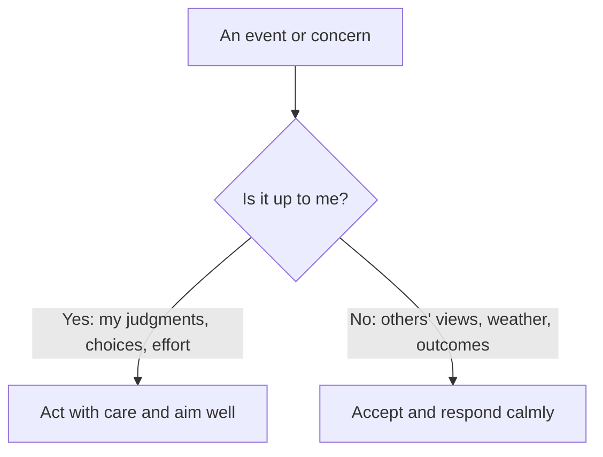

# Stoicism

## Summary

Stoicism is a school of ancient Greek and Roman philosophy founded by Zeno of Citium around 300 BCE. It teaches that virtue (wisdom, justice, courage and moderation) is what matters for a good life, that emotions come from judgments about events and not from the events, and that a person should concentrate on what is within their control and accept the rest. The Roman Stoics Seneca, Epictetus and Marcus Aurelius left practical writings that people still use. Modern cognitive therapy drew on Stoic ideas, and direct tests of Stoic practices are few.

*This note is educational. It is not mental health advice.*

## Prerequisites

No prior notes are needed.

## Core concepts

### Definition

The Stanford Encyclopedia of Philosophy describes *Stoicism* as a unified system of logic, physics and ethics, in which the ethics is meant to be lived (Baltzly, Durand and Shogry). The central claims:

- **Virtue is the only good.** Health, wealth and reputation are "preferred indifferents": things it is reasonable to choose, and which do not make a person good or bad.
- **Live in agreement with nature and reason.**
- **Emotions are judgments.** Distress arises from the belief that something bad has happened. Changing the judgment changes the emotion.
- **Some things are up to us, and some are not.** Epictetus opens his *Enchiridion* with this distinction.

### Analogy

A Stoic is like an archer who controls the aim and the release, and not the wind or whether the target moves. The archer's success is to shoot well, and the hit is a preferred outcome. The limit of the analogy is that a Stoic also considers the targets to be chosen well, in line with virtue.

### The dichotomy of control

| Up to us | Not up to us |
| --- | --- |
| Our opinions, intentions, choices, responses | Body, reputation, wealth, other people's actions, the outcome |

### Practices

| Practice | What it is | Source |
| --- | --- | --- |
| Premeditatio malorum | Rehearse possible misfortunes in advance to reduce their shock | Seneca |
| Evening review | Review the day: what went well, what failed, what to change | Seneca |
| View from above | Imagine the situation from a great height to see its scale | Marcus Aurelius |
| Negative visualization of loss | Remember that what you have could be lost | Epictetus, Seneca |
| Voluntary discomfort | Practice small deprivations to reduce fear of loss | Seneca |
| Reframing | Ask what judgment produces the feeling, and test it | Epictetus |

*Premeditatio malorum* is the planning cousin of the pre-mortem (see [planning and contingency](../../../personal-development/skills/soft-skills/cognitive/planning-and-contingency.md)). *Amor fati*, the love of fate, is Nietzsche's phrase (*The Gay Science*) for embracing everything that happens, and is close to the Stoic acceptance of events, though Nietzsche was critical of Stoicism in other respects. The Japanese idea of [shikata ga nai](../japanese-thought/endurance-ideas.md) is a related attitude of acceptance.

### Link to cognitive therapy

Beck (1976) acknowledged that the philosophical origins of cognitive therapy lie with the Stoics, who held that people are disturbed by their views of things (see [cognitive behavioral therapy](../../../social-sciences/psychology/clinical-and-counseling/cognitive-behavioral-therapy.md)). Hadot (1995) reads Stoicism as a set of spiritual exercises and not only a theory. Direct trials of Stoic training are few and small, so claims of benefit rest on the link to tested therapies.

## Worked example

A person is told that their project is cancelled.

| Step | Stoic reasoning |
| --- | --- |
| Separate | The decision is not up to me. My response is |
| Judgment | "This is a disaster" is a judgment. What is the fact? The project ended |
| Practice | Evening review: what did I learn, what can I carry to the next project? |
| Action | Ask the manager for feedback, update my plan, look for the next task |

The aim is not to feel nothing, and to act well and keep the feeling in proportion.

## Trade offs and when to use it

Stoic practices are simple and can reduce rumination and strengthen resilience. Critics note that Stoicism can slide into passivity or suppression of feeling, and that the "not up to us" line is not always clear (many things are partly in our control). Stoicism does not call for suppressing emotion, and it does ask for examining it. It does not replace treatment for depression or anxiety.

## Common mistakes

- **Equating Stoicism with having no feelings.** The aim is rational, proportionate emotion.
- **Using control as an excuse for passivity.** Effort is up to us.
- **Quoting Marcus Aurelius as a system.** His *Meditations* are private notes.

## Practice

1. What are the four virtues of Stoicism?
2. What does the dichotomy of control say?
3. What is premeditatio malorum?

### Answers

1. Wisdom, justice, courage and moderation.
2. Some things are up to us (judgments, choices, efforts) and some are not (outcomes, other people), and we should put effort into the first and accept the second.
3. Rehearsing possible misfortunes in advance to reduce their shock and prepare.

## Further reading

- Baltzly, D., Durand, M. and Shogry, S. (2023). Stoicism. Stanford Encyclopedia of Philosophy. [Link](https://plato.stanford.edu/entries/stoicism/). A scholarly entry on Stoic logic, physics and ethics.
- Epictetus. *Enchiridion and Discourses*. Many editions; recorded in the 2nd century. The Stoic teaching on what is and is not in our control.
- Marcus Aurelius. *Meditations*. Many editions; written in the 2nd century. A Stoic emperor's private notes on practice.
- Seneca. *Letters from a Stoic*. Many editions; written about 65 CE. Practical Stoic advice, including on rehearsing misfortune.
- Hadot, P. (1995). *Philosophy as a Way of Life*. Blackwell. Argues that ancient philosophy, including Stoicism, was a set of spiritual exercises.
- Beck, A. T. (1976). *Cognitive Therapy and the Emotional Disorders*. International Universities Press. The founding text of cognitive therapy, including cognitive distortions.
- Nietzsche, F. (1882). *The Gay Science*. Many editions. Contains the phrase amor fati and the announcement that God is dead.
