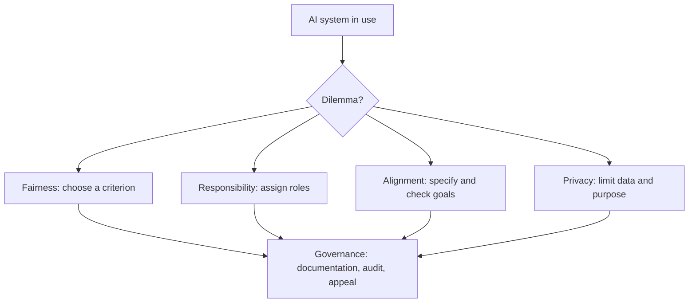

# Moral dilemmas of artificial intelligence

## Summary

Artificial intelligence raises moral questions that are partly old and partly new: who is responsible when a system causes harm, what counts as fair when a system makes decisions about people, how to make a system pursue human goals and what to do when values conflict. Trolley-style dilemmas get attention, and most real issues are about bias, privacy, accountability, safety and control. Some fairness requirements cannot be satisfied at once, so choices between them are moral and political and cannot be settled by technique alone.

*This note is educational. It describes debates and does not give legal advice.*

## Prerequisites

No prior notes are needed.

## Core concepts

### Definition

An *AI moral dilemma* is a situation in the design or use of an AI system in which values conflict and no option satisfies all of them. The Stanford Encyclopedia of Philosophy entry on the ethics of AI and robotics (Müller) surveys the issues: privacy and surveillance, manipulation, opacity, bias, human-robot interaction, automation and employment, autonomy, responsibility and machine ethics.

### Analogy

An AI system is like a very capable employee who follows instructions literally and has no common sense unless it is built in. The risk is not malice but doing exactly what was specified, and not what was meant. The limit of the analogy is that an employee shares human values by default, and a system does not.

### Categories

| Category | Question | Example |
| --- | --- | --- |
| Life-and-death choices | How should a system act when harm is unavoidable? | An autonomous vehicle that must choose between harms |
| Fairness | What does a fair decision mean? | Credit scoring or risk scores across groups |
| Privacy and surveillance | How much data collection is acceptable? | Face recognition in public spaces |
| Responsibility | Who is accountable for harm? | The developer, the operator, the user or the system? |
| Alignment and control | How to make a system pursue the intended goal? | A reward that is gamed |
| Work and dignity | What happens to jobs and human roles? | Automation of decisions about people |

### The trolley problem and its limits

The trolley problem asks whether it is permissible to divert a runaway trolley to kill one person instead of five, and whether pushing a person off a bridge to stop it is different (Thomson, 1985). In the Moral Machine experiment, Awad and colleagues (2018) collected millions of decisions from people in many countries about autonomous vehicle dilemmas and found patterns, such as preferences for saving more lives, the young and humans over animals, together with differences between regions. The results describe opinions and do not settle what is right. Critics note that real driving situations rarely resemble these choices, and that the main safety work lies in reducing risk before a dilemma arises.

### Fairness: a conflict of criteria

Several definitions of fairness are in use, for example *demographic parity* (the same share of each group is selected), *equal error rates* (the same true and false positive rates in each group) and *predictive parity* (a positive result means the same chance of a true positive in each group). Chouldechova (2017) shows that when the base rates of the outcome differ between groups, a score cannot satisfy several of these criteria at once.

### Alignment

The alignment problem is how to make a system's behavior match human intentions. Amodei and colleagues (2016) list concrete problems such as avoiding side effects, avoiding reward hacking, scalable supervision and safe exploration. Russell (2019) argues that systems should be uncertain about human preferences and learn them, instead of optimizing a fixed goal.

### Responsibility

When an AI system contributes to harm, responsibility may be spread across designers, deployers and users, and a *responsibility gap* arises if nobody can be held accountable. Regulation addresses this. The EU AI Act (Regulation (EU) 2024/1689) sets obligations by risk level, with stricter requirements for high-risk uses and prohibitions for some practices.



## Worked example

A lender uses a score to approve loans. The toy numbers below are invented, and the classifier has the same error rates in two groups.

```python
# Python 3.12. Two fairness criteria cannot both hold when base rates differ (toy numbers).
groups = {"A": dict(pos=50, neg=50), "B": dict(pos=20, neg=80)}   # people who would repay / default
TPR, FPR = 0.8, 0.2                                               # same error rates in both groups

for name, g in groups.items():
    tp, fp = g["pos"] * TPR, g["neg"] * FPR
    selected = (tp + fp) / (g["pos"] + g["neg"])
    precision = tp / (tp + fp)
    print(f"group {name}: selection rate {selected:.2f}, precision {precision:.2f}, true positive rate {TPR}, false positive rate {FPR}")
```

Output:

```text
group A: selection rate 0.50, precision 0.80, true positive rate 0.8, false positive rate 0.2
group B: selection rate 0.32, precision 0.50, true positive rate 0.8, false positive rate 0.2
```

The error rates are equal, so the equal-error-rate criterion holds. The selection rates differ (0.50 and 0.32), so demographic parity fails, and the precision differs (0.80 and 0.50), so predictive parity fails. Since the base rates differ (50% and 20% of people would repay), the criteria cannot all be satisfied by a better model. A lender has to decide which criterion to prioritize and explain why, and the choice has moral content.

## Trade offs and when to use it

Naming dilemmas helps teams to decide in advance, document trade-offs and give affected people a chance to challenge decisions. The risk is "ethics washing": discussion without changes. Practical steps include impact assessments, testing for disparities, human oversight for high-stakes decisions, clear accountability and ways to appeal.

## Common mistakes

- **Focusing on trolley cases.** Most harms come from ordinary design and deployment choices.
- **Assuming that a technical fix removes the dilemma.** Some conflicts are in the values.
- **Treating opinion surveys as moral answers.** They describe preferences.
- **Leaving responsibility unassigned.** A gap invites harm.

## Practice

1. Name three fairness criteria.
2. What did Chouldechova (2017) show?
3. What is a responsibility gap?

### Answers

1. For example demographic parity, equal error rates and predictive parity.
2. When base rates differ between groups, a score cannot satisfy several fairness criteria at once.
3. A situation in which nobody can be held accountable for harm caused with a system.

## Further reading

- Müller, V. C. (2026). Ethics of artificial intelligence and robotics. Stanford Encyclopedia of Philosophy. [Link](https://plato.stanford.edu/entries/ethics-ai/). Surveys issues of bias, responsibility, autonomy and machine ethics.
- Thomson, J. J. (1985). The Trolley Problem. *The Yale Law Journal*, 94(6), 1395. [DOI](https://doi.org/10.2307/796133). The paper that named and analyzed the trolley problem.
- Awad, E., Dsouza, S., Kim, R. et al. (2018). The Moral Machine experiment. *Nature*, 563(7729), 59-64. [DOI](https://doi.org/10.1038/s41586-018-0637-6). A large survey of moral preferences about autonomous vehicle dilemmas across countries.
- Chouldechova, A. (2017). Fair Prediction with Disparate Impact: A Study of Bias in Recidivism Prediction Instruments. *Big Data*, 5(2), 153-163. [DOI](https://doi.org/10.1089/big.2016.0047). Shows that a risk score cannot satisfy several common fairness criteria at once when base rates differ.
- Amodei, D., Olah, C., Steinhardt, J. et al. (2016). Concrete problems in AI safety. arXiv:1606.06565. [Link](https://arxiv.org/abs/1606.06565). Lists practical research problems in making AI systems behave safely.
- Russell, S. (2019). *Human Compatible: Artificial Intelligence and the Problem of Control*. Viking. Sets out the value alignment problem for advanced AI.
- Regulation (EU) 2024/1689 laying down harmonised rules on artificial intelligence (AI Act). European Union. [Link](https://eur-lex.europa.eu/eli/reg/2024/1689/oj). The EU regulation that sets risk-based rules for AI systems.
