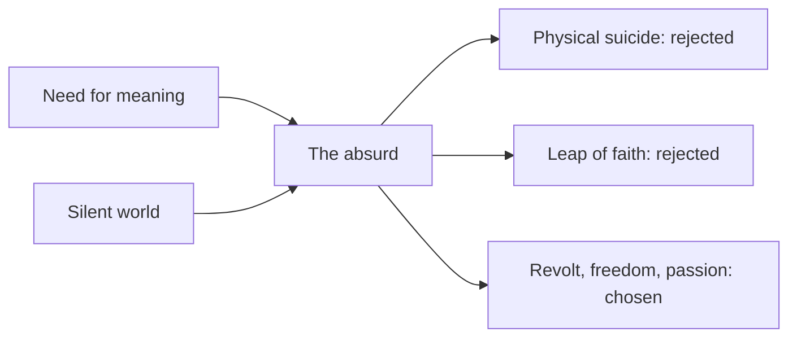

# Absurdism

## Summary

Absurdism is the philosophy associated with Albert Camus. It holds that the human search for meaning meets a universe that gives no answer, and that this clash is the absurd. Camus argued that the honest response is neither suicide nor a leap of faith, but revolt: to keep living, with awareness and passion, without false hope. His image for this is Sisyphus, who pushes a boulder up a hill forever, and whom Camus asks us to imagine as happy.

*This note is educational. If you are thinking of ending your life, contact a crisis line or emergency services.*

## Prerequisites

- [Nihilism](nihilism.md).
- [Existentialism](existentialism.md).

## Core concepts

### Definition

In *The Myth of Sisyphus* (1942), Camus defines the *absurd* as the confrontation between human beings' need for meaning and the "unreasonable silence of the world". The absurd is not in the world alone or in the person alone, but in the relation between them. The Stanford Encyclopedia of Philosophy entry on Camus (Aronson) discusses his thought and his break with the existentialists, whose label he rejected.

### Analogy

The absurd is like asking a question in an empty room: the question is real, and the silence is the answer. One can leave, pretend that someone answered, or keep asking and live well in the room. The limit of the analogy is that Camus does not claim that the room is empty with certainty, and only that we have no answer.

### Possible responses

| Response | Description | Camus's view |
| --- | --- | --- |
| Physical suicide | End life to escape the absurd | Rejected: it destroys one of the two terms and does not solve the problem |
| Philosophical suicide | A leap of faith or a system that supplies meaning | Rejected: it abandons lucidity |
| Revolt | Live with awareness of the absurd, refuse false hope, and live fully | Chosen |

### Revolt, freedom and passion

Camus draws three consequences from revolt: *revolt* (keeping the absurd in view without resignation), *freedom* (freedom from false goals and from the hope of another life) and *passion* (living as much and as intensely as possible). His Sisyphus finds meaning in the struggle itself: "one must imagine Sisyphus happy".

### Absurdism and other views

| View | Relation |
| --- | --- |
| Nihilism | Absurdism agrees that there is no given meaning and denies that it follows that nothing matters |
| Existentialism | Shares the starting point of human freedom, and refuses the idea of building a system of meaning |

## Worked example

A person in a repetitive job feels that the work is meaningless.

| Step | Reflection |
| --- | --- |
| Name the absurd | The work repeats and no larger purpose appears |
| Avoid false hope | Do not wait for a promotion to supply meaning |
| Revolt | Do the work with attention and craft, and choose a project outside it that matters |
| Passion | Give full attention to the present task |

Camus did not offer a plan for work. The example shows the attitude: lucid, engaged, without a promised reward.

## Trade offs and when to use it

Absurdism gives a way to live with uncertainty without false comfort, and can fit people who find religious or ideological answers unconvincing. Critics say that it is bleak, that the choice of revolt is itself unexplained and that "imagining Sisyphus happy" is an aesthetic and not an argument. It is a philosophical attitude and is not a treatment for depression.

## Common mistakes

- **Equating absurdism with nihilism.** Camus rejects despair.
- **Calling Camus an existentialist.** He rejected the label.
- **Reading the Sisyphus image as passive.** It describes active, lucid engagement.

## Practice

1. Define the absurd in Camus's sense.
2. Which two responses does Camus reject?
3. What does revolt mean?

### Answers

1. The confrontation between the human need for meaning and the silence of the world.
2. Physical suicide and philosophical suicide (a leap of faith).
3. Living with awareness of the absurd, refusing false hope and living fully.

## Further reading

- Aronson, R. (2021). Albert Camus. Stanford Encyclopedia of Philosophy. [Link](https://plato.stanford.edu/entries/camus/). Explains Camus's absurd and his response to it.
- Camus, A. (1942). *The Myth of Sisyphus*. Many editions. The essay on the absurd and on revolt.
- Aho, K. (2023). Existentialism. Stanford Encyclopedia of Philosophy. [Link](https://plato.stanford.edu/entries/existentialism/). Covers the main existentialist thinkers and themes.
