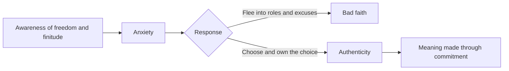

# Existentialism

## Summary

Existentialism is a philosophical movement of the 19th and 20th centuries that starts from the experience of individual existence: that each person must choose how to live, with no pre-given purpose, and bears responsibility for the choice. Its main figures include Kierkegaard, Nietzsche, Heidegger, Sartre and de Beauvoir. Central ideas are freedom, responsibility, authenticity, anxiety and the creation of meaning. It influenced psychotherapy, literature and ethics.

*This note is educational. It is not mental health advice.*

## Prerequisites

- [Nihilism](nihilism.md).

## Core concepts

### Definition

*Existentialism* treats human existence as the starting point. Sartre (1946) summed up its slogan: "existence precedes essence": a person first exists and then defines what they are through choices, unlike an object made for a purpose. The Stanford Encyclopedia of Philosophy entry on existentialism (Aho) covers the movement and its themes; the thinkers disagree on much, and several rejected the label.

### Key concepts

| Concept | Meaning |
| --- | --- |
| Existence precedes essence | There is no fixed human nature that defines a person in advance |
| Freedom | People are free to choose, even in constraints |
| Responsibility | Because we choose, we answer for our choices |
| Authenticity | Living in line with one's own values and not by default or by social pressure |
| Bad faith | Denying one's freedom, for example by saying "I had no choice" (Sartre) |
| Anxiety (angst) | The mood that reveals freedom and finitude (Kierkegaard, Heidegger) |
| Absurd | The clash between the human wish for meaning and a world that gives none (see [absurdism](absurdism.md)) |

### Main figures

| Thinker | Contribution |
| --- | --- |
| Søren Kierkegaard | Anxiety and despair, the leap of faith, the individual before God (*The Sickness Unto Death*, 1849) |
| Friedrich Nietzsche | The death of God, creating values, affirming life |
| Martin Heidegger | Being and time, being-toward-death, authenticity |
| Jean-Paul Sartre | Freedom, bad faith, existence precedes essence |
| Simone de Beauvoir | An ethics of freedom and ambiguity (1947) |

### Analogy

An existentialist sees life like a blank canvas that is handed over with no instructions. A painter may leave it empty, copy what others did or make something of their own. The limit of the analogy is that people do not start from a blank canvas, since body, history and society give them a situation.

### Process

### Existential therapy

Yalom (1980) built a therapy around four existential concerns: death, freedom, isolation and meaninglessness. The approach aims to help people to face these concerns and not to avoid them. Evidence for existential therapy as a form is smaller than for cognitive behavioral therapy.

## Worked example

A person stays in a job that they dislike, saying "I have no choice".

| Step | Existentialist reading |
| --- | --- |
| Statement | "I have no choice" |
| Check | There are costs, and still choices: stay, retrain, change roles |
| Bad faith | Treating a hard choice as no choice |
| Authentic response | Name the values at stake (security, meaning), choose, and accept the cost |

The result may be to stay, and it is then a choice that the person owns.

## Trade offs and when to use it

Existentialism gives a strong language for responsibility and meaning, and can help in decisions and transitions. Critics say that it overstates freedom by ignoring social and psychological constraints, and that its emphasis on the individual underrates community. Use it together with an honest account of constraints.

## Common mistakes

- **Equating existentialism with despair.** Most existentialists stress affirmation and responsibility.
- **Treating freedom as having no limits.** The situation shapes the options.
- **Lumping all existentialists.** Kierkegaard was religious and Sartre was an atheist.

## Practice

1. What does "existence precedes essence" mean?
2. What is bad faith?
3. Name two existentialist thinkers.

### Answers

1. A person first exists and then defines what they are through choices, with no fixed essence in advance.
2. Denying one's freedom, for example by claiming that one had no choice.
3. For example Kierkegaard and Sartre.

## Further reading

- Aho, K. (2023). Existentialism. Stanford Encyclopedia of Philosophy. [Link](https://plato.stanford.edu/entries/existentialism/). Covers the main existentialist thinkers and themes.
- Sartre, J.-P. (1946). *Existentialism Is a Humanism*. Many editions. A lecture that sets out existentialism as a doctrine of responsibility.
- Kierkegaard, S. (1849). *The Sickness Unto Death*. Many editions. An analysis of despair and the self.
- de Beauvoir, S. (1947). *The Ethics of Ambiguity*. Many editions. An existentialist ethics built on freedom and ambiguity.
- Yalom, I. D. (1980). *Existential Psychotherapy*. Basic Books. Sets out four existential concerns (death, freedom, isolation, meaninglessness) as a basis for therapy.
