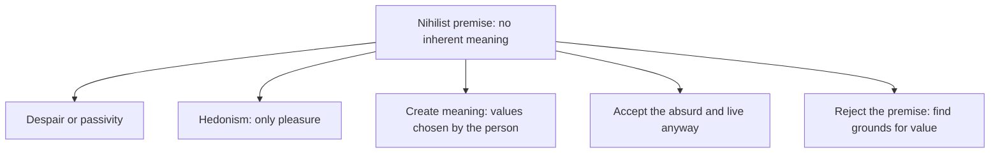

# Nihilism

## Summary

Nihilism is the family of views that deny that something usually taken to be real or valuable has any foundation: meaning, moral values, knowledge or the authority of the state. The word comes from the Latin *nihil*, nothing. Nietzsche made it central in modern philosophy by saying that belief in the old foundations of value had collapsed and that European culture faced a crisis of meaning. Philosophers distinguish several kinds, and most treat nihilism as a problem to answer and not as a recommendation.

*This note is educational. If feelings of meaninglessness come with hopelessness or thoughts of self-harm, contact a mental health professional or a crisis line.*

## Prerequisites

No prior notes are needed.

## Core concepts

### Definition

The Internet Encyclopedia of Philosophy lists several forms of *nihilism*, which differ in what they deny:

| Kind | Denies | Claim |
| --- | --- | --- |
| Existential | That life has meaning or purpose | Life has no inherent meaning |
| Moral | That there are objective moral facts | Nothing is objectively right or wrong |
| Epistemological | That knowledge is possible | Nothing can be known with certainty |
| Metaphysical | That certain things exist | For example that there are no persons or objects in some sense |
| Political | That existing social and political orders are justified | Calls for their destruction |

### Historical background

The term spread in 19th-century Russia and Germany. Nietzsche described nihilism as the condition in which the highest values lose their force, and the announcement that "God is dead" in *The Gay Science* (1882) meant that the Christian grounding of European values had lost credibility (see the Stanford Encyclopedia of Philosophy entry on Nietzsche). He distinguished *passive nihilism* (resignation, withdrawal) from *active nihilism* (destroying old values to make room for new ones), and thought the crisis could be overcome by creating new values.

### Analogy

Nihilism is like discovering that a map you trusted has no territory behind it. One response is despair, another is to stop using maps, and a third is to draw a new one. The limit of the analogy is that values are not found in a territory, and some philosophers argue that they are made by people.

### Responses

### Evidence and psychology

Philosophical nihilism is an argument and not an empirical claim. The psychological question is what happens when people feel that life is meaningless. Research on meaning in life links a sense of meaning to better well-being and health (see [hedonic and eudaimonic well-being](../../../social-sciences/psychology/humanistic-and-positive/hedonic-and-eudaimonic-well-being.md)). Many people hold the philosophical view with no distress, and others experience it as an existential crisis.

## Worked example

A person reads that the universe has no purpose and feels that nothing matters.

| Step | Reflection |
| --- | --- |
| Premise | There is no cosmic purpose |
| Does it follow that nothing matters? | Not logically: things can matter to people without a cosmic source |
| Response | Identify what matters to me in daily life: relationships, work, craft |
| Action | Choose one commitment for the month, and act on it |

The move is from cosmic to personal meaning, which is the response of existentialism (see [existentialism](existentialism.md)) and of [absurdism](absurdism.md).

## Trade offs and when to use it

Facing the nihilist argument can clear away unexamined beliefs and motivate people to build values deliberately. The risks are cynicism, withdrawal and moral irresponsibility if the argument is taken as a license. Moral nihilism is a minority view in academic ethics.

## Common mistakes

- **Equating nihilism with depression.** One is a philosophical position, the other a health condition, and they can interact.
- **Concluding that anything is permitted.** Even if values lack a cosmic basis, people still have reasons and consequences.
- **Treating Nietzsche as a nihilist.** He diagnosed nihilism and tried to overcome it.

## Practice

1. Name three kinds of nihilism.
2. What did Nietzsche mean by active nihilism?
3. Why does "no cosmic purpose" not imply "nothing matters"?

### Answers

1. For example existential, moral and epistemological.
2. Destroying old values to make room for new ones.
3. Things can matter to people without a cosmic source of meaning.

## Further reading

- Nihilism. Internet Encyclopedia of Philosophy. [Link](https://iep.utm.edu/nihilism/). An overview of the kinds of nihilism and their history.
- Anderson, R. L. (2026). Friedrich Nietzsche. Stanford Encyclopedia of Philosophy. [Link](https://plato.stanford.edu/entries/nietzsche/). Covers Nietzsche's nihilism, eternal recurrence and affirmation of life.
- Nietzsche, F. (1882). *The Gay Science*. Many editions. Contains the phrase amor fati and the announcement that God is dead.
