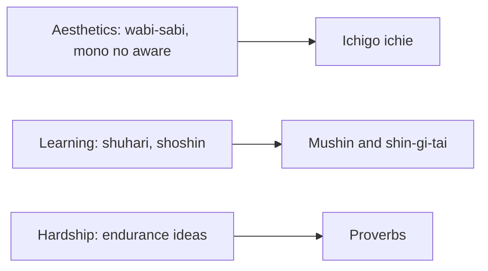

# Japanese thought

Japanese ideas about beauty, learning, attention and hardship that are often used as guides to living. This subfield belongs to [Philosophy](../README.md). The notes describe the ideas, relate them to research where it exists and say where they are traditions and not tested methods.

## Map of the subfield

## Notes in reading order

1. [Wabi-sabi and mono no aware](wabi-sabi-and-mono-no-aware.md): beauty in imperfection and impermanence.
2. [Ichigo ichie](ichigo-ichie.md): one time, one meeting.
3. [Shuhari and shoshin](shuhari-and-shoshin.md): stages of mastery and the beginner's mind.
4. [Mushin and shin-gi-tai](mushin-and-shin-gi-tai.md): no-mind and the balance of mind, technique and body.
5. [Japanese ideas of endurance and acceptance](endurance-ideas.md): gaman, shikata ga nai, ganbaru and nintai.
6. [Japanese proverbs](proverbs.md): five sayings and their research counterparts.

## Planned topics

- Zen Buddhism
- Bushido and ethics of the warrior
