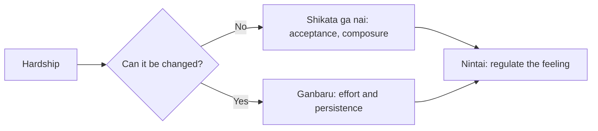

# Japanese ideas of endurance and acceptance

## Summary

Several Japanese words describe how to face hardship: *gaman* (patient endurance), *shikata ga nai* and *shogonai* (it cannot be helped), *ganbaru* (to do one's best, to persist) and *nintai* (forbearance, literally a blade over the heart). They share a stance of composure, perseverance and acceptance of what cannot be changed. They resemble Stoic and resilience ideas, and they also have a cost: when endurance is expected without limit, it can discourage asking for help and speaking up.

*This note is educational. It is not mental health advice.*

## Prerequisites

- [Stoicism](../ancient-philosophy/stoicism.md).

## Core concepts

### Definition

| Term | Meaning | Emphasis |
| --- | --- | --- |
| Gaman (我慢) | Enduring difficulty with patience and dignity, without complaint | Self-restraint |
| Shikata ga nai / shogonai | "It cannot be helped": accepting what is beyond control | Acceptance |
| Ganbaru (頑張る) | Do one's best and keep going | Effort |
| Nintai (忍耐) | Forbearance and perseverance, written with the characters for blade and heart | Emotional regulation |

Used well, they describe composure and focus on what can be done. Used badly, they describe silent suffering.

### Analogy

Gaman is like keeping a steady pace on a long hill. The pace saves energy, and a runner who never slows or asks for water may collapse. The limit of the analogy is that social expectation, and not a coach, sets the pace.

### Link to Western ideas

The two branches parallel the Stoic dichotomy of control (see [Stoicism](../ancient-philosophy/stoicism.md)) and the coping research on problem-focused and emotion-focused coping (see [stress and resilience](../../../personal-development/personal-growth/stress-and-resilience.md)). Self-regulation of emotion in nintai matches the strategies in [self-regulation](../../../personal-development/personal-growth/self-regulation.md). Acceptance in the sense of seeing clearly what cannot be changed is a healthy part of coping. Acceptance that prevents a change which is possible is not.

### The cost

Endurance without limit can discourage seeking help, hide problems such as overwork and stress, and put the burden on the individual and not on the situation. Social support is a main protective factor in stress research (Cohen and Wills, 1985). A balanced reading is: endure what cannot be changed, and change what can be, and ask for help in both.

## Worked example

A person faces a delayed project, a sick relative and a heavy workload.

| Issue | Response |
| --- | --- |
| Delay set by a supplier | Shikata ga nai: accept it, replan around it |
| Workload | Ganbaru with limits, and ask for help to share tasks |
| Fear and anger about the illness | Nintai: slow breathing, talk with a friend |
| Fatigue | Rest is part of lasting effort, not a failure of gaman |

The example keeps endurance and also corrects the pattern of silent suffering.

## Trade offs and when to use it

These ideas are useful for composure and persistence and for avoiding useless complaint. They can be misused to excuse harm or to pressure people into overwork. Whether a hardship should be endured is a judgment about whether it can and should be changed.

## Common mistakes

- **Equating acceptance with passivity.** It applies only to what cannot be changed.
- **Treating help-seeking as weakness.** Support is a resource.
- **Reading one cultural idea as a national trait.** Individuals and generations differ.

## Practice

1. What does shikata ga nai mean?
2. How does ganbaru differ from gaman?
3. What is the main risk of unlimited endurance?

### Answers

1. It cannot be helped: acceptance of what is beyond control.
2. Ganbaru stresses effort and persistence, gaman stresses patient self-restraint under hardship.
3. It can discourage help-seeking and hide problems that should be changed.

## Further reading

- Cohen, S. and Wills, T. A. (1985). Stress, social support, and the buffering hypothesis. *Psychological Bulletin*, 98(2), 310-357. [DOI](https://doi.org/10.1037/0033-2909.98.2.310). Reviews evidence that social support buffers the effects of stress.
- Lazarus, R. S. and Folkman, S. (1984). *Stress, Appraisal, and Coping*. Springer. The book that sets out the transactional model of stress and coping.
