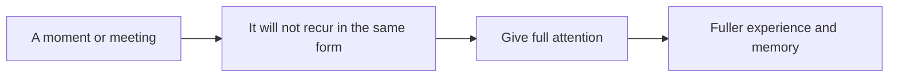

# Ichigo ichie

## Summary

Ichigo ichie (一期一会) is a Japanese saying that means "one time, one meeting". It comes from the tea ceremony, where each gathering is held to be unique and unrepeatable, so host and guests give it full attention. In daily life it is read as an encouragement to treat each moment and each encounter as something that will not return. It is an attitude close to mindfulness and savoring, and it is a philosophy of attention, not a researched method.

*This note is educational.*

## Prerequisites

- [Wabi-sabi and mono no aware](wabi-sabi-and-mono-no-aware.md).

## Core concepts

### Definition

*Ichigo ichie* is a tea ceremony maxim, associated with the tea tradition of Sen no Rikyū, which says that each meeting happens only once: the same people may meet again, but never in exactly the same circumstances. It is related to the impermanence of wabi-sabi and mono no aware. In current usage it is a call to be fully present.

### Analogy

Each performance of a play is different, even with the same actors and script: the audience, the weather and the mood make it a single event. The limit of the analogy is that daily life has no script and no audience, and attention must be chosen.

### Principles

| Principle | Meaning in practice |
| --- | --- |
| Do not postpone special moments | Do what matters now, since the chance may not return |
| Give full attention | Put the phone away when you meet someone |
| Notice small moments | A coffee, a conversation, the light |
| Try something new | New experiences create moments that stand out |
| Accept chance | Plans change, and the unplanned can be the memorable |
| Stay in the present | Do not live only for the weekend or the holiday |

### Link to research

The ideas fit research on mindfulness (see [mindfulness](../../../personal-development/personal-growth/mindfulness.md)), in which attention to present experience is trained, and on the way novelty makes time feel longer in memory (see [time perception](../../../social-sciences/psychology/cognitive-psychology/time-perception.md)). Ichigo ichie itself has not been tested as a method.

## Worked example

A person plans a weekly lunch with a friend and normally checks their phone throughout.

| Change | Effect |
| --- | --- |
| Phone in the bag | Fewer interruptions |
| Ask one question they have never asked | A new angle on the friend |
| Choose a new place once a month | A fresh setting |
| Note one detail afterwards | Memory and gratitude |

The practice does not need a ritual: it needs a decision about what gets attention.

## Trade offs and when to use it

The attitude enriches routine and relationships. It can also create pressure to make every moment special, and pursuit of "perfect moments" is its own distraction. Ordinary, repeated days have a value.

## Common mistakes

- **Treating every moment as an occasion.** The point is attention and not intensity.
- **Documenting instead of living.** Photos can replace presence.
- **Reading it as a license for impulsive acts.** It asks for attention, not recklessness.

## Practice

1. What does ichigo ichie literally mean?
2. Where does it come from?
3. Which research area is closest to it?

### Answers

1. One time, one meeting.
2. The Japanese tea ceremony.
3. Mindfulness, in which attention to the present is trained.

## Further reading

- Parkes, G. and Loughnane, A. (2023). Japanese aesthetics. Stanford Encyclopedia of Philosophy. [Link](https://plato.stanford.edu/entries/japanese-aesthetics/). Covers wabi-sabi, mono no aware and related ideals.
- Goyal, M., Singh, S., Sibinga, E. M. S. et al. (2014). Meditation Programs for Psychological Stress and Well-being. *JAMA Internal Medicine*, 174(3), 357. [DOI](https://doi.org/10.1001/jamainternmed.2013.13018). A meta-analysis of meditation programs for psychological stress.
