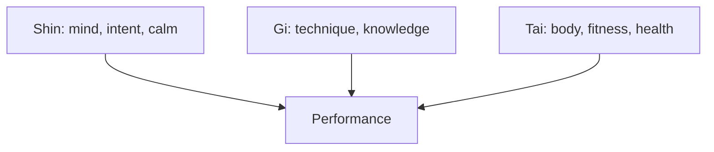

# Mushin and shin-gi-tai

## Summary

Mushin (無心) means "no-mind": a state in which action flows without hesitation, self-consciousness or fixation on a goal. Shin-gi-tai (心技体) is a triad used in Japanese martial arts: mind (spirit), technique and body must develop together. The two ideas describe high performance as a balance of attitude, skill and physical condition, and as action that is free of over-thinking. They come from martial and Zen traditions, and they match research on flow and automaticity, though they are not themselves tested methods.

*This note is educational.*

## Prerequisites

- [Shuhari and shoshin](shuhari-and-shoshin.md).

## Core concepts

### Definition

*Mushin* is a state of mind without fixation, in which the practitioner responds to the situation directly and does not stop to deliberate. It does not mean emptiness of thought. It means that attention is not stuck on the opponent's move, one's own technique or the result. *Shin-gi-tai* names three elements: *shin* (mind, spirit and intent), *gi* (technique and knowledge) and *tai* (body, health and physical ability).

### Analogy

A skilled typist does not think about each key, and attention stays on the text. If the typist starts to watch the fingers, the flow breaks. The limit of the analogy is that martial arts add an opponent and risk, so mushin also means calm under pressure.

### The triad

| Element | Develop by | If neglected |
| --- | --- | --- |
| Shin | Meditation, reflection, handling pressure | Nerves and loss of focus spoil good technique |
| Gi | Deliberate practice, study, feedback | Effort and spirit have no skill to express |
| Tai | Training, sleep, nutrition, recovery | Technique and will fail when the body is tired |

The same triad fits daily life: a person who has the will and skill and neglects health, or has the body and skill and no motivation, performs below potential.

### Link to research

Mushin resembles the absorbed state of [flow](../../../personal-development/skills/soft-skills/intrapersonal/flow-state.md) and the automaticity described in [habit formation](../../../personal-development/personal-growth/habit-formation.md), reached through [deliberate practice](../../../personal-development/skills/deliberate-practice.md). Its idea that conscious monitoring can disrupt well-learned skills is consistent with research on performance under pressure. The concept itself has been described in practice texts and has little direct experimental testing.

## Worked example

A person prepares for a presentation.

| Element | Preparation |
| --- | --- |
| Gi | Rehearse the talk aloud three times and get feedback |
| Tai | Sleep seven hours, eat, take a short walk before |
| Shin | Two minutes of slow breathing, and a single intention: help the audience understand |

On stage, attention goes to the audience and not to self-monitoring, which is the practical meaning of mushin.

## Trade offs and when to use it

The triad is a good checklist for preparation. Chasing "no-mind" as a goal defeats it, since trying to have no thoughts is itself a thought. Balance does not mean equal time for each element, and the weakest one usually limits performance.

## Common mistakes

- **Equating mushin with thinking of nothing.** It is attention without fixation.
- **Training only technique.** Mind and body limit it.
- **Forcing the state.** It arises from practice.

## Practice

1. What do the three parts of shin-gi-tai stand for?
2. What does mushin mean?
3. Which research concept is closest to it?

### Answers

1. Mind, technique and body.
2. No-mind: action without hesitation or fixation on oneself or the result.
3. Flow, together with automaticity of well-practiced skills.

## Further reading

- Csikszentmihalyi, M. (1990). *Flow: The Psychology of Optimal Experience*. Harper & Row. The founding account of the flow state.
- Parkes, G. and Loughnane, A. (2023). Japanese aesthetics. Stanford Encyclopedia of Philosophy. [Link](https://plato.stanford.edu/entries/japanese-aesthetics/). Covers wabi-sabi, mono no aware and related ideals.
