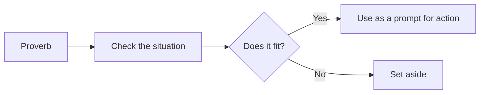

# Japanese proverbs on effort, patience and humility

## Summary

Short sayings carry much of the practical wisdom of Japanese culture. Five widely quoted ones address haste, persistence, humility, recovery and comparison: *isogaba maware*, *nana korobi ya oki*, *saru mo ki kara ochiru*, *kishi kaisei* and *oubaitori*. Like all proverbs, they compress experience, they fit some situations and not others, and several have close counterparts in research.

*This note is educational.*

## Prerequisites

No prior notes are needed.

## Core concepts

### Definition

A *proverb* is a short traditional saying that states a general lesson. The table gives the five with their literal and usual meanings.

| Saying | Literally | Meaning | Research counterpart |
| --- | --- | --- | --- |
| Isogaba maware (急がば回れ) | If in a hurry, go around | The safe, longer route is often faster than a rushed shortcut | Planning fallacy, see [planning and contingency](../../../personal-development/skills/soft-skills/cognitive/planning-and-contingency.md) |
| Nana korobi ya oki (七転び八起き) | Fall seven times, rise eight | Persevere after repeated failure | Resilience, see [stress and resilience](../../../personal-development/personal-growth/stress-and-resilience.md) |
| Saru mo ki kara ochiru (猿も木から落ちる) | Even monkeys fall from trees | Experts make mistakes, and pride comes before a fall | Overconfidence, see [Dunning-Kruger effect](../../../social-sciences/psychology/cognitive-psychology/dunning-kruger-effect.md) |
| Kishi kaisei (起死回生) | Wake from death, return to life | A comeback from a near-hopeless situation | Recovery after setbacks |
| Oubaitori (桜梅桃李) | Cherry, plum, peach, apricot | Each blooms in its own time: do not compare | Social comparison, see [social comparison](../../../social-sciences/psychology/social-psychology/social-comparison.md) |

### Analogy

Proverbs are like trail markers: they point to a direction a traveler found useful, and do not describe the whole terrain. The limit of the analogy is that proverbs come in opposing pairs, as "look before you leap" and "he who hesitates is lost".

### Reading them well

## Worked example

A person learning to code fails an interview and feels behind a friend who got hired.

| Saying | Application |
| --- | --- |
| Nana korobi ya oki | Treat the failure as data: review the questions missed, and book the next one |
| Oubaitori | Drop the comparison with the friend's timeline |
| Isogaba maware | Spend two weeks on fundamentals and not on a shortcut course |
| Saru mo ki kara ochiru | Remember that the friend will also fail some interviews |

The sayings become four small actions.

## Trade offs and when to use it

Proverbs are memorable and encourage reflection. They are not evidence, and quoting one in place of an argument is weak. Check the claim against the situation.

## Common mistakes

- **Quoting a proverb as proof.** It is a lesson from experience.
- **Ignoring the opposite proverb.** Many have one.
- **Reading "fall seven times" as a duty to repeat the same approach.** Adjust between attempts.

## Practice

1. What does isogaba maware say?
2. Which proverb warns against comparison?
3. Why should one check whether a proverb fits?

### Answers

1. When in a hurry, take the safe route around, since a rushed shortcut often costs more time.
2. Oubaitori.
3. Proverbs state general lessons and may have opposing counterparts, so their fit depends on the situation.

## Further reading

- Parkes, G. and Loughnane, A. (2023). Japanese aesthetics. Stanford Encyclopedia of Philosophy. [Link](https://plato.stanford.edu/entries/japanese-aesthetics/). Covers wabi-sabi, mono no aware and related ideals.
- Festinger, L. (1954). A Theory of Social Comparison Processes. *Human Relations*, 7(2), 117-140. [DOI](https://doi.org/10.1177/001872675400700202). The theory of social comparison processes.
