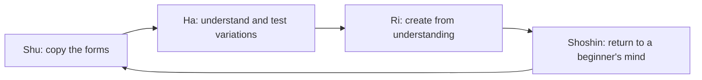

# Shuhari and shoshin

## Summary

Shuhari (守破離) is a model of mastery in Japanese arts and martial arts with three stages: *shu* (protect or obey: learn and copy the forms exactly), *ha* (break: depart from the forms and test them) and *ri* (leave: go beyond the forms and create one's own). Shoshin (初心) is the "beginner's mind", an attitude of openness and lack of preconception that Shunryu Suzuki made known in the West. Together they describe how to learn well and how to avoid stagnation. They are models and not empirical findings, and they resemble stage models of skill acquisition.

*This note is educational.*

## Prerequisites

- [Skill acquisition](../../../personal-development/skills/skill-acquisition.md).

## Core concepts

### Definition

*Shuhari* describes three phases in the learning of a craft or art:

| Stage | Meaning | What the learner does |
| --- | --- | --- |
| Shu (守) | Protect, obey | Copies the master's forms precisely and repeats them until they are automatic |
| Ha (破) | Break, detach | Understands the principles behind the forms, tests variations and learns from other masters |
| Ri (離) | Leave, separate | Acts freely from understanding, and creates new forms |

The model is used in aikido and other martial arts, and has been taken up in software development circles. *Shoshin* is a concept of Zen. Suzuki (1970) wrote: "In the beginner's mind there are many possibilities, but in the expert's there are few." It means approaching a subject with openness, even after years of practice.

### Analogy

A musician first plays the score as written (shu), then learns why the composer chose certain harmonies and tries variations (ha), and finally improvises in the style (ri). The limit of the analogy is that jazz players also revisit the score, and the stages overlap.

### How they connect

Shoshin closes the loop: even at ri, a learner stays open to new teachers and new forms, so that experience does not harden into fixed habits.

### Relation to research

| Idea | Research counterpart |
| --- | --- |
| Shuhari | Stages of skill acquisition (Fitts and Posner, Dreyfus), see [skill acquisition](../../../personal-development/skills/skill-acquisition.md) |
| Shu: precise repetition | [Deliberate practice](../../../personal-development/skills/deliberate-practice.md) with a model to copy |
| Shoshin | Openness to experience and the cost of rigid expertise, see [Einstellung effect](../../../social-sciences/psychology/cognitive-psychology/einstellung-effect.md) |

## Worked example

Learning to cook.

| Stage | Practice |
| --- | --- |
| Shu | Follow five recipes exactly, with the stated measures and times |
| Ha | Ask why each step is there, change one element and compare |
| Ri | Cook from ingredients and taste, without a recipe |
| Shoshin | Take a class in a new cuisine and follow the teacher exactly again |

The example shows that the stages are cyclic: a new area starts at shu.

## Trade offs and when to use it

Shuhari encourages a good order: fundamentals first, then variation. It can be misused to demand obedience from learners without explaining reasons, and some fields are not suited to a "copy first" approach. The stages are not sharp, and a person can be at different stages in different areas.

## Common mistakes

- **Skipping shu.** Variation without fundamentals leads to errors.
- **Never leaving shu.** Copying without understanding stalls.
- **Believing that experts need no openness.** Shoshin keeps learning alive.

## Practice

1. Name the three stages of shuhari.
2. What does shoshin mean?
3. How does shoshin relate to the Einstellung effect?

### Answers

1. Shu (obey), ha (break) and ri (leave).
2. The beginner's mind: openness and lack of preconception, even for experts.
3. It is a remedy: an open mind looks for better solutions instead of repeating a familiar one.

## Further reading

- Suzuki, S. (1970). *Zen Mind, Beginner's Mind*. Weatherhill. The book that made shoshin, the beginner's mind, widely known.
- Dunlosky, J., Rawson, K. A., Marsh, E. J. et al. (2013). Improving Students’ Learning With Effective Learning Techniques. *Psychological Science in the Public Interest*, 14(1), 4-58. [DOI](https://doi.org/10.1177/1529100612453266). Rates ten learning techniques by evidence.
