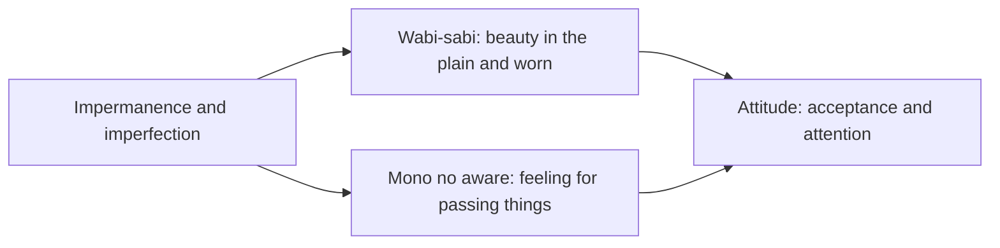

# Wabi-sabi and mono no aware

## Summary

Wabi-sabi and mono no aware are two Japanese aesthetic ideas about imperfection and impermanence. Wabi-sabi finds beauty in the simple, modest, worn and incomplete. Mono no aware, associated with the scholar Motoori Norinaga, is a gentle sadness at the passing of things, which gives them depth. Both ask the viewer to accept that nothing lasts. They are ideas of art and attitude, and a source of everyday advice on accepting flaws.

*This note is educational.*

## Prerequisites

No prior notes are needed.

## Core concepts

### Definition

The Stanford Encyclopedia of Philosophy entry on Japanese aesthetics (Parkes and Loughnane) describes several ideals. *Wabi* (侘) originally meant the loneliness of living in nature and came to mean a modest, unadorned elegance. *Sabi* (寂) meant the chill or withering of old age and came to mean the beauty of age and wear. Together *wabi-sabi* names an aesthetic of imperfection, simplicity, asymmetry and the marks of time, which is closely tied to the Japanese tea ceremony. *Mono no aware* (物の哀れ), "the pathos of things", names the poignant feeling at the transience of things, and was put forward by Motoori Norinaga in his study of the *Tale of Genji*. Kenkō's *Essays in Idleness* (14th century) is an early source of the idea that impermanence gives things beauty.

### Analogy

A handmade tea bowl with an uneven glaze is wabi-sabi: the irregular surface shows how it was made and used. Cherry blossoms, which bloom for a few days, are the standard image of mono no aware: they are beautiful because they fall. The limit of these images is that they are conventional symbols, and the ideals were also contested and changed over time.

### Ideas compared

| Idea | Focus | Typical objects | Attitude |
| --- | --- | --- | --- |
| Wabi | Simplicity and modesty | A bare tea room | Contentment with little |
| Sabi | Age and wear | A weathered object | Appreciation of time's marks |
| Mono no aware | Transience | Cherry blossoms, autumn leaves | Gentle sadness and sensitivity |

### In everyday practice

- Accept flaws in objects and in oneself without rushing to fix or replace them.
- Prefer simplicity and what lasts, and repair over discard.
- Pay attention to the passing of seasons and moments.
- Value what is real over what is perfect.

*Kintsugi*, the repair of broken pottery with gold lacquer, is often linked to wabi-sabi as a picture of valuing the history of an object. The link is a modern popular association and is not a tested account of the tradition.

## Worked example

A person is frustrated by a scratch on a new table.

| Reaction | Description |
| --- | --- |
| Perfectionist | Hide it, or replace the table |
| Wabi-sabi | Treat it as a mark of use, and accept it |
| Mono no aware | Notice that the table will keep changing like the household |

The exercise changes the standard from flawless to lived-in. The value of the idea is in the attitude, which can reduce stress about perfection (see [self-compassion](../../../personal-development/personal-growth/self-compassion.md)).

## Trade offs and when to use it

The ideas are good counterweights to perfectionism and consumer waste. They can be turned into a lifestyle brand that sells "imperfect" goods, and they do not say that quality does not matter: craft is part of the tradition. In a safety-critical work, high standards are not a matter of taste.

## Common mistakes

- **Treating wabi-sabi as an excuse for sloppy work.** The tradition values careful craft.
- **Reducing it to decor.** It is also an attitude to time.
- **Equating mono no aware with sadness alone.** It includes appreciation.

## Practice

1. What does mono no aware mean?
2. Name three qualities valued in wabi-sabi.
3. Who linked mono no aware to the *Tale of Genji*?

### Answers

1. A gentle sadness at the passing of things, which gives them depth.
2. For example simplicity, asymmetry and the marks of age.
3. Motoori Norinaga.

## Further reading

- Parkes, G. and Loughnane, A. (2023). Japanese aesthetics. Stanford Encyclopedia of Philosophy. [Link](https://plato.stanford.edu/entries/japanese-aesthetics/). Covers wabi-sabi, mono no aware and related ideals.
- Yoshida, K. *Essays in Idleness (Tsurezuregusa)*. Many editions; written in the 14th century. An early source of the aesthetic of impermanence.
