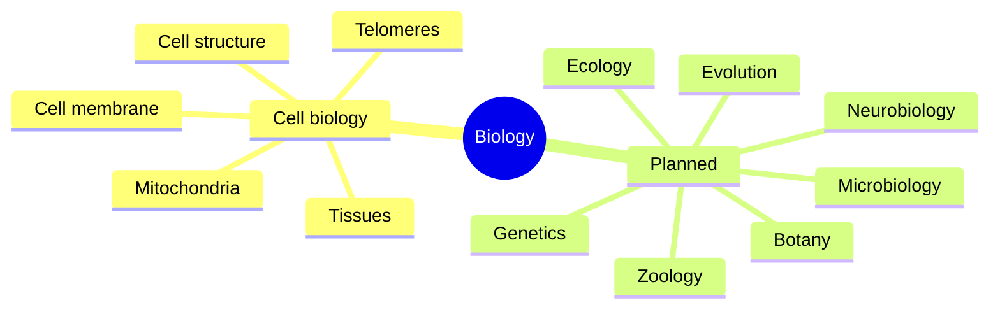

# Biology

Living organisms, from molecules to ecosystems. This field belongs to [Natural sciences](../README.md). The first subfield with notes is cell biology, which explains the cell structures that the health and biochemistry notes rely on.

## Map of the field

## Subfields

- [Cell biology](cell-biology/README.md): the parts of the cell, membranes and transport, mitochondria, the four tissue types and telomeres.

## Planned topics

- Genetics
- Evolution
- Microbiology
- Botany
- Zoology
- Ecology
- Neurobiology

## Related

- [Biochemistry](../chemistry/biochemistry/README.md): the reactions that run inside cells.
- [Medicine and health](../../applied-sciences/medicine-and-health/README.md): anatomy and physiology of the human body.
