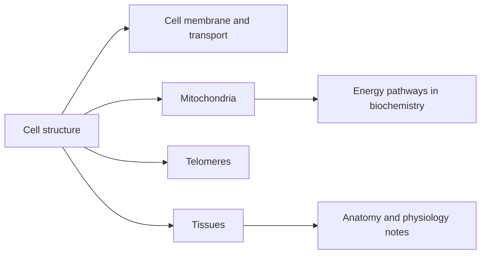

# Cell biology

The cell is the smallest unit of life. These notes describe the parts of a human cell, how substances cross its membrane, how mitochondria make energy, how cells form the four tissue types, and how telomeres limit cell division. Anatomy and physiology notes build on them.

## Map of the subfield

## Reading order

1. [Cell structure](cell-structure.md): the organelles of a human cell and what each does.
2. [Cell membrane and transport](cell-membrane.md): the lipid bilayer and the ways substances cross it.
3. [Mitochondria](mitochondria.md): structure and functions of the cell's power plants.
4. [Tissues](tissues.md): epithelial, connective, muscle and nervous tissue.
5. [Telomeres](telomeres.md): chromosome ends, cell aging and what affects telomere length.
