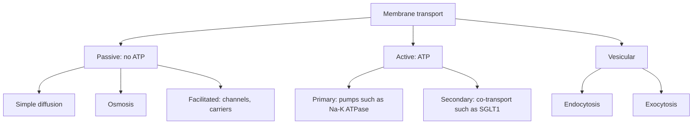

# Cell membrane and transport

## Summary

The cell membrane is a double layer of phospholipids with cholesterol and proteins embedded in it. It lets small fat-soluble molecules through but blocks ions and large polar molecules, which must use channels, carriers or pumps. Passive transport moves substances down their concentration gradient without energy, while active transport moves them against the gradient and costs ATP, which is the osmotic work of cells. Vesicles carry large particles in and out.

## Prerequisites

- [Cell structure](cell-structure.md)
- [Phospholipids and lecithin](../../chemistry/biochemistry/lipids/phospholipids-and-lecithin.md)

## Core concepts

### Definition

The *plasma membrane* is the boundary of a cell, about 5 to 10 nm thick, made of a phospholipid bilayer with embedded proteins, cholesterol and carbohydrate chains on the outer surface. The *fluid mosaic model* (Singer and Nicolson, 1972) describes it as a two-dimensional fluid in which lipids and proteins move sideways. *Selective permeability* means that the membrane lets some substances pass freely and others only through specific proteins.

### Analogy

The membrane is like a city wall with different kinds of gates. Small, inconspicuous travelers (oxygen, carbon dioxide, fat-soluble molecules) can slip through the wall itself. Others need a gate: open gates for specific travelers (channels), revolving doors that let one traveler through at a time (carriers), and toll gates that push travelers uphill for a fee (pumps using ATP). Large shipments come in through a loading dock (vesicles). The analogy breaks because the wall itself is fluid and constantly reshaped.

### Mechanism

| Mode | Energy | Direction | Example |
| --- | --- | --- | --- |
| Simple diffusion | None | Down the gradient | O2, CO2, steroid hormones |
| Osmosis | None | Water towards higher solute concentration | Water through aquaporins and the bilayer |
| Facilitated diffusion: channels | None | Down the gradient | Sodium and potassium channels in nerves |
| Facilitated diffusion: carriers | None | Down the gradient | Glucose transporter GLUT4 in muscle |
| Primary active transport | ATP | Against the gradient | Sodium-potassium pump (3 Na+ out, 2 K+ in per ATP), calcium pump |
| Secondary active transport | Gradient made by a pump | One substance down, the other against | SGLT1 moves glucose with sodium in the gut |
| Endocytosis and exocytosis | ATP | Vesicles in or out | LDL uptake, neurotransmitter release |

The diagram groups the modes of transport.

### Membrane potential

The sodium-potassium pump and potassium leak channels make the inside of a resting cell negative, about -70 mV in neurons and about -90 mV in skeletal muscle. Nerve and muscle cells use rapid changes in this potential (action potentials) to send signals. Restoring the gradients after activity is the electrical work of cells and uses a large share of the brain's energy.

### Osmosis and cell volume

Water moves towards the side with more dissolved particles. Red blood cells in pure water swell and burst; in very salty water they shrink. Intravenous fluids are made *isotonic* (for example 0.9 percent sodium chloride) so that cells keep their volume.

## Worked example

After a meal, insulin makes muscle cells move GLUT4 transporters from internal vesicles to the membrane, which lets glucose enter by facilitated diffusion. Exercise does the same through a separate signal. This is why a walk after a meal lowers the rise in blood glucose even in people with insulin resistance. In type 2 diabetes, the insulin signal is weaker but the exercise route still works.

## Trade offs and when to use it

- A selective membrane protects the cell but makes it depend on many transport proteins, each a possible point of failure. Cystic fibrosis, for example, results from a faulty chloride channel.
- Active transport costs energy: the sodium-potassium pump alone uses an estimated 20 to 25 percent of the ATP of a resting human, more in the brain.

## Common mistakes

- **Thinking water only crosses through the bilayer.** Most water moves through aquaporin channels.
- **Mixing up diffusion and active transport.** Only active transport moves substances against their gradient.

## Practice

1. How many sodium and potassium ions does the sodium-potassium pump move per ATP?
2. How does glucose enter gut cells against its gradient?
3. What happens to red blood cells placed in pure water?

### Answers

1. Three sodium ions out and two potassium ions in.
2. By secondary active transport with sodium through SGLT1.
3. Water flows in by osmosis, and they swell and burst.

## Further reading

- Alberts, B., Johnson, A., Lewis, J. et al. (2002). *Molecular Biology of the Cell (4th ed.)*. Garland Science, free on NCBI Bookshelf. [Link](https://www.ncbi.nlm.nih.gov/books/NBK21054/). Chapters 10 and 11 on membrane structure and transport.
- Betts, J. G., Young, K. A., Wise, J. A. et al. (2022). *Anatomy and Physiology 2e*. OpenStax, Rice University. [Link](https://openstax.org/details/books/anatomy-and-physiology-2e). Section 3.1 on the cell membrane.
